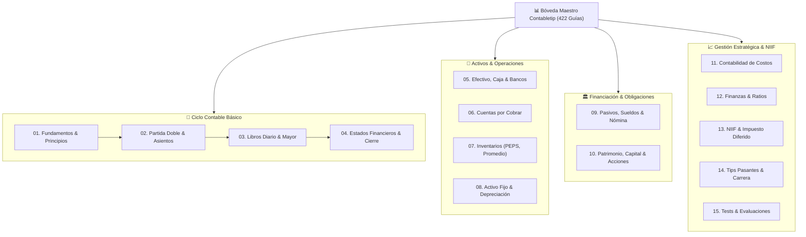

# 📑 Directorio General: Bóveda de Contabilidad y Finanzas de Contabletip 📊

> [!abstract] 📊 Panel Maestro del Repositorio
> **Catálogo Maestro y Mapa de Contenidos (MOC)** que indexa la totalidad de la obra educativa de **Caro Nuga (Contabletip)**: **422 artículos y guías técnicas** organizados minuciosamente en **15 módulos temáticos estructurados**, con notas individuales, conceptos clave, asientos contables y **416 vídeos formativos de YouTube** vinculados bidireccionalmente en Obsidian:
> 
> | 📊 Tipo de Contenido | 🗂️ Organización Temática | 🎬 Total Notas | 📅 Periodo Activo | 📁 Acceso Rápido |
> | :--- | :---: | :---: | :---: | :--- |
> | **📚 Guías y Artículos Contables** | **15 Módulos Temáticos** | **422 notas técnicas** | 2016 – 2024 | [Ver Módulos Abajo ↗](#-1-fundamentos-y-principios-contables-36-guías) |
> | **🎥 Vídeos y Clases en YouTube** | **Clases audiovisuales integradas** | **416 vídeos formativos** | 2016 – 2024 | *Clases embebidas en cada lección* |
> | **🌟 Total Bóveda Contabletip** | **15 Módulos + Guía Editorial** | **422 recursos** | **2016 – 2024** | *Bóveda Unificada de Aprendizaje* |

> [!info] 📘 Documentación Oficial y Estándar del Vault
> Para consultar la norma editorial, convención de nombres sanitizados `YYYY-MM-DD`, registros contables Debe/Haber y protocolo de actualización, revisa:  
> 🔗 **[[Guía de Actualización y Formato de Artículos y Guías|Abrir Guía Oficial de Formato y Actualización ↗]]**

> [!tip] 🧭 Navegación Rápida por los 15 Módulos Temáticos
> 📍 **Acceso Directo a Secciones:**  
> [📘 1. Fundamentos](#-1-fundamentos-y-principios-contables-36-guías) • [⚖️ 2. Partida Doble](#-2-la-partida-doble-y-asientos-contables-44-guías) • [📖 3. Libros Contables](#-3-libros-contables-y-ciclo-contable-28-guías) • [🏛️ 4. Estados Financieros](#-4-estados-financieros-y-cierre-contable-43-guías)  
> [💰 5. Efectivo y Bancos](#-5-efectivo-bancos-y-conciliaciones-19-guías) • [📋 6. Cuentas por Cobrar](#-6-cuentas-por-cobrar-e-inversiones-11-guías) • [📦 7. Inventarios](#-7-inventarios-y-métodos-de-valuación-27-guías) • [🏗️ 8. Propiedad, Planta y Equipo](#-8-propiedad-planta-y-equipo-activos-fijos-27-guías)  
> [👥 9. Pasivos y Nómina](#-9-pasivos-nómina-y-obligaciones-17-guías) • [🛡️ 10. Patrimonio](#-10-patrimonio-capital-y-reservas-40-guías) • [🏭 11. Costos](#-11-contabilidad-de-costos-22-guías) • [📈 12. Finanzas](#-12-finanzas-y-análisis-financiero-59-guías)  
> [🌐 13. NIIF e Impuesto Diferido](#-13-normas-internacionales-niif-e-impuesto-diferido-11-guías) • [💡 14. Consejos y Profesión](#-14-consejos-pasantes-y-profesión-contable-33-guías) • [📝 15. Evaluaciones](#-15-evaluaciones-y-preguntas-tipo-test-5-guías)

---

## 📍 1. 01 - Fundamentos y Principios Contables (36 guías)

> [!abstract] 📌 Objetivos y Alcance
> Introducción a la ciencia contable, principios de contabilidad generalmente aceptados (PCGA), objetivos de la información financiera, la ecuación contable básica (Activo = Pasivo + Patrimonio) y usuarios de la información contable.

| # | Fecha | Título del Artículo o Guía | Categorías | YouTube | Enlace y Notas en Obsidian |
| :-: | :---: | :--- | :--- | :---: | :--- |
| 01 | `2016-02-01` | **ORIGEN DE LA PALABRA CONTABILIDAD** | `Contabilidad Básica`, `Tema 1 Fundamentos Básicos` | [Ver Vídeo ↗](https://www.youtube.com/watch?v=4d0N8q3x-5M) | 📑 [[2016-02-01 ORIGEN DE LA PALABRA CONTABILIDAD\|Abrir Guía ↗]] |
| 02 | `2016-02-02` | **CONCEPTO DE CONTABILIDAD** | `Contabilidad Básica`, `Tema 1 Fundamentos Básicos` | [Ver Vídeo ↗](https://www.youtube.com/watch?v=e1nt1aNcrug) | 📑 [[2016-02-02 CONCEPTO DE CONTABILIDAD\|Abrir Guía ↗]] |
| 03 | `2016-02-03` | **QUÉ ES EL MÉTODO CONTABLE** | `Contabilidad Básica`, `Tema 1 Fundamentos Básicos` | [Ver Vídeo ↗](https://www.youtube.com/watch?v=eOvJ5XhrKfU) | 📑 [[2016-02-03 QUÉ ES EL MÉTODO CONTABLE\|Abrir Guía ↗]] |
| 04 | `2016-02-04` | **USUARIOS DE LA CONTABILIDAD** | `Contabilidad Básica`, `Tema 1 Fundamentos Básicos` | [Ver Vídeo ↗](https://www.youtube.com/watch?v=6OjPWvYl_TM) | 📑 [[2016-02-04 USUARIOS DE LA CONTABILIDAD\|Abrir Guía ↗]] |
| 05 | `2016-02-05` | **CIENCIAS AFINES A LA CONTABILIDAD** | `Contabilidad Básica`, `Tema 1 Fundamentos Básicos` | [Ver Vídeo ↗](https://www.youtube.com/watch?v=CAKA-IRh15Q) | 📑 [[2016-02-05 CIENCIAS AFINES A LA CONTABILIDAD\|Abrir Guía ↗]] |
| 06 | `2016-02-08` | **TIPOS DE CONTABILIDAD** | `Contabilidad Básica`, `Tema 1 Fundamentos Básicos` | [Ver Vídeo ↗](https://www.youtube.com/watch?v=5aNbTtQpowk) | 📑 [[2016-02-08 TIPOS DE CONTABILIDAD\|Abrir Guía ↗]] |
| 07 | `2016-02-11` | **MARCO CONCEPTUAL - CONTABILIDAD** | `Contabilidad Básica`, `Tema 1 Fundamentos Básicos` | [Ver Vídeo ↗](https://www.youtube.com/watch?v=avzuhvTwZmQ) | 📑 [[2016-02-11 MARCO CONCEPTUAL - CONTABILIDAD\|Abrir Guía ↗]] |
| 08 | `2016-02-12` | **DIFERENCIAS ENTRE GRANDES EMPRESAS Y PYMES** | `Contabilidad Básica`, `Tema 1 Fundamentos Básicos` | [Ver Vídeo ↗](https://www.youtube.com/watch?v=HazVdl9t5B4) | 📑 [[2016-02-12 DIFERENCIAS ENTRE GRANDES EMPRESAS Y PYMES\|Abrir Guía ↗]] |
| 09 | `2016-02-16` | **¿CUÁNDO SE RECONOCEN LAS CUENTAS EN LOS ESTADOS FINANCIEROS?** | `Contabilidad Básica`, `Tema 1 Fundamentos Básicos` | [Ver Vídeo ↗](https://www.youtube.com/watch?v=5JbwXPVI848) | 📑 [[2016-02-16 ¿CUÁNDO SE RECONOCEN LAS CUENTAS EN LOS ESTADOS FINANCIEROS\|Abrir Guía ↗]] |
| 10 | `2016-02-18` | **PRINCIPIO DE COMPRENSIBILIDAD** | `Contabilidad Básica`, `Tema 1 Fundamentos Básicos` | [Ver Vídeo ↗](https://www.youtube.com/watch?v=BrYMztjfL48) | 📑 [[2016-02-18 PRINCIPIO DE COMPRENSIBILIDAD\|Abrir Guía ↗]] |
| 11 | `2016-02-19` | **PRINCIPIO DE RELEVANCIA** | `Contabilidad Básica`, `Tema 1 Fundamentos Básicos` | [Ver Vídeo ↗](https://www.youtube.com/watch?v=zl3B5Xl8-cQ) | 📑 [[2016-02-19 PRINCIPIO DE RELEVANCIA\|Abrir Guía ↗]] |
| 12 | `2016-02-22` | **PRINCIPIO DE MATERIALIDAD O IMPORTANCIA RELATIVA** | `Contabilidad Básica`, `Tema 1 Fundamentos Básicos` | [Ver Vídeo ↗](https://www.youtube.com/watch?v=oF1EMZbJQh8) | 📑 [[2016-02-22 PRINCIPIO DE MATERIALIDAD O IMPORTANCIA RELATIVA\|Abrir Guía ↗]] |
| 13 | `2016-02-23` | **PRINCIPIO DE FIABILIDAD** | `Contabilidad Básica`, `Tema 1 Fundamentos Básicos` | [Ver Vídeo ↗](https://www.youtube.com/watch?v=PJYzRLjLYJ0) | 📑 [[2016-02-23 PRINCIPIO DE FIABILIDAD\|Abrir Guía ↗]] |
| 14 | `2016-02-24` | **PRINCIPIO DE LA ESENCIA SOBRE LA FORMA** | `Contabilidad Básica`, `Tema 1 Fundamentos Básicos` | [Ver Vídeo ↗](https://www.youtube.com/watch?v=uq4etJBfltg) | 📑 [[2016-02-24 PRINCIPIO DE LA ESENCIA SOBRE LA FORMA\|Abrir Guía ↗]] |
| 15 | `2016-02-25` | **PRINCIPIO DE PRUDENCIA** | `Contabilidad Básica`, `Tema 1 Fundamentos Básicos` | [Ver Vídeo ↗](https://www.youtube.com/watch?v=6Inrc0ZCLyc) | 📑 [[2016-02-25 PRINCIPIO DE PRUDENCIA\|Abrir Guía ↗]] |
| 16 | `2016-02-26` | **PRINCIPIO DE COMPARABILIDAD** | `Contabilidad Básica`, `Tema 1 Fundamentos Básicos` | [Ver Vídeo ↗](https://www.youtube.com/watch?v=iS6V_pqXA2A) | 📑 [[2016-02-26 PRINCIPIO DE COMPARABILIDAD\|Abrir Guía ↗]] |
| 17 | `2016-02-29` | **PRINCIPIO DE OPORTUNIDAD** | `Contabilidad Básica`, `Tema 1 Fundamentos Básicos` | [Ver Vídeo ↗](https://www.youtube.com/watch?v=jTMp3GY7lFM) | 📑 [[2016-02-29 PRINCIPIO DE OPORTUNIDAD\|Abrir Guía ↗]] |
| 18 | `2016-03-07` | **BASE DE ACUMULACION O DEVENGO - PRINCIPIO DE CAUSACIÓN** | `Contabilidad Básica`, `Tema 1 Fundamentos Básicos` | [Ver Vídeo ↗](https://www.youtube.com/watch?v=kzDUcCPEVW0) | 📑 [[2016-03-07 BASE DE ACUMULACION O DEVENGO - PRINCIPIO DE CAUSACIÓN\|Abrir Guía ↗]] |
| 19 | `2016-03-09` | **PRINCIPIO DE NEGOCIO EN MARCHA** | `Contabilidad Básica`, `Tema 1 Fundamentos Básicos` | [Ver Vídeo ↗](https://www.youtube.com/watch?v=BpgTyHtDiIc) | 📑 [[2016-03-09 PRINCIPIO DE NEGOCIO EN MARCHA\|Abrir Guía ↗]] |
| 20 | `2016-03-14` | **FRECUENCIA DE PRESENTACIÓN DE LA INFORMACIÓN - CONTABILIDAD** | `Contabilidad Básica`, `Tema 1 Fundamentos Básicos` | [Ver Vídeo ↗](https://www.youtube.com/watch?v=MknLaKXcfOw) | 📑 [[2016-03-14 FRECUENCIA DE PRESENTACIÓN DE LA INFORMACIÓN - CONTABILIDAD\|Abrir Guía ↗]] |
| 21 | `2016-03-16` | **CUESTIONARIO TEMA Nº 1 - FUNDAMENTOS DE CONTABILIDAD** | `Contabilidad Básica`, `Tema 1 Fundamentos Básicos` | [Ver Vídeo ↗](https://www.youtube.com/watch?v=xt5XRnfE4kQ) | 📑 [[2016-03-16 CUESTIONARIO TEMA Nº 1 - FUNDAMENTOS DE CONTABILIDAD\|Abrir Guía ↗]] |
| 22 | `2016-03-22` | **EVALUACIÓN FUNDAMENTOS DE CONTABILIDAD** | `Contabilidad Básica`, `Tema 1 Fundamentos Básicos` | [Ver Vídeo ↗](https://www.youtube.com/watch?v=Y83JM0tC1ZU) | 📑 [[2016-03-22 EVALUACIÓN FUNDAMENTOS DE CONTABILIDAD\|Abrir Guía ↗]] |
| 23 | `2022-01-10` | **BIENVENIDO 2022 - AGENDA CONTABILIDAD - CONSULTAS - TEMAS BASICOS** | `Bienvenido 2022` | [Ver Vídeo ↗](https://www.youtube.com/watch?v=GjMaYYB07m0) | 📑 [[2022-01-10 BIENVENIDO 2022 - AGENDA CONTABILIDAD - CONSULTAS - TEMAS BASICOS\|Abrir Guía ↗]] |
| 24 | `2022-01-20` | **¿QUÉ SE REGISTRA EN EL DEBE?** | `Contabilidad Básica`, `Tema 1 Fundamentos Básicos` | [Ver Vídeo ↗](https://www.youtube.com/watch?v=tcIxzxm4oXw) | 📑 [[2022-01-20 ¿QUÉ SE REGISTRA EN EL DEBE\|Abrir Guía ↗]] |
| 25 | `2022-01-27` | **¿QUÉ SE REGISTRA EN EL HABER?** | `Contabilidad Básica` | [Ver Vídeo ↗](https://www.youtube.com/watch?v=BHWGd-wX6yU) | 📑 [[2022-01-27 ¿QUÉ SE REGISTRA EN EL HABER\|Abrir Guía ↗]] |
| 26 | `2022-02-21` | **¿QUÉ SON LOS INSTRUMENTOS FINANCIEROS?** | `Contabilidad Básica` | [Ver Vídeo ↗](https://www.youtube.com/watch?v=dK2aQx_dYEM) | 📑 [[2022-02-21 ¿QUÉ SON LOS INSTRUMENTOS FINANCIEROS\|Abrir Guía ↗]] |
| 27 | `2024-01-16` | **EJERCICIO 1 ECUACIÓN PATRIMONIAL** | `Contabilidad Básica`, `Ejercicios de Contabilidad` | [Ver Vídeo ↗](https://www.youtube.com/watch?v=q7qpfRt-4ZY) | 📑 [[2024-01-16 EJERCICIO 1 ECUACIÓN PATRIMONIAL\|Abrir Guía ↗]] |
| 28 | `2024-01-18` | **EJERCICIO 2 ECUACIÓN PATRIMONIAL** | `Contabilidad Basica`, `Ejercicios de Contabilidad` | [Ver Vídeo ↗](https://www.youtube.com/watch?v=yuv4WCiyh84) | 📑 [[2024-01-18 EJERCICIO 2 ECUACIÓN PATRIMONIAL\|Abrir Guía ↗]] |
| 29 | `2024-01-23` | **EJERCICIO 3 ECUACIÓN PATRIMONIAL** | `Contabilidad Basica`, `Ejercicios de Contabilidad` | [Ver Vídeo ↗](https://www.youtube.com/watch?v=Wg6Ejwa1LPc) | 📑 [[2024-01-23 EJERCICIO 3 ECUACIÓN PATRIMONIAL\|Abrir Guía ↗]] |
| 30 | `2024-01-25` | **EJERCICIO 4 ECUACIÓN PATRIMONIAL** | `Contabilidad Basica`, `Ejercicios de Contabilidad` | [Ver Vídeo ↗](https://www.youtube.com/watch?v=KqB7_8_vZ6U) | 📑 [[2024-01-25 EJERCICIO 4 ECUACIÓN PATRIMONIAL\|Abrir Guía ↗]] |
| 31 | `2024-01-29` | **EJERCICIO 5 ECUACIÓN PATRIMONIAL** | `Contabilidad Basica`, `Ejercicios de Contabilidad` | [Ver Vídeo ↗](https://www.youtube.com/watch?v=2OsxWLDbdqs) | 📑 [[2024-01-29 EJERCICIO 5 ECUACIÓN PATRIMONIAL\|Abrir Guía ↗]] |
| 32 | `2024-01-31` | **EJERCICIO 6 ECUACION PATRIMONIAL** | `Contabilidad Basica`, `Ejercicios de Contabilidad` | [Ver Vídeo ↗](https://www.youtube.com/watch?v=b6_vHq81CQY) | 📑 [[2024-01-31 EJERCICIO 6 ECUACION PATRIMONIAL\|Abrir Guía ↗]] |
| 33 | `2024-02-07` | **APRENDE A CREAR UN PLAN DE CUENTAS CONTABLE** | `Contabilidad Básica`, `Ejercicios de Contabilidad` | [Ver Vídeo ↗](https://www.youtube.com/watch?v=gPA0ncFn4Q0) | 📑 [[2024-02-07 APRENDE A CREAR UN PLAN DE CUENTAS CONTABLE\|Abrir Guía ↗]] |
| 34 | `2024-02-21` | **¿CÓMO LLEVAR LA CONTABILIDAD DE UNA PERSONA FÍSICA?** | `Contabilidad Basica`, `Ejercicios de Contabilidad` | [Ver Vídeo ↗](https://www.youtube.com/watch?v=i-W98dIfX8w) | 📑 [[2024-02-21 ¿CÓMO LLEVAR LA CONTABILIDAD DE UNA PERSONA FÍSICA\|Abrir Guía ↗]] |
| 35 | `2024-02-28` | **¿COMO LLEVAR LA CONTABILIDAD DE UNA EMPRESA DE SERVICIOS?** | `Contabilidad Básica`, `Ejercicios de Contabilidad` | [Ver Vídeo ↗](https://www.youtube.com/watch?v=rP0JcgyRzZw) | 📑 [[2024-02-28 ¿COMO LLEVAR LA CONTABILIDAD DE UNA EMPRESA DE SERVICIOS\|Abrir Guía ↗]] |
| 36 | `2024-03-06` | **EJERCICIOS CUENTAS T** | `Contabilidad Básica`, `Ejercicios de Contabilidad` | [Ver Vídeo ↗](https://www.youtube.com/watch?v=NdWjwfE9Er4) | 📑 [[2024-03-06 EJERCICIOS CUENTAS T\|Abrir Guía ↗]] |

> [!note]+ 📂 Abrir Directorio del Módulo: [[01 - Fundamentos y Principios Contables]]
> Accede al Hub de la sección: **[[01 - Fundamentos y Principios Contables]]** para ver el mapa conceptual y el índice detallado.

---

## 📍 2. 02 - La Partida Doble y Asientos Contables (44 guías)

> [!abstract] 📌 Objetivos y Alcance
> La regla de oro de la contabilidad: la teoría del cargo y del abono (Partida Doble). Asientos simples, compuestos y mixtos, dinámica de cuentas de activo, pasivo, patrimonio, ingresos y gastos.

| # | Fecha | Título del Artículo o Guía | Categorías | YouTube | Enlace y Notas en Obsidian |
| :-: | :---: | :--- | :--- | :---: | :--- |
| 01 | `2016-06-13` | **CONCEPTO DE CUENTA - IDENTIFICACIÓN DEL DEBE Y EL HABER** | `Contabilidad Básica`, `tema 2` | [Ver Vídeo ↗](https://www.youtube.com/watch?v=uahdeK9p3QA) | 📑 [[2016-06-13 CONCEPTO DE CUENTA - IDENTIFICACIÓN DEL DEBE Y EL HABER\|Abrir Guía ↗]] |
| 02 | `2016-06-15` | **CUENTAS DE ACTIVOS - CONCEPTO, NATURALEZA DE LAS CUENTAS, CLASIFICACION** | `Contabilidad Básica`, `tema 2` | [Ver Vídeo ↗](https://www.youtube.com/watch?v=dC_rwW-vCWw) | 📑 [[2016-06-15 CUENTAS DE ACTIVOS - CONCEPTO, NATURALEZA DE LAS CUENTAS, CLASIFICACION\|Abrir Guía ↗]] |
| 03 | `2016-06-22` | **CUENTAS DE INGRESOS** | `Contabilidad Básica`, `tema 2` | [Ver Vídeo ↗](https://www.youtube.com/watch?v=Q7k9ti0s60w) | 📑 [[2016-06-22 CUENTAS DE INGRESOS\|Abrir Guía ↗]] |
| 04 | `2016-06-24` | **CUENTAS DE GASTOS** | `Contabilidad Básica`, `tema 2` | [Ver Vídeo ↗](https://www.youtube.com/watch?v=VcDvsRvr7d0) | 📑 [[2016-06-24 CUENTAS DE GASTOS\|Abrir Guía ↗]] |
| 05 | `2016-06-29` | **CLASIFICACIÓN DE LAS CUENTAS POR SU TEMPORALIDAD** | `Contabilidad Básica`, `tema 2` | [Ver Vídeo ↗](https://www.youtube.com/watch?v=4QHg23-BM0A) | 📑 [[2016-06-29 CLASIFICACIÓN DE LAS CUENTAS POR SU TEMPORALIDAD\|Abrir Guía ↗]] |
| 06 | `2016-07-01` | **¿CÓMO CREAR UN PLAN DE CUENTAS?** | `Contabilidad Básica`, `tema 2` | [Ver Vídeo ↗](https://www.youtube.com/watch?v=DWuIXTG9l7w) | 📑 [[2016-07-01 ¿CÓMO CREAR UN PLAN DE CUENTAS\|Abrir Guía ↗]] |
| 07 | `2016-07-04` | **PLAN GENERAL DE CONTABILIDAD EN ESPAÑA - PGC** | `Contabilidad Básica`, `tema 2` | [Ver Vídeo ↗](https://www.youtube.com/watch?v=BPQMIeodi7A) | 📑 [[2016-07-04 PLAN GENERAL DE CONTABILIDAD EN ESPAÑA - PGC\|Abrir Guía ↗]] |
| 08 | `2016-07-06` | **PLAN GENERAL DE CONTABILIDAD - CUADRO DE CUENTAS** | `Contabilidad Básica`, `tema 2` | [Ver Vídeo ↗](https://www.youtube.com/watch?v=1tOMTNWbxuE) | 📑 [[2016-07-06 PLAN GENERAL DE CONTABILIDAD - CUADRO DE CUENTAS\|Abrir Guía ↗]] |
| 09 | `2016-07-08` | **¿COMO HALLAR LAS CUENTAS EN EL PGC?** | `Contabilidad Básica`, `tema 2` | [Ver Vídeo ↗](https://www.youtube.com/watch?v=zvtqRVMIVuY) | 📑 [[2016-07-08 ¿COMO HALLAR LAS CUENTAS EN EL PGC\|Abrir Guía ↗]] |
| 10 | `2016-07-11` | **ECUACIÓN PATRIMONIAL - CONTABILIDAD** | `Contabilidad Básica`, `tema 2` | [Ver Vídeo ↗](https://www.youtube.com/watch?v=h-5z1pQDfqc) | 📑 [[2016-07-11 ECUACIÓN PATRIMONIAL - CONTABILIDAD\|Abrir Guía ↗]] |
| 11 | `2016-07-13` | **ECUACIÓN PATRIMONIAL AMPLIADA - EJEMPLOS** | `Contabilidad Básica`, `tema 2` | [Ver Vídeo ↗](https://www.youtube.com/watch?v=Y1TGbssBYgI) | 📑 [[2016-07-13 ECUACIÓN PATRIMONIAL AMPLIADA - EJEMPLOS\|Abrir Guía ↗]] |
| 12 | `2016-07-15` | **TEORÍA DEL CARGO Y EL ABONO - CONTABILIDAD** | `Contabilidad Básica`, `tema 2` | [Ver Vídeo ↗](https://www.youtube.com/watch?v=lpNC1qZ412g) | 📑 [[2016-07-15 TEORÍA DEL CARGO Y EL ABONO - CONTABILIDAD\|Abrir Guía ↗]] |
| 13 | `2016-07-27` | **ERRORES AUNQUE EL BALANCE CUADRE ¿ES POSIBLE?** | `Contabilidad Básica`, `tema 2` | [Ver Vídeo ↗](https://www.youtube.com/watch?v=8l2qtZckT38) | 📑 [[2016-07-27 ERRORES AUNQUE EL BALANCE CUADRE ¿ES POSIBLE\|Abrir Guía ↗]] |
| 14 | `2016-08-17` | **EJERCICIO CUENTAS T** | `Contabilidad Básica`, `tema 2` | [Ver Vídeo ↗](https://www.youtube.com/watch?v=_UkQE1gF3CI) | 📑 [[2016-08-17 EJERCICIO CUENTAS T\|Abrir Guía ↗]] |
| 15 | `2016-08-19` | **EJERCICIO MAYOR ANALÍTICO** | `Contabilidad Básica`, `tema 2` | [Ver Vídeo ↗](https://www.youtube.com/watch?v=R3Q39SIDLPs) | 📑 [[2016-08-19 EJERCICIO MAYOR ANALÍTICO\|Abrir Guía ↗]] |
| 16 | `2016-08-22` | **CUESTIONARIO TEMA Nº 2 LA CUENTA** | `Contabilidad Básica`, `tema 2` | [Ver Vídeo ↗](https://www.youtube.com/watch?v=GD8lTGrgqsU) | 📑 [[2016-08-22 CUESTIONARIO TEMA Nº 2 LA CUENTA\|Abrir Guía ↗]] |
| 17 | `2016-08-26` | **EVALUACIÓN TEMA LA CUENTA - PREGUNTA UNO** | `Contabilidad Básica`, `tema 2` | [Ver Vídeo ↗](https://www.youtube.com/watch?v=mZaEAeMvGkA) | 📑 [[2016-08-26 EVALUACIÓN TEMA LA CUENTA - PREGUNTA UNO\|Abrir Guía ↗]] |
| 18 | `2016-08-29` | **EVALUACIÓN TEMA LA CUENTA - PREGUNTA DOS** | `Contabilidad Básica`, `tema 2` | [Ver Vídeo ↗](https://www.youtube.com/watch?v=sXacg0zUAFc) | 📑 [[2016-08-29 EVALUACIÓN TEMA LA CUENTA - PREGUNTA DOS\|Abrir Guía ↗]] |
| 19 | `2016-08-31` | **EVALUACIÓN TEMA LA CUENTA - PREGUNTA TRES** | `Contabilidad Básica`, `tema 2` | [Ver Vídeo ↗](https://www.youtube.com/watch?v=kom33Y-gEg4) | 📑 [[2016-08-31 EVALUACIÓN TEMA LA CUENTA - PREGUNTA TRES\|Abrir Guía ↗]] |
| 20 | `2020-02-03` | **¿CÓMO SE REGISTRA UNA VENTA DE CONTADO?** | `asientos contables basicos`, `Contabilidad Básica` | [Ver Vídeo ↗](https://www.youtube.com/watch?v=4l4cLq6V6kU) | 📑 [[2020-02-03 ¿CÓMO SE REGISTRA UNA VENTA DE CONTADO\|Abrir Guía ↗]] |
| 21 | `2020-02-10` | **¿CÓMO SE REGISTRA UNA VENTA A CRÉDITO?** | `asientos contables basicos`, `Contabilidad Básica` | [Ver Vídeo ↗](https://www.youtube.com/watch?v=eWikzS8PLSE) | 📑 [[2020-02-10 ¿CÓMO SE REGISTRA UNA VENTA A CRÉDITO\|Abrir Guía ↗]] |
| 22 | `2020-02-17` | **¿CÓMO SE REGISTRA UNA VENTA CON COBRO DE CONTADO Y A CRÉDITO?** | `asientos contables basicos`, `Contabilidad Básica` | [Ver Vídeo ↗](https://www.youtube.com/watch?v=a-lInPNxNUU) | 📑 [[2020-02-17 ¿CÓMO SE REGISTRA UNA VENTA CON COBRO DE CONTADO Y A CRÉDITO\|Abrir Guía ↗]] |
| 23 | `2020-02-24` | **¿CÓMO SE REGISTRA EL COBRO DE UNA FACTURA?** | `asientos contables basicos`, `Contabilidad Básica` | [Ver Vídeo ↗](https://www.youtube.com/watch?v=umOgceuZdvc) | 📑 [[2020-02-24 ¿CÓMO SE REGISTRA EL COBRO DE UNA FACTURA\|Abrir Guía ↗]] |
| 24 | `2020-03-02` | **¿CÓMO SE REGISTRA UNA DEVOLUCIÓN EN VENTAS?** | `asientos contables basicos`, `Contabilidad Básica` | [Ver Vídeo ↗](https://www.youtube.com/watch?v=DIpiCAj1_iw) | 📑 [[2020-03-02 ¿CÓMO SE REGISTRA UNA DEVOLUCIÓN EN VENTAS\|Abrir Guía ↗]] |
| 25 | `2020-03-09` | **¿CÓMO SE REGISTRA UN DESCUENTO POR PRONTO PAGO EN VENTAS?** | `asientos contables basicos`, `Contabilidad Básica` | [Ver Vídeo ↗](https://www.youtube.com/watch?v=0t68WMH9n4w) | 📑 [[2020-03-09 ¿CÓMO SE REGISTRA UN DESCUENTO POR PRONTO PAGO EN VENTAS\|Abrir Guía ↗]] |
| 26 | `2020-05-25` | **¿CÓMO SE REGISTRA UN ANTICIPO RECIBIDO DE CLIENTES?** | `asientos contables basicos`, `Contabilidad Básica` | [Ver Vídeo ↗](https://www.youtube.com/watch?v=QSeiyk9tJi8) | 📑 [[2020-05-25 ¿CÓMO SE REGISTRA UN ANTICIPO RECIBIDO DE CLIENTES\|Abrir Guía ↗]] |
| 27 | `2020-06-01` | **¿CÓMO SE REGISTRA UNA VENTA UTILIZANDO ANTICIPO RECIBIDO DE CLIENTES?** | `asientos contables basicos`, `Contabilidad Básica` | [Ver Vídeo ↗](https://www.youtube.com/watch?v=vdk1QDkUuGo) | 📑 [[2020-06-01 ¿CÓMO SE REGISTRA UNA VENTA UTILIZANDO ANTICIPO RECIBIDO DE CLIENTES\|Abrir Guía ↗]] |
| 28 | `2020-06-08` | **¿CÓMO SE REGISTRA UNA COMPRA DE CONTADO?** | `asientos contables basicos`, `Contabilidad Básica` | [Ver Vídeo ↗](https://www.youtube.com/watch?v=-Sy64rLn1KQ) | 📑 [[2020-06-08 ¿CÓMO SE REGISTRA UNA COMPRA DE CONTADO\|Abrir Guía ↗]] |
| 29 | `2020-06-15` | **¿CÓMO SE REGISTRA UNA COMPRA A CRÉDITO?** | `asientos contables basicos`, `Contabilidad Básica` | [Ver Vídeo ↗](https://www.youtube.com/watch?v=PX-CCB5NTTE) | 📑 [[2020-06-15 ¿CÓMO SE REGISTRA UNA COMPRA A CRÉDITO\|Abrir Guía ↗]] |
| 30 | `2020-06-23` | **¿CÓMO SE REGISTRA UNA COMPRA PAGADA PARCIALMENTE?** | `asientos contables basicos`, `Contabilidad Básica` | [Ver Vídeo ↗](https://www.youtube.com/watch?v=DPGtSdfAX80) | 📑 [[2020-06-23 ¿CÓMO SE REGISTRA UNA COMPRA PAGADA PARCIALMENTE\|Abrir Guía ↗]] |
| 31 | `2020-06-30` | **¿CÓMO SE REGISTRA EL PAGO DE UNA FACTURA?** | `asientos contables basicos`, `Contabilidad Básica` | [Ver Vídeo ↗](https://www.youtube.com/watch?v=Z6s2AgEXWUY) | 📑 [[2020-06-30 ¿CÓMO SE REGISTRA EL PAGO DE UNA FACTURA\|Abrir Guía ↗]] |
| 32 | `2020-07-07` | **¿CÓMO SE REGISTRA UNA DEVOLUCIÓN EN COMPRAS?** | `asientos contables basicos`, `Contabilidad Básica` | [Ver Vídeo ↗](https://www.youtube.com/watch?v=vPolROxDt5U) | 📑 [[2020-07-07 ¿CÓMO SE REGISTRA UNA DEVOLUCIÓN EN COMPRAS\|Abrir Guía ↗]] |
| 33 | `2020-07-14` | **¿CÓMO SE REGISTRA UN DESCUENTO POR PRONTO PAGO EN COMPRAS?** | `asientos contables basicos`, `Contabilidad Básica` | [Ver Vídeo ↗](https://www.youtube.com/watch?v=CQ9HXj6Lc84) | 📑 [[2020-07-14 ¿CÓMO SE REGISTRA UN DESCUENTO POR PRONTO PAGO EN COMPRAS\|Abrir Guía ↗]] |
| 34 | `2020-07-28` | **¿CÓMO SE REGISTRA UN ANTICIPO DADO A PROVEEDORES?** | `asientos contables basicos`, `Contabilidad Básica` | [Ver Vídeo ↗](https://www.youtube.com/watch?v=njeCaTKeSDo) | 📑 [[2020-07-28 ¿CÓMO SE REGISTRA UN ANTICIPO DADO A PROVEEDORES\|Abrir Guía ↗]] |
| 35 | `2020-08-04` | **¿CÓMO SE REGISTRA UNA COMPRA USANDO ANTICIPO DADO A PROVEEDORES?** | `asientos contables basicos`, `Contabilidad Básica` | [Ver Vídeo ↗](https://www.youtube.com/watch?v=GgVYvqsFCeE) | 📑 [[2020-08-04 ¿CÓMO SE REGISTRA UNA COMPRA USANDO ANTICIPO DADO A PROVEEDORES\|Abrir Guía ↗]] |
| 36 | `2020-08-11` | **¿CÓMO SE REGISTRAN LOS GASTOS DE SEGURO Y FLETE?** | `asientos contables basicos`, `Contabilidad Básica` | [Ver Vídeo ↗](https://www.youtube.com/watch?v=lbw-AzxlvrY) | 📑 [[2020-08-11 ¿CÓMO SE REGISTRAN LOS GASTOS DE SEGURO Y FLETE\|Abrir Guía ↗]] |
| 37 | `2020-08-18` | **¿CÓMO SE REGISTRA UN GASTO PAGADO DE CONTADO?** | `asientos contables basicos`, `Contabilidad Básica` | [Ver Vídeo ↗](https://www.youtube.com/watch?v=ztv-Ldl--9M) | 📑 [[2020-08-18 ¿CÓMO SE REGISTRA UN GASTO PAGADO DE CONTADO\|Abrir Guía ↗]] |
| 38 | `2020-08-25` | **¿CÓMO SE REGISTRA UN GASTO CAUSADO Y NO PAGADO?** | `asientos contables basicos`, `Contabilidad Básica` | [Ver Vídeo ↗](https://www.youtube.com/watch?v=oD9LhHq9QME) | 📑 [[2020-08-25 ¿CÓMO SE REGISTRA UN GASTO CAUSADO Y NO PAGADO\|Abrir Guía ↗]] |
| 39 | `2020-09-01` | **¿CÓMO SE REGISTRA EL PAGO DE UN GASTO CAUSADO EN PERIODOS ANTERIORES?** | `asientos contables basicos`, `Contabilidad Básica` | [Ver Vídeo ↗](https://www.youtube.com/watch?v=6Csii1UdWcA) | 📑 [[2020-09-01 ¿CÓMO SE REGISTRA EL PAGO DE UN GASTO CAUSADO EN PERIODOS ANTERIORES\|Abrir Guía ↗]] |
| 40 | `2020-09-09` | **¿CÓMO SE REGISTRA UN GASTO PREPAGADO?** | `asientos contables basicos`, `Contabilidad Básica` | [Ver Vídeo ↗](https://www.youtube.com/watch?v=_OQqbCnTGEY) | 📑 [[2020-09-09 ¿CÓMO SE REGISTRA UN GASTO PREPAGADO\|Abrir Guía ↗]] |
| 41 | `2020-09-16` | **¿CÓMO SE AMORTIZA UN GASTO PREPAGADO?** | `asientos contables basicos`, `Contabilidad Básica` | [Ver Vídeo ↗](https://www.youtube.com/watch?v=nI3F_mawksc) | 📑 [[2020-09-16 ¿CÓMO SE AMORTIZA UN GASTO PREPAGADO\|Abrir Guía ↗]] |
| 42 | `2020-09-23` | **¿CÓMO SE REGISTRA UN INGRESO EXTRAORDINARIO COBRADO POR ANTICIPADO?** | `asientos contables basicos`, `Contabilidad Básica` | [Ver Vídeo ↗](https://www.youtube.com/watch?v=8AbwIiKp87w) | 📑 [[2020-09-23 ¿CÓMO SE REGISTRA UN INGRESO EXTRAORDINARIO COBRADO POR ANTICIPADO\|Abrir Guía ↗]] |
| 43 | `2022-01-13` | **¿CÓMO SE AJUSTA UNA CUENTA DE ACTIVO EN MONEDA EXTRANJERA?** | `asientos contables basicos`, `Contabilidad Básica` | [Ver Vídeo ↗](https://www.youtube.com/watch?v=IprFfTGSaKU) | 📑 [[2022-01-13 ¿CÓMO SE AJUSTA UNA CUENTA DE ACTIVO EN MONEDA EXTRANJERA\|Abrir Guía ↗]] |
| 44 | `2022-02-01` | **¿CÓMO SE AMORTIZA UN ACTIVO INTANGIBLE?** | `asientos contables basicos`, `Contabilidad Básica` | [Ver Vídeo ↗](https://www.youtube.com/watch?v=qLC2PX_QSZA) | 📑 [[2022-02-01 ¿CÓMO SE AMORTIZA UN ACTIVO INTANGIBLE\|Abrir Guía ↗]] |

> [!note]+ 📂 Abrir Directorio del Módulo: [[02 - La Partida Doble y Asientos Contables]]
> Accede al Hub de la sección: **[[02 - La Partida Doble y Asientos Contables]]** para ver el mapa conceptual y el índice detallado.

---

## 📍 3. 03 - Libros Contables y Ciclo Contable (28 guías)

> [!abstract] 📌 Objetivos y Alcance
> Estructura y diligenciamiento de los libros principales y auxiliares: Libro Diario (cronológico), Libro Mayor (sistemático por cuentas T) y Balances de Comprobación previos al cierre.

| # | Fecha | Título del Artículo o Guía | Categorías | YouTube | Enlace y Notas en Obsidian |
| :-: | :---: | :--- | :--- | :---: | :--- |
| 01 | `2016-07-18` | **LIBRO DIARIO - FORMATO Y TIPS PARA SU ELABORACION** | `Contabilidad Básica`, `tema 2` | [Ver Vídeo ↗](https://www.youtube.com/watch?v=PWBqQihRAFw) | 📑 [[2016-07-18 LIBRO DIARIO - FORMATO Y TIPS PARA SU ELABORACION\|Abrir Guía ↗]] |
| 02 | `2016-07-20` | **LIBRO MAYOR -  FORMATO Y TIPS PARA SU ELABORACIÓN** | `Contabilidad Básica`, `tema 2` | [Ver Vídeo ↗](https://www.youtube.com/watch?v=nE6tdEXk96w) | 📑 [[2016-07-20 LIBRO MAYOR - FORMATO Y TIPS PARA SU ELABORACIÓN\|Abrir Guía ↗]] |
| 03 | `2016-07-22` | **BALANCE DE COMPROBACIÓN ¿CÓMO SE ELABORA?** | `Contabilidad Básica`, `tema 2` | [Ver Vídeo ↗](https://www.youtube.com/watch?v=cGgYsYYCQ-c) | 📑 [[2016-07-22 BALANCE DE COMPROBACIÓN ¿CÓMO SE ELABORA\|Abrir Guía ↗]] |
| 04 | `2016-07-25` | **ERRORES EN EL BALANCE DE COMPROBACIÓN ¿QUÉ HACER?** | `Contabilidad Básica`, `tema 2` | [Ver Vídeo ↗](https://www.youtube.com/watch?v=bavPxJO7bSM) | 📑 [[2016-07-25 ERRORES EN EL BALANCE DE COMPROBACIÓN ¿QUÉ HACER\|Abrir Guía ↗]] |
| 05 | `2016-07-29` | **EJERCICIO 1 BALANCE DE COMPROBACIÓN** | `Contabilidad Básica`, `tema 2` | [Ver Vídeo ↗](https://www.youtube.com/watch?v=8Fm7El3ltvI) | 📑 [[2016-07-29 EJERCICIO 1 BALANCE DE COMPROBACIÓN\|Abrir Guía ↗]] |
| 06 | `2016-08-01` | **EJERCICIO 2 BALANCE DE COMPROBACIÓN** | `Contabilidad Básica`, `tema 2` | [Ver Vídeo ↗](https://www.youtube.com/watch?v=j4cPLlCQWxs) | 📑 [[2016-08-01 EJERCICIO 2 BALANCE DE COMPROBACIÓN\|Abrir Guía ↗]] |
| 07 | `2016-08-03` | **EJERCICIO 3 BALANCE DE COMPROBACIÓN** | `Contabilidad Básica`, `tema 2` | [Ver Vídeo ↗](https://www.youtube.com/watch?v=sRDAvAPKf_0) | 📑 [[2016-08-03 EJERCICIO 3 BALANCE DE COMPROBACIÓN\|Abrir Guía ↗]] |
| 08 | `2016-08-05` | **EJERCICIO 4 BALANCE DE COMPROBACIÓN** | `Contabilidad Básica`, `tema 2` | [Ver Vídeo ↗](https://www.youtube.com/watch?v=p3K2nN478Ds) | 📑 [[2016-08-05 EJERCICIO 4 BALANCE DE COMPROBACIÓN\|Abrir Guía ↗]] |
| 09 | `2016-08-08` | **EJERCICIO LIBRO DIARIO** | `Contabilidad Básica`, `tema 2` | [Ver Vídeo ↗](https://www.youtube.com/watch?v=PZwmIErsILI) | 📑 [[2016-08-08 EJERCICIO LIBRO DIARIO\|Abrir Guía ↗]] |
| 10 | `2016-09-05` | **5 LIBROS DE CONTABILIDAD QUE NO TE DEBEN FALTAR** | `Contabilidad Básica`, `Estudiantes` | [Ver Vídeo ↗](https://www.youtube.com/watch?v=LO5mvsaXjes) | 📑 [[2016-09-05 5 LIBROS DE CONTABILIDAD QUE NO TE DEBEN FALTAR\|Abrir Guía ↗]] |
| 11 | `2016-09-14` | **IVA - IMPUESTO AL VALOR AGREGADO** | `Contabilidad Basica`, `impuestos` | [Ver Vídeo ↗](https://www.youtube.com/watch?v=wqXXL8JQ6Yc) | 📑 [[2016-09-14 IVA - IMPUESTO AL VALOR AGREGADO\|Abrir Guía ↗]] |
| 12 | `2016-09-21` | **AGENTE DE PERCEPCIÓN Y AGENTE DE RETENCIÓN - IVA** | `Contabilidad Básica`, `impuestos` | [Ver Vídeo ↗](https://www.youtube.com/watch?v=scA4Ge3ALCg) | 📑 [[2016-09-21 AGENTE DE PERCEPCIÓN Y AGENTE DE RETENCIÓN - IVA\|Abrir Guía ↗]] |
| 13 | `2016-09-23` | **HECHO IMPONIBLE - IMPUESTO AL VALOR AGREGADO IVA** | `Contabilidad Básica`, `impuestos` | [Ver Vídeo ↗](https://www.youtube.com/watch?v=3nPGcfXq1e8) | 📑 [[2016-09-23 HECHO IMPONIBLE - IMPUESTO AL VALOR AGREGADO IVA\|Abrir Guía ↗]] |
| 14 | `2016-09-26` | **OPERACIONES NO SUJETAS A IVA** | `Contabilidad Básica`, `impuestos` | [Ver Vídeo ↗](https://www.youtube.com/watch?v=2JKMUTbo_yQ) | 📑 [[2016-09-26 OPERACIONES NO SUJETAS A IVA\|Abrir Guía ↗]] |
| 15 | `2016-09-28` | **DÉBITOS Y CRÉDITOS FISCALES ¿QUÉ SON?** | `Contabilidad Básica`, `impuestos` | [Ver Vídeo ↗](https://www.youtube.com/watch?v=tzZ9Ji_kAj8) | 📑 [[2016-09-28 DÉBITOS Y CRÉDITOS FISCALES ¿QUÉ SON\|Abrir Guía ↗]] |
| 16 | `2016-10-03` | **EXENTO Y EXONERADO ¿CUÁL ES LA DIFERENCIA?** | `Contabilidad Básica`, `impuestos` | [Ver Vídeo ↗](https://www.youtube.com/watch?v=27NbroOW2Pw) | 📑 [[2016-10-03 EXENTO Y EXONERADO ¿CUÁL ES LA DIFERENCIA\|Abrir Guía ↗]] |
| 17 | `2016-10-05` | **¿CÓMO SE CALCULA EL IVA?** | `Contabilidad Básica`, `impuestos` | [Ver Vídeo ↗](https://www.youtube.com/watch?v=u110GTMXKMw) | 📑 [[2016-10-05 ¿CÓMO SE CALCULA EL IVA\|Abrir Guía ↗]] |
| 18 | `2016-10-07` | **EJERCICIO PRECIO VENTA IVA INCLUIDO** | `Contabilidad Básica`, `impuestos` | [Ver Vídeo ↗](https://www.youtube.com/watch?v=sxOUKfNb1Ts) | 📑 [[2016-10-07 EJERCICIO PRECIO VENTA IVA INCLUIDO\|Abrir Guía ↗]] |
| 19 | `2016-10-13` | **EJERCICIO IVA VENTAS Y DEVOLUCIONES EN VENTAS: CALCULO Y REGISTRO** | `Contabilidad Básica`, `impuestos` | [Ver Vídeo ↗](https://www.youtube.com/watch?v=1dtj-9h608I) | 📑 [[2016-10-13 EJERCICIO IVA VENTAS Y DEVOLUCIONES EN VENTAS CALCULO Y REGISTRO\|Abrir Guía ↗]] |
| 20 | `2016-10-17` | **EJERCICIO COMPRAS Y DEVOLUCIONES EN COMPRAS IVA INCLUIDO** | `Contabilidad Básica`, `impuestos` | [Ver Vídeo ↗](https://www.youtube.com/watch?v=-V6TxI74sbA) | 📑 [[2016-10-17 EJERCICIO COMPRAS Y DEVOLUCIONES EN COMPRAS IVA INCLUIDO\|Abrir Guía ↗]] |
| 21 | `2016-10-21` | **COMPENSACIÓN IVA - DÉBITOS FISCALES MAYORES A CRÉDITOS FISCALES** | `Contabilidad Básica`, `impuestos` | [Ver Vídeo ↗](https://www.youtube.com/watch?v=HbrdqJStpU8) | 📑 [[2016-10-21 COMPENSACIÓN IVA - DÉBITOS FISCALES MAYORES A CRÉDITOS FISCALES\|Abrir Guía ↗]] |
| 22 | `2016-10-24` | **COMPENSACIÓN IVA - CRÉDITOS FISCALES MAYORES A DÉBITOS FISCALES** | `Contabilidad Básica`, `impuestos` | [Ver Vídeo ↗](https://www.youtube.com/watch?v=kg9JPLYuJWo) | 📑 [[2016-10-24 COMPENSACIÓN IVA - CRÉDITOS FISCALES MAYORES A DÉBITOS FISCALES\|Abrir Guía ↗]] |
| 23 | `2024-02-14` | **APRENDE A ELABORAR LIBRO DIARIO Y MAYOR ANALITICO** | `Contabilidad Basica`, `Ejercicios de Contabilidad` | [Ver Vídeo ↗](https://www.youtube.com/watch?v=FVUf5U20tjU) | 📑 [[2024-02-14 APRENDE A ELABORAR LIBRO DIARIO Y MAYOR ANALITICO\|Abrir Guía ↗]] |
| 24 | `2024-03-13` | **¿CÓMO CLASIFICAR LAS CUENTAS USANDO EL BALANCE DE COMPROBACIÓN?** | `Contabilidad Basica`, `Ejercicios de Contabilidad` | [Ver Vídeo ↗](https://www.youtube.com/watch?v=rkfC95AVH7o) | 📑 [[2024-03-13 ¿CÓMO CLASIFICAR LAS CUENTAS USANDO EL BALANCE DE COMPROBACIÓN\|Abrir Guía ↗]] |
| 25 | `2024-03-20` | **¿CÓMO CORREGIR ERRORES EN EL BALANCE DE COMPROBACIÓN?** | `Contabilidad Básica`, `Ejercicios de Contabilidad` | [Ver Vídeo ↗](https://www.youtube.com/watch?v=wtT3sKukw9c) | 📑 [[2024-03-20 ¿CÓMO CORREGIR ERRORES EN EL BALANCE DE COMPROBACIÓN\|Abrir Guía ↗]] |
| 26 | `2024-03-27` | **ANÁLISIS DE ERRORES EN EL BALANCE DE COMPROBACIÓN** | `Contabilidad Basica`, `Ejercicios de Contabilidad` | [Ver Vídeo ↗](https://www.youtube.com/watch?v=lMixfMxAroI) | 📑 [[2024-03-27 ANÁLISIS DE ERRORES EN EL BALANCE DE COMPROBACIÓN\|Abrir Guía ↗]] |
| 27 | `2024-04-03` | **AJUSTE DE ERRORES EN EL LIBRO DIARIO** | `Contabilidad Basica`, `Ejercicios de Contabilidad` | [Ver Vídeo ↗](https://www.youtube.com/watch?v=P-rC7V8-JHs) | 📑 [[2024-04-03 AJUSTE DE ERRORES EN EL LIBRO DIARIO\|Abrir Guía ↗]] |
| 28 | `2024-04-17` | **APRENDE A ELABORAR EL ESTADO DE SITUACIÓN FINANCIERA** | `Contabilidad Básica`, `Ejercicios de Contabilidad` | [Ver Vídeo ↗](https://www.youtube.com/watch?v=I3KisOFlkRQ) | 📑 [[2024-04-17 APRENDE A ELABORAR EL ESTADO DE SITUACIÓN FINANCIERA\|Abrir Guía ↗]] |

> [!note]+ 📂 Abrir Directorio del Módulo: [[03 - Libros Contables y Ciclo Contable]]
> Accede al Hub de la sección: **[[03 - Libros Contables y Ciclo Contable]]** para ver el mapa conceptual y el índice detallado.

---

## 📍 4. 04 - Estados Financieros y Cierre Contable (43 guías)

> [!abstract] 📌 Objetivos y Alcance
> Preparación, presentación y análisis de los informes contables principales: Estado de Situación Financiera (Balance General) y Estado de Resultados (Pérdidas y Ganancias), asientos de regularización y cierre del ejercicio económico.

| # | Fecha | Título del Artículo o Guía | Categorías | YouTube | Enlace y Notas en Obsidian |
| :-: | :---: | :--- | :--- | :---: | :--- |
| 01 | `2016-11-02` | **¿QUÉ ES EL ESTADO DE RESULTADOS?** | `Contabilidad Básica`, `estados financieros` | [Ver Vídeo ↗](https://www.youtube.com/watch?v=JjswpHXB8oY) | 📑 [[2016-11-02 ¿QUÉ ES EL ESTADO DE RESULTADOS\|Abrir Guía ↗]] |
| 02 | `2016-11-04` | **DESGLOSE DE GASTOS POR NATURALEZA** | `Contabilidad Básica`, `estados financieros` | [Ver Vídeo ↗](https://www.youtube.com/watch?v=hopXhCZJOsE) | 📑 [[2016-11-04 DESGLOSE DE GASTOS POR NATURALEZA\|Abrir Guía ↗]] |
| 03 | `2016-11-07` | **DESGLOSE DE GASTOS POR FUNCIÓN** | `Contabilidad Básica`, `estados financieros` | [Ver Vídeo ↗](https://www.youtube.com/watch?v=iKi8Kl2Y3zE) | 📑 [[2016-11-07 DESGLOSE DE GASTOS POR FUNCIÓN\|Abrir Guía ↗]] |
| 04 | `2016-11-09` | **COMERCIALIZADORAS / MANUFACTURERAS ¿CUÁL ES LA DIFERENCIA?** | `Contabilidad Básica`, `estados financieros` | [Ver Vídeo ↗](https://www.youtube.com/watch?v=m9bXR9l66V8) | 📑 [[2016-11-09 COMERCIALIZADORAS MANUFACTURERAS ¿CUÁL ES LA DIFERENCIA\|Abrir Guía ↗]] |
| 05 | `2016-11-18` | **MARGEN DE UTILIDAD % DE LA VENTA** | `Contabilidad Básica`, `estados financieros` | [Ver Vídeo ↗](https://www.youtube.com/watch?v=WL2EKVELiwU) | 📑 [[2016-11-18 MARGEN DE UTILIDAD % DE LA VENTA\|Abrir Guía ↗]] |
| 06 | `2016-11-21` | **ESTADO DE RESULTADOS INTEGRAL** | `Contabilidad Básica`, `estados financieros` | [Ver Vídeo ↗](https://www.youtube.com/watch?v=S2M1ApD0A3c) | 📑 [[2016-11-21 ESTADO DE RESULTADOS INTEGRAL\|Abrir Guía ↗]] |
| 07 | `2016-11-24` | **PRESENTACIÓN DEL ESTADO DE RESULTADOS** | `Contabilidad Básica`, `estados financieros` | [Ver Vídeo ↗](https://www.youtube.com/watch?v=4TdOQ1hQ24E) | 📑 [[2016-11-24 PRESENTACIÓN DEL ESTADO DE RESULTADOS\|Abrir Guía ↗]] |
| 08 | `2016-11-28` | **PERSONAS FÍSICAS O NATURALES ¿SE LES ELABORA ESTADO DE RESULTADOS?** | `Contabilidad Básica`, `estados financieros` | [Ver Vídeo ↗](https://www.youtube.com/watch?v=A3dAwRSRanw) | 📑 [[2016-11-28 PERSONAS FÍSICAS O NATURALES ¿SE LES ELABORA ESTADO DE RESULTADOS\|Abrir Guía ↗]] |
| 09 | `2016-11-30` | **¿QUÉ ES EL CIERRE DE EJERCICIO ECONÓMICO?** | `Contabilidad Básica`, `estados financieros` | [Ver Vídeo ↗](https://www.youtube.com/watch?v=l9XfZr25hj0) | 📑 [[2016-11-30 ¿QUÉ ES EL CIERRE DE EJERCICIO ECONÓMICO\|Abrir Guía ↗]] |
| 10 | `2016-12-02` | **¿CÓMO SE ELABORA EL ASIENTO DE CIERRE?** | `Contabilidad Básica`, `estados financieros` | [Ver Vídeo ↗](https://www.youtube.com/watch?v=DldYmLwGUss) | 📑 [[2016-12-02 ¿CÓMO SE ELABORA EL ASIENTO DE CIERRE\|Abrir Guía ↗]] |
| 11 | `2016-12-05` | **EJERCICIO ESTADO DE RESULTADOS** | `Contabilidad Básica`, `estados financieros` | [Ver Vídeo ↗](https://www.youtube.com/watch?v=9XY-Yagxp-s) | 📑 [[2016-12-05 EJERCICIO ESTADO DE RESULTADOS\|Abrir Guía ↗]] |
| 12 | `2016-12-07` | **LIBRO DIARIO EJERCICIO ESTADO DE RESULTADOS** | `Contabilidad Básica`, `estados financieros` | [Ver Vídeo ↗](https://www.youtube.com/watch?v=oZFgQlhOB3w) | 📑 [[2016-12-07 LIBRO DIARIO EJERCICIO ESTADO DE RESULTADOS\|Abrir Guía ↗]] |
| 13 | `2016-12-09` | **EJERCICIO ASIENTO DE CIERRE** | `Contabilidad Básica`, `estados financieros` | [Ver Vídeo ↗](https://www.youtube.com/watch?v=GUnerqOqzdM) | 📑 [[2016-12-09 EJERCICIO ASIENTO DE CIERRE\|Abrir Guía ↗]] |
| 14 | `2016-12-12` | **EJERCICIO ESTADO DE RESULTADOS EN UNIDADES** | `Contabilidad Básica`, `estados financieros` | [Ver Vídeo ↗](https://www.youtube.com/watch?v=H3Lto1rvm2s) | 📑 [[2016-12-12 EJERCICIO ESTADO DE RESULTADOS EN UNIDADES\|Abrir Guía ↗]] |
| 15 | `2016-12-15` | **EJERCICIO ESTADO DE RESULTADOS EN UNIDADES SEGUNDA PARTE** | `Contabilidad Básica`, `estados financieros` | [Ver Vídeo ↗](https://www.youtube.com/watch?v=97mOrifLt-4) | 📑 [[2016-12-15 EJERCICIO ESTADO DE RESULTADOS EN UNIDADES SEGUNDA PARTE\|Abrir Guía ↗]] |
| 16 | `2016-12-19` | **EJERCICIO ESTADO DE RESULTADOS COMPARATIVO** | `Contabilidad Básica`, `estados financieros` | [Ver Vídeo ↗](https://www.youtube.com/watch?v=x61RyUbNPmM) | 📑 [[2016-12-19 EJERCICIO ESTADO DE RESULTADOS COMPARATIVO\|Abrir Guía ↗]] |
| 17 | `2016-12-22` | **EJERCICIO ESTADO DE RESULTADOS COMPARATIVO PARTE DOS** | `Contabilidad Básica`, `estados financieros` | [Ver Vídeo ↗](https://www.youtube.com/watch?v=V5isFCqaIJI) | 📑 [[2016-12-22 EJERCICIO ESTADO DE RESULTADOS COMPARATIVO PARTE DOS\|Abrir Guía ↗]] |
| 18 | `2017-01-09` | **¿QUÉ ES EL BALANCE GENERAL O ESTADO DE SITUACIÓN FINANCIERA?** | `Contabilidad Básica`, `estados financieros` | [Ver Vídeo ↗](https://www.youtube.com/watch?v=ooYmJM6q-nk) | 📑 [[2017-01-09 ¿QUÉ ES EL BALANCE GENERAL O ESTADO DE SITUACIÓN FINANCIERA\|Abrir Guía ↗]] |
| 19 | `2017-01-11` | **¿CUÁL ES LA DIFERENCIA ENTRE CIRCULANTE Y LARGO PLAZO?** | `Contabilidad Básica`, `estados financieros` | [Ver Vídeo ↗](https://www.youtube.com/watch?v=ipCR6UHLsb0) | 📑 [[2017-01-11 ¿CUÁL ES LA DIFERENCIA ENTRE CIRCULANTE Y LARGO PLAZO\|Abrir Guía ↗]] |
| 20 | `2017-01-13` | **¿CADA CUÁNTO TIEMPO SE PRESENTA EL BALANCE GENERAL?** | `Contabilidad Básica`, `estados financieros` | [Ver Vídeo ↗](https://www.youtube.com/watch?v=Zp2DVlLhxqY) | 📑 [[2017-01-13 ¿CADA CUÁNTO TIEMPO SE PRESENTA EL BALANCE GENERAL\|Abrir Guía ↗]] |
| 21 | `2017-01-16` | **¿CÓMO SE PRESENTA EL BALANCE GENERAL?** | `Contabilidad Básica`, `estados financieros` | [Ver Vídeo ↗](https://www.youtube.com/watch?v=aWH6nO7Wtd8) | 📑 [[2017-01-16 ¿CÓMO SE PRESENTA EL BALANCE GENERAL\|Abrir Guía ↗]] |
| 22 | `2017-01-18` | **PERSONAS NATURALES Y BALANCE GENERAL** | `Contabilidad Básica`, `estados financieros` | [Ver Vídeo ↗](https://www.youtube.com/watch?v=-TXUBalIuiA) | 📑 [[2017-01-18 PERSONAS NATURALES Y BALANCE GENERAL\|Abrir Guía ↗]] |
| 23 | `2017-01-23` | **NOTAS A LOS ESTADOS FINANCIEROS** | `Contabilidad Básica`, `estados financieros` | [Ver Vídeo ↗](https://www.youtube.com/watch?v=vViqpHTNCv0) | 📑 [[2017-01-23 NOTAS A LOS ESTADOS FINANCIEROS\|Abrir Guía ↗]] |
| 24 | `2017-01-26` | **TIPS PARA RESOLVER EJERCICIOS DE BALANCE GENERAL** | `Contabilidad Básica`, `estados financieros` | [Ver Vídeo ↗](https://www.youtube.com/watch?v=hnIErmb2LcM) | 📑 [[2017-01-26 TIPS PARA RESOLVER EJERCICIOS DE BALANCE GENERAL\|Abrir Guía ↗]] |
| 25 | `2017-01-30` | **EJERCICIO BALANCE GENERAL - PRACTICA** | `Contabilidad Básica`, `estados financieros` | [Ver Vídeo ↗](https://www.youtube.com/watch?v=Pt86SpM4Jfg) | 📑 [[2017-01-30 EJERCICIO BALANCE GENERAL - PRACTICA\|Abrir Guía ↗]] |
| 26 | `2017-02-06` | **EJERCICIO II BALANCE GENERAL - PRÁCTICA** | `Contabilidad Básica`, `estados financieros` | [Ver Vídeo ↗](https://www.youtube.com/watch?v=6eDzv8T5yZo) | 📑 [[2017-02-06 EJERCICIO II BALANCE GENERAL - PRÁCTICA\|Abrir Guía ↗]] |
| 27 | `2017-03-17` | **INFLACIÓN Y  EFECTIVO** | `Contabilidad Básica`, `Finanzas Básicas` | [Ver Vídeo ↗](https://www.youtube.com/watch?v=HQ5Z8XWiams) | 📑 [[2017-03-17 INFLACIÓN Y EFECTIVO\|Abrir Guía ↗]] |
| 28 | `2017-04-28` | **FACTURAS -  ASPECTOS FORMALES Y CONTROL INTERNO** | `Contabilidad Básica`, `tema 7` | [Ver Vídeo ↗](https://www.youtube.com/watch?v=NtP7ZR4SX6M) | 📑 [[2017-04-28 FACTURAS - ASPECTOS FORMALES Y CONTROL INTERNO\|Abrir Guía ↗]] |
| 29 | `2017-05-01` | **POLÍTICA DE COBRANZA EN LA EMPRESA** | `Contabilidad Básica`, `tema 7` | [Ver Vídeo ↗](https://www.youtube.com/watch?v=1h_NJCTRNbk) | 📑 [[2017-05-01 POLÍTICA DE COBRANZA EN LA EMPRESA\|Abrir Guía ↗]] |
| 30 | `2017-05-05` | **LÍNEA DE TIEMPO - COBRANZA EN LA EMPRESA** | `Contabilidad Básica`, `tema 7` | [Ver Vídeo ↗](https://www.youtube.com/watch?v=jDrg7Ww2o7I) | 📑 [[2017-05-05 LÍNEA DE TIEMPO - COBRANZA EN LA EMPRESA\|Abrir Guía ↗]] |
| 31 | `2017-05-08` | **COBRANZA POR TERCEROS - GIROS AL COBRO Y AL DESCUENTO** | `Contabilidad Básica`, `tema 7` | [Ver Vídeo ↗](https://www.youtube.com/watch?v=ba5RjSuWRDo) | 📑 [[2017-05-08 COBRANZA POR TERCEROS - GIROS AL COBRO Y AL DESCUENTO\|Abrir Guía ↗]] |
| 32 | `2017-05-11` | **¿QUÉ ES EL FACTORING?** | `Contabilidad Básica`, `tema 7` | [Ver Vídeo ↗](https://www.youtube.com/watch?v=N7sgQXP_aR8) | 📑 [[2017-05-11 ¿QUÉ ES EL FACTORING\|Abrir Guía ↗]] |
| 33 | `2017-05-15` | **¿QUÉ CUENTA CONTABLE USAR? ENVÍO DE GIROS AL COBRO O DESCUENTO** | `Contabilidad Básica`, `tema 7` | [Ver Vídeo ↗](https://www.youtube.com/watch?v=mWE1IrgaTl8) | 📑 [[2017-05-15 ¿QUÉ CUENTA CONTABLE USAR ENVÍO DE GIROS AL COBRO O DESCUENTO\|Abrir Guía ↗]] |
| 34 | `2017-05-17` | **REGISTRO CONTABLE GIROS ENVIADOS AL DESCUENTO** | `Contabilidad Básica`, `tema 7` | [Ver Vídeo ↗](https://www.youtube.com/watch?v=wfTsgm6Fg_s) | 📑 [[2017-05-17 REGISTRO CONTABLE GIROS ENVIADOS AL DESCUENTO\|Abrir Guía ↗]] |
| 35 | `2017-05-19` | **REGISTRO CONTABLE GIROS ENVIADOS AL COBRO** | `Contabilidad Básica`, `tema 7` | [Ver Vídeo ↗](https://www.youtube.com/watch?v=R77Rh-SVR7A) | 📑 [[2017-05-19 REGISTRO CONTABLE GIROS ENVIADOS AL COBRO\|Abrir Guía ↗]] |
| 36 | `2017-05-22` | **¿QUÉ ES LA PROVISIÓN PARA CUENTAS DE COBRO DUDOSO?** | `Contabilidad Básica`, `tema 7` | [Ver Vídeo ↗](https://www.youtube.com/watch?v=0Eu3CJb7Fuc) | 📑 [[2017-05-22 ¿QUÉ ES LA PROVISIÓN PARA CUENTAS DE COBRO DUDOSO\|Abrir Guía ↗]] |
| 37 | `2017-05-24` | **MÉTODOS PARA CALCULAR LA PROVISIÓN CUENTAS COBRO DUDOSO** | `Contabilidad Básica`, `tema 7` | [Ver Vídeo ↗](https://www.youtube.com/watch?v=aFlBQZpdgnY) | 📑 [[2017-05-24 MÉTODOS PARA CALCULAR LA PROVISIÓN CUENTAS COBRO DUDOSO\|Abrir Guía ↗]] |
| 38 | `2017-05-26` | **REGISTRO PROVISIÓN CUENTA COBRO DUDOSO** | `Contabilidad Básica`, `tema 7` | [Ver Vídeo ↗](https://www.youtube.com/watch?v=_i0K4xNCVRo) | 📑 [[2017-05-26 REGISTRO PROVISIÓN CUENTA COBRO DUDOSO\|Abrir Guía ↗]] |
| 39 | `2017-05-29` | **¿CÓMO RESTAR FECHAS DE FORMA MANUAL?** | `Contabilidad Básica`, `Finanzas Básicas` | [Ver Vídeo ↗](https://www.youtube.com/watch?v=2ROHIhPKers) | 📑 [[2017-05-29 ¿CÓMO RESTAR FECHAS DE FORMA MANUAL\|Abrir Guía ↗]] |
| 40 | `2017-06-05` | **EJERCICIO VENTA Y COBRANZA EN PERIODOS ECONÓMICOS DISTINTOS** | `Contabilidad Básica`, `tema 7` | [Ver Vídeo ↗](https://www.youtube.com/watch?v=ZtKAWN1lHSk) | 📑 [[2017-06-05 EJERCICIO VENTA Y COBRANZA EN PERIODOS ECONÓMICOS DISTINTOS\|Abrir Guía ↗]] |
| 41 | `2017-06-12` | **EJERCICIO GIROS ENVIADOS AL COBRO** | `Contabilidad Básica`, `tema 7` | [Ver Vídeo ↗](https://www.youtube.com/watch?v=0k8wWrFEOfI) | 📑 [[2017-06-12 EJERCICIO GIROS ENVIADOS AL COBRO\|Abrir Guía ↗]] |
| 42 | `2017-06-14` | **EJERCICIO GIROS DESCONTADOS** | `Contabilidad Básica`, `tema 7` | [Ver Vídeo ↗](https://www.youtube.com/watch?v=Z6wQ42pMBC4) | 📑 [[2017-06-14 EJERCICIO GIROS DESCONTADOS\|Abrir Guía ↗]] |
| 43 | `2024-04-10` | **APRENDE A ELABORAR EL ESTADO DE RESULTADOS** | `Contabilidad Básica`, `Ejercicios de Contabilidad` | [Ver Vídeo ↗](https://www.youtube.com/watch?v=4YzIZDSXM7I) | 📑 [[2024-04-10 APRENDE A ELABORAR EL ESTADO DE RESULTADOS\|Abrir Guía ↗]] |

> [!note]+ 📂 Abrir Directorio del Módulo: [[04 - Estados Financieros y Cierre Contable]]
> Accede al Hub de la sección: **[[04 - Estados Financieros y Cierre Contable]]** para ver el mapa conceptual y el índice detallado.

---

## 📍 5. 05 - Efectivo, Bancos y Conciliaciones (19 guías)

> [!abstract] 📌 Objetivos y Alcance
> Administración del disponible: control de caja chica (fondo fijo, arqueos, reposiciones), gestión de cuentas corrientes y elaboración técnica de la conciliación bancaria.

| # | Fecha | Título del Artículo o Guía | Categorías | YouTube | Enlace y Notas en Obsidian |
| :-: | :---: | :--- | :--- | :---: | :--- |
| 01 | `2017-02-20` | **CAJA, CONCEPTO Y GENERALIDADES** | `Contabilidad Básica`, `tema 6` | [Ver Vídeo ↗](https://www.youtube.com/watch?v=zleFI1Edo1E) | 📑 [[2017-02-20 CAJA, CONCEPTO Y GENERALIDADES\|Abrir Guía ↗]] |
| 02 | `2017-02-22` | **ARQUEO DE CAJA** | `Contabilidad Básica`, `tema 6` | [Ver Vídeo ↗](https://www.youtube.com/watch?v=RntlNCOSz0U) | 📑 [[2017-02-22 ARQUEO DE CAJA\|Abrir Guía ↗]] |
| 03 | `2017-02-24` | **MEDIDAS DE CONTROL INTERNO CUENTA DE CAJA** | `Contabilidad Básica`, `tema 6` | [Ver Vídeo ↗](https://www.youtube.com/watch?v=z3MKYqv6zq8) | 📑 [[2017-02-24 MEDIDAS DE CONTROL INTERNO CUENTA DE CAJA\|Abrir Guía ↗]] |
| 04 | `2017-02-27` | **EJERCICIO CUENTA DE CAJA** | `Contabilidad Básica`, `tema 6` | [Ver Vídeo ↗](https://www.youtube.com/watch?v=7IFeYjSMMhw) | 📑 [[2017-02-27 EJERCICIO CUENTA DE CAJA\|Abrir Guía ↗]] |
| 05 | `2017-03-03` | **EJERCICIO ARQUEO DE CAJA** | `Contabilidad Básica`, `tema 6` | [Ver Vídeo ↗](https://www.youtube.com/watch?v=VbMzKCnYjWg) | 📑 [[2017-03-03 EJERCICIO ARQUEO DE CAJA\|Abrir Guía ↗]] |
| 06 | `2017-03-09` | **EJERCICIO CAJA MONEDA EXTRANJERA** | `Contabilidad Básica`, `tema 6` | [Ver Vídeo ↗](https://www.youtube.com/watch?v=LgTRSE4xoIg) | 📑 [[2017-03-09 EJERCICIO CAJA MONEDA EXTRANJERA\|Abrir Guía ↗]] |
| 07 | `2017-03-13` | **BANCO CONCEPTO Y GENERALIDADES** | `Contabilidad Básica`, `tema 6` | [Ver Vídeo ↗](https://www.youtube.com/watch?v=v2m8nD56UlQ) | 📑 [[2017-03-13 BANCO CONCEPTO Y GENERALIDADES\|Abrir Guía ↗]] |
| 08 | `2017-03-20` | **¿QUÉ ES LA CONCILIACIÓN BANCARIA?** | `Contabilidad Básica`, `tema 6` | [Ver Vídeo ↗](https://www.youtube.com/watch?v=QqAA3qkq7Cs) | 📑 [[2017-03-20 ¿QUÉ ES LA CONCILIACIÓN BANCARIA\|Abrir Guía ↗]] |
| 09 | `2017-03-22` | **¿CUÁLES SON LOS PASOS PARA ELABORAR UNA CONCILIACIÓN BANCARIA?** | `Contabilidad Básica`, `tema 6` | [Ver Vídeo ↗](https://www.youtube.com/watch?v=NnmgiYebg_Y) | 📑 [[2017-03-22 ¿CUÁLES SON LOS PASOS PARA ELABORAR UNA CONCILIACIÓN BANCARIA\|Abrir Guía ↗]] |
| 10 | `2017-03-24` | **MÉTODOS DE CONCILIACIÓN BANCARIA** | `Contabilidad Básica`, `tema 6` | [Ver Vídeo ↗](https://www.youtube.com/watch?v=g_TCGO4CQCE) | 📑 [[2017-03-24 MÉTODOS DE CONCILIACIÓN BANCARIA\|Abrir Guía ↗]] |
| 11 | `2017-03-27` | **REGLA DE LOS SIGNOS - CONCILIACIÓN SALDOS ENCONTRADOS** | `Contabilidad Básica`, `tema 6` | [Ver Vídeo ↗](https://www.youtube.com/watch?v=F2Q8mdq1548) | 📑 [[2017-03-27 REGLA DE LOS SIGNOS - CONCILIACIÓN SALDOS ENCONTRADOS\|Abrir Guía ↗]] |
| 12 | `2017-03-29` | **EJERCICIO CONCILIACIÓN SALDOS AJUSTADOS** | `Contabilidad Básica`, `tema 6` | [Ver Vídeo ↗](https://www.youtube.com/watch?v=-QyEwIX6TYk) | 📑 [[2017-03-29 EJERCICIO CONCILIACIÓN SALDOS AJUSTADOS\|Abrir Guía ↗]] |
| 13 | `2017-04-03` | **ASIENTOS DE AJUSTE - CONCILIACIÓN SALDOS AJUSTADOS** | `Contabilidad Básica`, `tema 6` | [Ver Vídeo ↗](https://www.youtube.com/watch?v=GVWLuTj_yWc) | 📑 [[2017-04-03 ASIENTOS DE AJUSTE - CONCILIACIÓN SALDOS AJUSTADOS\|Abrir Guía ↗]] |
| 14 | `2017-04-07` | **EJERCICIO DE CONCILIACIÓN SALDOS ENCONTRADOS** | `Contabilidad Básica`, `tema 6` | [Ver Vídeo ↗](https://www.youtube.com/watch?v=spKeR6lXWWQ) | 📑 [[2017-04-07 EJERCICIO DE CONCILIACIÓN SALDOS ENCONTRADOS\|Abrir Guía ↗]] |
| 15 | `2017-04-10` | **¿CÓMO CONCILIAR VARIOS BANCOS A LA VEZ?** | `Contabilidad Básica`, `tema 6` | [Ver Vídeo ↗](https://www.youtube.com/watch?v=NA0ObJMJs3Q) | 📑 [[2017-04-10 ¿CÓMO CONCILIAR VARIOS BANCOS A LA VEZ\|Abrir Guía ↗]] |
| 16 | `2017-04-12` | **EJERCICIO DE CONCILIACION BANCARIA SALDOS AJUSTADOS EN EXCEL** | `Contabilidad Básica`, `tema 6` | [Ver Vídeo ↗](https://www.youtube.com/watch?v=JtTCxAscefs) | 📑 [[2017-04-12 EJERCICIO DE CONCILIACION BANCARIA SALDOS AJUSTADOS EN EXCEL\|Abrir Guía ↗]] |
| 17 | `2019-02-27` | **EJERCICIO VALOR NETO DE REALIZACIÓN** | `Contabilidad Básica`, `tema 8` | [Ver Vídeo ↗](https://www.youtube.com/watch?v=BmDA9p_eK7Y) | 📑 [[2019-02-27 EJERCICIO VALOR NETO DE REALIZACIÓN\|Abrir Guía ↗]] |
| 18 | `2022-02-03` | **¿CÓMO SE CALCULA UN AJUSTE EN LA CUENTA DE BANCOS?** | `asientos contables basicos`, `Contabilidad Básica` | [Ver Vídeo ↗](https://www.youtube.com/watch?v=YmKbVpHs7ak) | 📑 [[2022-02-03 ¿CÓMO SE CALCULA UN AJUSTE EN LA CUENTA DE BANCOS\|Abrir Guía ↗]] |
| 19 | `2024-05-22` | **** | `Contabilidad Basica`, `tema 8` | [Ver Vídeo ↗](https://www.youtube.com/watch?v=E1NP9bgI0gA) | 📑 [[2024-05-22\|Abrir Guía ↗]] |

> [!note]+ 📂 Abrir Directorio del Módulo: [[05 - Efectivo, Bancos y Conciliaciones]]
> Accede al Hub de la sección: **[[05 - Efectivo, Bancos y Conciliaciones]]** para ver el mapa conceptual y el índice detallado.

---

## 📍 6. 06 - Cuentas por Cobrar e Inversiones (11 guías)

> [!abstract] 📌 Objetivos y Alcance
> Tratamiento contable de los derechos de cobro: clientes, documentos por cobrar, estimación y cálculo del deterioro de cartera (provisión para cuentas incobrables) e inversiones financieras en acciones o bonos.

| # | Fecha | Título del Artículo o Guía | Categorías | YouTube | Enlace y Notas en Obsidian |
| :-: | :---: | :--- | :--- | :---: | :--- |
| 01 | `2016-08-23` | **¿POR QUÉ NO SE DEPRECIAN LOS TERRENOS?** | `Contabilidad Básica`, `tema 2` | — | 📑 [[2016-08-23 ¿POR QUÉ NO SE DEPRECIAN LOS TERRENOS\|Abrir Guía ↗]] |
| 02 | `2017-04-24` | **CUENTAS POR COBRAR CONCEPTO Y GENERALIDADES** | `Contabilidad Básica`, `tema 7` | [Ver Vídeo ↗](https://www.youtube.com/watch?v=Ymvs2v-9b8Y) | 📑 [[2017-04-24 CUENTAS POR COBRAR CONCEPTO Y GENERALIDADES\|Abrir Guía ↗]] |
| 03 | `2017-04-26` | **¿CUÁL ES LA DIFERENCIA ENTRE UNA CUENTA Y UN EFECTO POR COBRAR?** | `Contabilidad Básica`, `tema 7` | [Ver Vídeo ↗](https://www.youtube.com/watch?v=KRDbgplunQo) | 📑 [[2017-04-26 ¿CUÁL ES LA DIFERENCIA ENTRE UNA CUENTA Y UN EFECTO POR COBRAR\|Abrir Guía ↗]] |
| 04 | `2017-05-31` | **EJERCICIO CUENTAS POR COBRAR** | `Contabilidad Básica`, `tema 7` | [Ver Vídeo ↗](https://www.youtube.com/watch?v=u5SUbpTVW64) | 📑 [[2017-05-31 EJERCICIO CUENTAS POR COBRAR\|Abrir Guía ↗]] |
| 05 | `2019-04-12` | **¿EL TERRENO SE DEPRECIA?** | `Contabilidad Básica`, `tema 9` | [Ver Vídeo ↗](https://www.youtube.com/watch?v=tO8Jb0LNvVw) | 📑 [[2019-04-12 ¿EL TERRENO SE DEPRECIA\|Abrir Guía ↗]] |
| 06 | `2019-10-15` | **¿CÓMO RESTAR FECHAS EN EXCEL?** | `Contabilidad Básica`, `Finanzas Básicas` | [Ver Vídeo ↗](https://www.youtube.com/watch?v=2RHsS0MnWzE) | 📑 [[2019-10-15 ¿CÓMO RESTAR FECHAS EN EXCEL\|Abrir Guía ↗]] |
| 07 | `2020-01-21` | **¿CUÁNTO COBRAR POR HONORARIOS?** | `Freelance`, `Profesión Contable` | [Ver Vídeo ↗](https://www.youtube.com/watch?v=ZxozmVFK9Ps) | 📑 [[2020-01-21 ¿CUÁNTO COBRAR POR HONORARIOS\|Abrir Guía ↗]] |
| 08 | `2020-01-23` | **¿CÓMO CALCULAR LA TARIFA A COBRAR A TUS CLIENTES?** | `Freelance`, `Profesión Contable` | [Ver Vídeo ↗](https://www.youtube.com/watch?v=xHx12yK--aM) | 📑 [[2020-01-23 ¿CÓMO CALCULAR LA TARIFA A COBRAR A TUS CLIENTES\|Abrir Guía ↗]] |
| 09 | `2024-04-24` | **¿CÓMO SE REGISTRA UNA GANANCIA EN VENTA DE ACTIVOS?** | `asientos contables basicos`, `Contabilidad Basica` | [Ver Vídeo ↗](https://www.youtube.com/watch?v=AdQu-V3LwhE) | 📑 [[2024-04-24 ¿CÓMO SE REGISTRA UNA GANANCIA EN VENTA DE ACTIVOS\|Abrir Guía ↗]] |
| 10 | `2024-05-01` | **¿CÓMO SE REGISTRA UNA PÉRDIDA EN VENTA DE ACTIVOS?** | `asientos contables basicos`, `Contabilidad Básica` | [Ver Vídeo ↗](https://www.youtube.com/watch?v=HAgPo2QMRWQ) | 📑 [[2024-05-01 ¿CÓMO SE REGISTRA UNA PÉRDIDA EN VENTA DE ACTIVOS\|Abrir Guía ↗]] |
| 11 | `2024-05-08` | **¿CÓMO SE REGISTRA UNA GANANCIA EN CANJE DE ACTIVOS?** | `asientos contables basicos`, `tema 9` | [Ver Vídeo ↗](https://www.youtube.com/watch?v=cGufFLrI2GY) | 📑 [[2024-05-08 ¿CÓMO SE REGISTRA UNA GANANCIA EN CANJE DE ACTIVOS\|Abrir Guía ↗]] |

> [!note]+ 📂 Abrir Directorio del Módulo: [[06 - Cuentas por Cobrar e Inversiones]]
> Accede al Hub de la sección: **[[06 - Cuentas por Cobrar e Inversiones]]** para ver el mapa conceptual y el índice detallado.

---

## 📍 7. 07 - Inventarios y Métodos de Valuación (27 guías)

> [!abstract] 📌 Objetivos y Alcance
> Control y valuación de existencias de mercancías: sistemas de inventario periódico y permanente (perpetuo), métodos de valuación (PEPS / FIFO, Promedio Ponderado), tarjetas Kárdex y ajuste por faltantes o sobrantes.

| # | Fecha | Título del Artículo o Guía | Categorías | YouTube | Enlace y Notas en Obsidian |
| :-: | :---: | :--- | :--- | :---: | :--- |
| 01 | `2017-06-19` | **INVENTARIO CONCEPTO Y GENERALIDADES** | `Contabilidad Básica`, `tema 8` | [Ver Vídeo ↗](https://www.youtube.com/watch?v=uqdI5Y8NVNo) | 📑 [[2017-06-19 INVENTARIO CONCEPTO Y GENERALIDADES\|Abrir Guía ↗]] |
| 02 | `2017-06-21` | **¿ES INVENTARIO O NO?** | `Contabilidad Básica`, `tema 8` | [Ver Vídeo ↗](https://www.youtube.com/watch?v=M9NUDo1qhTo) | 📑 [[2017-06-21 ¿ES INVENTARIO O NO\|Abrir Guía ↗]] |
| 03 | `2017-06-26` | **¿CÓMO SE VALORAN LOS INVENTARIOS?** | `Contabilidad Básica`, `tema 8` | [Ver Vídeo ↗](https://www.youtube.com/watch?v=BmDA9p_eK7Y) | 📑 [[2017-06-26 ¿CÓMO SE VALORAN LOS INVENTARIOS\|Abrir Guía ↗]] |
| 04 | `2017-06-28` | **PÉRDIDA POR DETERIORO DE INVENTARIOS** | `Contabilidad Básica`, `tema 8` | [Ver Vídeo ↗](https://www.youtube.com/watch?v=WdN2ynVYTlE) | 📑 [[2017-06-28 PÉRDIDA POR DETERIORO DE INVENTARIOS\|Abrir Guía ↗]] |
| 05 | `2017-06-30` | **INFORMACIÓN A REVELAR SOBRE LOS INVENTARIOS** | `Contabilidad Básica`, `tema 8` | [Ver Vídeo ↗](https://www.youtube.com/watch?v=damZj1ILfmE) | 📑 [[2017-06-30 INFORMACIÓN A REVELAR SOBRE LOS INVENTARIOS\|Abrir Guía ↗]] |
| 06 | `2017-07-03` | **KARDEX DE INVENTARIO O CUADRO DE ENTRADAS Y SALIDAS** | `Contabilidad Básica`, `tema 8` | [Ver Vídeo ↗](https://www.youtube.com/watch?v=gfSRV8p8NoI) | 📑 [[2017-07-03 KARDEX DE INVENTARIO O CUADRO DE ENTRADAS Y SALIDAS\|Abrir Guía ↗]] |
| 07 | `2017-07-05` | **METODO DE UNIDADES ESPECIFICAS - VALORACION DE INVENTARIOS** | `Contabilidad Básica`, `tema 8` | [Ver Vídeo ↗](https://www.youtube.com/watch?v=PLREIMmeoX0) | 📑 [[2017-07-05 METODO DE UNIDADES ESPECIFICAS - VALORACION DE INVENTARIOS\|Abrir Guía ↗]] |
| 08 | `2019-01-09` | **MÉTODO DE PROMEDIO PONDERADO - VALORACIÓN DE INVENTARIOS** | `Contabilidad Básica`, `tema 8` | [Ver Vídeo ↗](https://www.youtube.com/watch?v=a1fGY78NBx8) | 📑 [[2019-01-09 MÉTODO DE PROMEDIO PONDERADO - VALORACIÓN DE INVENTARIOS\|Abrir Guía ↗]] |
| 09 | `2019-01-11` | **EJERCICIO 1 - VALORACIÓN DE INVENTARIOS PROMEDIO PONDERADO** | `Contabilidad Básica`, `tema 8` | [Ver Vídeo ↗](https://www.youtube.com/watch?v=HgexMi2Nguc) | 📑 [[2019-01-11 EJERCICIO 1 - VALORACIÓN DE INVENTARIOS PROMEDIO PONDERADO\|Abrir Guía ↗]] |
| 10 | `2019-01-16` | **EJERCICIO 2 VALORACIÓN INVENTARIO PROMEDIO PONDERADO** | `Contabilidad Básica`, `tema 8` | [Ver Vídeo ↗](https://www.youtube.com/watch?v=QDvVRHQ1Z7A) | 📑 [[2019-01-16 EJERCICIO 2 VALORACIÓN INVENTARIO PROMEDIO PONDERADO\|Abrir Guía ↗]] |
| 11 | `2019-01-18` | **MÉTODO DE VALORACIÓN PEPS O FIFO** | `Contabilidad Básica`, `tema 8` | [Ver Vídeo ↗](https://www.youtube.com/watch?v=D-TTYPqL0I4) | 📑 [[2019-01-18 MÉTODO DE VALORACIÓN PEPS O FIFO\|Abrir Guía ↗]] |
| 12 | `2019-01-23` | **EJERCICIO METODO DE VALORACIÓN INVENTARIOS PEPS O FIFO** | `Contabilidad Básica`, `tema 8` | [Ver Vídeo ↗](https://www.youtube.com/watch?v=latG0Ji06Bg) | 📑 [[2019-01-23 EJERCICIO METODO DE VALORACIÓN INVENTARIOS PEPS O FIFO\|Abrir Guía ↗]] |
| 13 | `2019-01-25` | **¿CÓMO RESOLVER UN EJERCICIO DE VALORACIÓN DE INVENTARIOS METODO PEPS SIN KARDEX?** | `Contabilidad Básica`, `tema 8` | [Ver Vídeo ↗](https://www.youtube.com/watch?v=uGqvxIKoXGs) | 📑 [[2019-01-25 ¿CÓMO RESOLVER UN EJERCICIO DE VALORACIÓN DE INVENTARIOS METODO PEPS SIN KARDEX\|Abrir Guía ↗]] |
| 14 | `2019-01-30` | **MÉTODO DE REGISTRO DE INVENTARIO PERIODICO** | `Contabilidad Básica`, `tema 8` | [Ver Vídeo ↗](https://www.youtube.com/watch?v=kAuAaUNTIis) | 📑 [[2019-01-30 MÉTODO DE REGISTRO DE INVENTARIO PERIODICO\|Abrir Guía ↗]] |
| 15 | `2019-02-08` | **EJERCICIO MÉTODO DE REGISTRO DE INVENTARIO PERIODICO** | `Contabilidad Básica`, `tema 8` | [Ver Vídeo ↗](https://www.youtube.com/watch?v=latG0Ji06Bg) | 📑 [[2019-02-08 EJERCICIO MÉTODO DE REGISTRO DE INVENTARIO PERIODICO\|Abrir Guía ↗]] |
| 16 | `2019-02-13` | **MÉTODO DE REGISTRO DE INVENTARIO PERPETUO** | `Contabilidad Básica`, `tema 8` | [Ver Vídeo ↗](https://www.youtube.com/watch?v=YSk95zKT-3U) | 📑 [[2019-02-13 MÉTODO DE REGISTRO DE INVENTARIO PERPETUO\|Abrir Guía ↗]] |
| 17 | `2019-02-15` | **EJERCICIO MÉTODO DE REGISTRO DE INVENTARIO PERPETUO** | `Contabilidad Básica`, `tema 8` | [Ver Vídeo ↗](https://www.youtube.com/watch?v=HgexMi2Nguc) | 📑 [[2019-02-15 EJERCICIO MÉTODO DE REGISTRO DE INVENTARIO PERPETUO\|Abrir Guía ↗]] |
| 18 | `2019-02-20` | **EJERCICIO SINIESTRO DE INVENTARIO** | `Contabilidad Básica`, `tema 8` | [Ver Vídeo ↗](https://www.youtube.com/watch?v=PW60QS4_17E) | 📑 [[2019-02-20 EJERCICIO SINIESTRO DE INVENTARIO\|Abrir Guía ↗]] |
| 19 | `2020-05-20` | **CUENTAS POR PAGAR PROVEEDORES O COMERCIALES** | `Contabilidad Básica`, `tema 10` | [Ver Vídeo ↗](https://www.youtube.com/watch?v=wxB3JyQLWSg) | 📑 [[2020-05-20 CUENTAS POR PAGAR PROVEEDORES O COMERCIALES\|Abrir Guía ↗]] |
| 20 | `2020-05-27` | **EJERCICIO CUENTAS POR PAGAR PROVEEDORES O COMERCIALES** | `Contabilidad Básica`, `tema 10` | [Ver Vídeo ↗](https://www.youtube.com/watch?v=4QNXIpR0DMI) | 📑 [[2020-05-27 EJERCICIO CUENTAS POR PAGAR PROVEEDORES O COMERCIALES\|Abrir Guía ↗]] |
| 21 | `2020-06-03` | **PRÉSTAMOS BANCARIOS ¿QUÉ SON? ¿CÓMO SE REGISTRAN?** | `Contabilidad Básica`, `tema 10` | [Ver Vídeo ↗](https://www.youtube.com/watch?v=wBVDAGz3F0k) | 📑 [[2020-06-03 PRÉSTAMOS BANCARIOS ¿QUÉ SON ¿CÓMO SE REGISTRAN\|Abrir Guía ↗]] |
| 22 | `2020-07-23` | **¿QUÉ SON LAS RETENCIONES LABORALES?** | `Contabilidad Básica`, `Empresas` | [Ver Vídeo ↗](https://www.youtube.com/watch?v=FAUytaTA5ew) | 📑 [[2020-07-23 ¿QUÉ SON LAS RETENCIONES LABORALES\|Abrir Guía ↗]] |
| 23 | `2020-07-30` | **EJERCICIO CÁLCULO DE RETENCIONES LABORALES** | `Contabilidad Básica`, `Empresas` | [Ver Vídeo ↗](https://www.youtube.com/watch?v=xoY70Zq9VXw) | 📑 [[2020-07-30 EJERCICIO CÁLCULO DE RETENCIONES LABORALES\|Abrir Guía ↗]] |
| 24 | `2020-08-20` | **¿QUÉ ES EL FINIQUITO O LIQUIDACIÓN DEL EMPLEADO?** | `Contabilidad Básica`, `Empresas` | [Ver Vídeo ↗](https://www.youtube.com/watch?v=tM9UoEXPaEE) | 📑 [[2020-08-20 ¿QUÉ ES EL FINIQUITO O LIQUIDACIÓN DEL EMPLEADO\|Abrir Guía ↗]] |
| 25 | `2020-08-27` | **¿CÓMO SE CALCULA EL FINIQUITO POR RENUNCIA O FINALIZACIÓN DE CONTRATO?** | `Contabilidad Básica`, `Empresas` | [Ver Vídeo ↗](https://www.youtube.com/watch?v=A9s59wExbQw) | 📑 [[2020-08-27 ¿CÓMO SE CALCULA EL FINIQUITO POR RENUNCIA O FINALIZACIÓN DE CONTRATO\|Abrir Guía ↗]] |
| 26 | `2020-09-03` | **¿CÓMO SE CALCULA EL FINIQUITO POR DESPIDO IMPROCEDENTE?** | `Contabilidad Básica`, `Empresas` | [Ver Vídeo ↗](https://www.youtube.com/watch?v=giziPT1NCys) | 📑 [[2020-09-03 ¿CÓMO SE CALCULA EL FINIQUITO POR DESPIDO IMPROCEDENTE\|Abrir Guía ↗]] |
| 27 | `2024-05-29` | **METODO DE  LA UTILIDAD BRUTA PARA LA ESTIMACION DE INVENTARIOS** | `Contabilidad Basica`, `tema 8` | [Ver Vídeo ↗](https://www.youtube.com/watch?v=Ol1AZ-tbBjs) | 📑 [[2024-05-29 METODO DE LA UTILIDAD BRUTA PARA LA ESTIMACION DE INVENTARIOS\|Abrir Guía ↗]] |

> [!note]+ 📂 Abrir Directorio del Módulo: [[07 - Inventarios y Métodos de Valuación]]
> Accede al Hub de la sección: **[[07 - Inventarios y Métodos de Valuación]]** para ver el mapa conceptual y el índice detallado.

---

## 📍 8. 08 - Propiedad, Planta y Equipo (Activos Fijos) (27 guías)

> [!abstract] 📌 Objetivos y Alcance
> Activos tangibles de uso productivo: costo de adquisición, métodos de depreciación (línea recta, suma de dígitos, unidades producidas), mejoras vs reparaciones, bajas y venta de activos fijos.

| # | Fecha | Título del Artículo o Guía | Categorías | YouTube | Enlace y Notas en Obsidian |
| :-: | :---: | :--- | :--- | :---: | :--- |
| 01 | `2019-03-06` | **PROPIEDAD, PLANTA Y EQUIPO, CONCEPTO Y GENERALIDADES** | `Contabilidad Básica`, `tema 9` | [Ver Vídeo ↗](https://www.youtube.com/watch?v=UnxzOdgk_VY) | 📑 [[2019-03-06 PROPIEDAD, PLANTA Y EQUIPO, CONCEPTO Y GENERALIDADES\|Abrir Guía ↗]] |
| 02 | `2019-03-13` | **NORMAS ESPECÍFICAS DE VALORACIÓN EN LA PROPIEDAD, PLANTA Y EQUIPO** | `Contabilidad Básica`, `tema 9` | [Ver Vídeo ↗](https://www.youtube.com/watch?v=QJu4pyeMnQA) | 📑 [[2019-03-13 NORMAS ESPECÍFICAS DE VALORACIÓN EN LA PROPIEDAD, PLANTA Y EQUIPO\|Abrir Guía ↗]] |
| 03 | `2019-03-27` | **¿ES PROPIEDAD, PLANTA Y EQUIPO?** | `Contabilidad Básica`, `tema 9` | [Ver Vídeo ↗](https://www.youtube.com/watch?v=Hi7bA8Sk3_c) | 📑 [[2019-03-27 ¿ES PROPIEDAD, PLANTA Y EQUIPO\|Abrir Guía ↗]] |
| 04 | `2019-04-03` | **¿CUÁL ES LA DIFERENCIA ENTRE LAS PROPIEDADES DE INVERSIÓN Y LA PROPIEDAD, PLANTA Y EQUIPO?** | `Contabilidad Básica`, `tema 9` | [Ver Vídeo ↗](https://www.youtube.com/watch?v=yNHsjjExvh4) | 📑 [[2019-04-03 ¿CUÁL ES LA DIFERENCIA ENTRE LAS PROPIEDADES DE INVERSIÓN Y LA PROPIEDAD, PLANTA Y EQUIPO\|Abrir Guía ↗]] |
| 05 | `2019-04-10` | **¿QUÉ ES LA DEPRECIACIÓN?** | `Contabilidad Básica`, `tema 9` | [Ver Vídeo ↗](https://www.youtube.com/watch?v=aBFNtrMQnvc) | 📑 [[2019-04-10 ¿QUÉ ES LA DEPRECIACIÓN\|Abrir Guía ↗]] |
| 06 | `2019-04-12` | **INFORMACIÓN A REVELAR EN LA PROPIEDAD, PLANTA Y EQUIPO** | `Contabilidad Básica`, `tema 9` | [Ver Vídeo ↗](https://www.youtube.com/watch?v=GO_IoskSJmk) | 📑 [[2019-04-12 INFORMACIÓN A REVELAR EN LA PROPIEDAD, PLANTA Y EQUIPO\|Abrir Guía ↗]] |
| 07 | `2019-10-17` | **MÉTODO DE DEPRECIACIÓN LÍNEA RECTA** | `Contabilidad Básica`, `tema 9` | [Ver Vídeo ↗](https://www.youtube.com/watch?v=bAVVBJOaq0w) | 📑 [[2019-10-17 MÉTODO DE DEPRECIACIÓN LÍNEA RECTA\|Abrir Guía ↗]] |
| 08 | `2019-10-22` | **EJERCICIO DEPRECIACIÓN LÍNEA RECTA CUANDO NO TENEMOS VIDA UTIL** | `Contabilidad Básica`, `tema 9` | [Ver Vídeo ↗](https://www.youtube.com/watch?v=VpPqecn16RI) | 📑 [[2019-10-22 EJERCICIO DEPRECIACIÓN LÍNEA RECTA CUANDO NO TENEMOS VIDA UTIL\|Abrir Guía ↗]] |
| 09 | `2019-10-24` | **EJERCICIO DEPRECIACIÓN MÉTODO LÍNEA RECTA** | `Contabilidad Básica`, `tema 9` | [Ver Vídeo ↗](https://www.youtube.com/watch?v=8gy6YBWYxGg) | 📑 [[2019-10-24 EJERCICIO DEPRECIACIÓN MÉTODO LÍNEA RECTA\|Abrir Guía ↗]] |
| 10 | `2019-10-29` | **MÉTODO DE DEPRECIACIÓN PORCENTAJE VARIABLE** | `Contabilidad Básica`, `tema 9` | [Ver Vídeo ↗](https://www.youtube.com/watch?v=fFdgbrI6Ag8) | 📑 [[2019-10-29 MÉTODO DE DEPRECIACIÓN PORCENTAJE VARIABLE\|Abrir Guía ↗]] |
| 11 | `2019-10-31` | **EJERCICIO DE DEPRECIACIÓN MÉTODO PORCENTAJE VARIABLE** | `Contabilidad Básica`, `tema 9` | [Ver Vídeo ↗](https://www.youtube.com/watch?v=691BM7WL7Dk) | 📑 [[2019-10-31 EJERCICIO DE DEPRECIACIÓN MÉTODO PORCENTAJE VARIABLE\|Abrir Guía ↗]] |
| 12 | `2019-11-05` | **MÉTODO DE DEPRECIACIÓN PORCENTAJE FIJO** | `Contabilidad Básica`, `tema 9` | [Ver Vídeo ↗](https://www.youtube.com/watch?v=s38_QfiAT1o) | 📑 [[2019-11-05 MÉTODO DE DEPRECIACIÓN PORCENTAJE FIJO\|Abrir Guía ↗]] |
| 13 | `2019-11-07` | **EJERCICIO MÉTODO DE DEPRECIACIÓN PORCENTAJE FIJO** | `Contabilidad Básica`, `tema 9` | [Ver Vídeo ↗](https://www.youtube.com/watch?v=RGWG8GdAfkU) | 📑 [[2019-11-07 EJERCICIO MÉTODO DE DEPRECIACIÓN PORCENTAJE FIJO\|Abrir Guía ↗]] |
| 14 | `2019-11-19` | **MÉTODO DE DEPRECIACIÓN UNIDADES DE PRODUCCIÓN** | `Contabilidad Básica`, `tema 9` | [Ver Vídeo ↗](https://www.youtube.com/watch?v=eHcLvwvS_ak) | 📑 [[2019-11-19 MÉTODO DE DEPRECIACIÓN UNIDADES DE PRODUCCIÓN\|Abrir Guía ↗]] |
| 15 | `2020-01-28` | **EJERCICIO METODO DE DEPRECIACION UNIDADES DE PRODUCCION** | `Contabilidad Básica`, `tema 9` | [Ver Vídeo ↗](https://www.youtube.com/watch?v=WbmbCNib6bU) | 📑 [[2020-01-28 EJERCICIO METODO DE DEPRECIACION UNIDADES DE PRODUCCION\|Abrir Guía ↗]] |
| 16 | `2020-01-30` | **DESINCORPORACION DE PROPIEDAD, PLANTA Y EQUIPO** | `Contabilidad Básica`, `tema 9` | [Ver Vídeo ↗](https://www.youtube.com/watch?v=yXKaxlXRGI4) | 📑 [[2020-01-30 DESINCORPORACION DE PROPIEDAD, PLANTA Y EQUIPO\|Abrir Guía ↗]] |
| 17 | `2020-02-05` | **DONACIÓN DE PROPIEDAD, PLANTA Y EQUIPO** | `Contabilidad Básica`, `tema 9` | [Ver Vídeo ↗](https://www.youtube.com/watch?v=M5bEnEU8R14) | 📑 [[2020-02-05 DONACIÓN DE PROPIEDAD, PLANTA Y EQUIPO\|Abrir Guía ↗]] |
| 18 | `2020-02-12` | **EJERCICIO VENTA PROPIEDAD, PLANTA Y EQUIPO** | `Contabilidad Básica`, `tema 9` | [Ver Vídeo ↗](https://www.youtube.com/watch?v=g5HTaWnSbJs) | 📑 [[2020-02-12 EJERCICIO VENTA PROPIEDAD, PLANTA Y EQUIPO\|Abrir Guía ↗]] |
| 19 | `2020-02-19` | **EJERCICIO PERMUTA PROPIEDAD, PLANTA Y EQUIPO** | `Contabilidad Básica`, `tema 9` | [Ver Vídeo ↗](https://www.youtube.com/watch?v=y8zFyxJjlHw) | 📑 [[2020-02-19 EJERCICIO PERMUTA PROPIEDAD, PLANTA Y EQUIPO\|Abrir Guía ↗]] |
| 20 | `2020-02-26` | **EJERCICIO SINIESTRO PROPIEDAD, PLANTA Y EQUIPO** | `Contabilidad Básica`, `tema 9` | [Ver Vídeo ↗](https://www.youtube.com/watch?v=2psADpFDyyo) | 📑 [[2020-02-26 EJERCICIO SINIESTRO PROPIEDAD, PLANTA Y EQUIPO\|Abrir Guía ↗]] |
| 21 | `2020-09-30` | **¿CÓMO SE CALCULA LA DEPRECIACIÓN?** | `Contabilidad Básica`, `preguntas tipo test` | [Ver Vídeo ↗](https://www.youtube.com/watch?v=RGWG8GdAfkU) | 📑 [[2020-09-30 ¿CÓMO SE CALCULA LA DEPRECIACIÓN\|Abrir Guía ↗]] |
| 22 | `2020-10-13` | **¿QUÉ ES UNA EMPRESA? ¿CUÁLES SON SUS ACTIVIDADES BÁSICAS?** | `Empresas`, `tema 11` | — | 📑 [[2020-10-13 ¿QUÉ ES UNA EMPRESA ¿CUÁLES SON SUS ACTIVIDADES BÁSICAS\|Abrir Guía ↗]] |
| 23 | `2020-10-27` | **TIPOS DE ORGANIZACIONES ECONÓMICAS** | `Empresas`, `tema 11` | — | 📑 [[2020-10-27 TIPOS DE ORGANIZACIONES ECONÓMICAS\|Abrir Guía ↗]] |
| 24 | `2021-12-07` | **¿QUÉ SE REGISTRA EN LA CUENTA RESULTADO DEL EJERCICIO?** | `Contabilidad Básica`, `tema 11` | [Ver Vídeo ↗](https://www.youtube.com/watch?v=iPdgKip3vsI) | 📑 [[2021-12-07 ¿QUÉ SE REGISTRA EN LA CUENTA RESULTADO DEL EJERCICIO\|Abrir Guía ↗]] |
| 25 | `2021-12-14` | **¿QUÉ ES EL SUPERÁVIT POR DONACIÓN?** | `Contabilidad Básica`, `tema 11` | [Ver Vídeo ↗](https://www.youtube.com/watch?v=QNj7RuJlmko) | 📑 [[2021-12-14 ¿QUÉ ES EL SUPERÁVIT POR DONACIÓN\|Abrir Guía ↗]] |
| 26 | `2021-12-28` | **¿QUÉ SON LOS DIVIDENDOS? ¿CUÁNTOS TIPOS DE DIVIDENDOS EXISTEN?** | `Contabilidad Básica`, `tema 11` | [Ver Vídeo ↗](https://www.youtube.com/watch?v=6SyYV8VHJrw) | 📑 [[2021-12-28 ¿QUÉ SON LOS DIVIDENDOS ¿CUÁNTOS TIPOS DE DIVIDENDOS EXISTEN\|Abrir Guía ↗]] |
| 27 | `2024-05-15` | **¿COMO SE REGISTRA UNA PERDIDA EN CANJE DE ACTIVOS? METODO DEPRECIACION UNIDADES DE PRODUCCIÓN** | `asientos contables basicos`, `Contabilidad Básica` | [Ver Vídeo ↗](https://www.youtube.com/watch?v=YU9KFp2qQxM) | 📑 [[2024-05-15 ¿COMO SE REGISTRA UNA PERDIDA EN CANJE DE ACTIVOS METODO DEPRECIACION UNIDADES DE PRODUCCIÓN\|Abrir Guía ↗]] |

> [!note]+ 📂 Abrir Directorio del Módulo: [[08 - Propiedad, Planta y Equipo (Activos Fijos)]]
> Accede al Hub de la sección: **[[08 - Propiedad, Planta y Equipo (Activos Fijos)]]** para ver el mapa conceptual y el índice detallado.

---

## 📍 9. 09 - Pasivos, Nómina y Obligaciones (17 guías)

> [!abstract] 📌 Objetivos y Alcance
> Obligaciones presentes de la empresa: pasivos corrientes y no corrientes, proveedores, acreedores, liquidación integral de nómina, aportes a seguridad social, retenciones en la fuente y prestaciones sociales.

| # | Fecha | Título del Artículo o Guía | Categorías | YouTube | Enlace y Notas en Obsidian |
| :-: | :---: | :--- | :--- | :---: | :--- |
| 01 | `2016-06-16` | **DIFERENCIAS ENTRE CUENTAS REALES Y NOMINALES** | `Contabilidad Básica`, `tema 2` | — | 📑 [[2016-06-16 DIFERENCIAS ENTRE CUENTAS REALES Y NOMINALES\|Abrir Guía ↗]] |
| 02 | `2016-06-17` | **CUENTAS DE PASIVO** | `Contabilidad Básica`, `tema 2` | [Ver Vídeo ↗](https://www.youtube.com/watch?v=OCvvts9kfA8) | 📑 [[2016-06-17 CUENTAS DE PASIVO\|Abrir Guía ↗]] |
| 03 | `2016-09-19` | **SUJETO ACTIVO Y PASIVO - IVA** | `Contabilidad Básica`, `impuestos` | [Ver Vídeo ↗](https://www.youtube.com/watch?v=4DnvT9Deg30) | 📑 [[2016-09-19 SUJETO ACTIVO Y PASIVO - IVA\|Abrir Guía ↗]] |
| 04 | `2017-01-20` | **COMPENSACIÓN DE ACTIVOS Y PASIVOS ¿SE REALIZA?** | `Contabilidad Básica`, `estados financieros` | [Ver Vídeo ↗](https://www.youtube.com/watch?v=EVNn1XSpSPQ) | 📑 [[2017-01-20 COMPENSACIÓN DE ACTIVOS Y PASIVOS ¿SE REALIZA\|Abrir Guía ↗]] |
| 05 | `2017-03-15` | **SOBREGIRO BANCARIO ¿ACTIVO O PASIVO?** | `Contabilidad Básica`, `tema 6` | [Ver Vídeo ↗](https://www.youtube.com/watch?v=xVCWA5ZHCMM) | 📑 [[2017-03-15 SOBREGIRO BANCARIO ¿ACTIVO O PASIVO\|Abrir Guía ↗]] |
| 06 | `2020-04-01` | **PASIVOS, CONCEPTO Y GENERALIDADES** | `Contabilidad Básica`, `tema 10` | [Ver Vídeo ↗](https://www.youtube.com/watch?v=pVQHxU1bJ68) | 📑 [[2020-04-01 PASIVOS, CONCEPTO Y GENERALIDADES\|Abrir Guía ↗]] |
| 07 | `2020-06-25` | **PASIVOS EN MONEDA EXTRANJERA** | `Contabilidad Básica`, `tema 10` | [Ver Vídeo ↗](https://www.youtube.com/watch?v=zsQqvgJlLNM) | 📑 [[2020-06-25 PASIVOS EN MONEDA EXTRANJERA\|Abrir Guía ↗]] |
| 08 | `2020-07-02` | **EJERCICIO PASIVO EN MONEDA EXTRANJERA** | `Contabilidad Básica`, `tema 10` | [Ver Vídeo ↗](https://www.youtube.com/watch?v=2RCg4_wLVi4) | 📑 [[2020-07-02 EJERCICIO PASIVO EN MONEDA EXTRANJERA\|Abrir Guía ↗]] |
| 09 | `2020-07-09` | **¿QUÉ SON LOS PASIVOS LABORALES?** | `Contabilidad Básica`, `Empresas` | [Ver Vídeo ↗](https://www.youtube.com/watch?v=UHo6Rljb4vk) | 📑 [[2020-07-09 ¿QUÉ SON LOS PASIVOS LABORALES\|Abrir Guía ↗]] |
| 10 | `2020-07-16` | **EJERCICIO PASIVOS LABORALES** | `Contabilidad Básica`, `Empresas` | [Ver Vídeo ↗](https://www.youtube.com/watch?v=gVKsRQzS4FA) | 📑 [[2020-07-16 EJERCICIO PASIVOS LABORALES\|Abrir Guía ↗]] |
| 11 | `2020-08-06` | **¿CÓMO CALCULAR LA NÓMINA?** | `Contabilidad Básica`, `Empresas` | [Ver Vídeo ↗](https://www.youtube.com/watch?v=ptmumXBbd_U) | 📑 [[2020-08-06 ¿CÓMO CALCULAR LA NÓMINA\|Abrir Guía ↗]] |
| 12 | `2020-08-13` | **¿CÓMO SE ELABORA UN RECIBO DE NÓMINA?** | `Contabilidad Básica`, `Empresas` | [Ver Vídeo ↗](https://www.youtube.com/watch?v=kl2UBDgIqmk) | 📑 [[2020-08-13 ¿CÓMO SE ELABORA UN RECIBO DE NÓMINA\|Abrir Guía ↗]] |
| 13 | `2022-02-24` | **¿QUÉ SON LOS CRITERIOS DE VALORACIÓN CONTABLE?** | `Contabilidad Básica`, `tema 12` | [Ver Vídeo ↗](https://www.youtube.com/watch?v=4bG74C_d8Pw) | 📑 [[2022-02-24 ¿QUÉ SON LOS CRITERIOS DE VALORACIÓN CONTABLE\|Abrir Guía ↗]] |
| 14 | `2022-03-15` | **¿QUÉ ES EL VALOR RAZONABLE?** | `Contabilidad Básica`, `Tema 1 Fundamentos Básicos` | [Ver Vídeo ↗](https://www.youtube.com/watch?v=5mZUMMQjgBE) | 📑 [[2022-03-15 ¿QUÉ ES EL VALOR RAZONABLE\|Abrir Guía ↗]] |
| 15 | `2022-03-17` | **¿QUÉ ES EL VALOR NETO REALIZABLE?** | `Contabilidad Básica`, `Tema 1 Fundamentos Básicos` | [Ver Vídeo ↗](https://www.youtube.com/watch?v=s3VYXFwCtLM) | 📑 [[2022-03-17 ¿QUÉ ES EL VALOR NETO REALIZABLE\|Abrir Guía ↗]] |
| 16 | `2022-04-04` | **¿QUÉ ES EL VALOR EN USO?** | `Contabilidad Básica`, `tema 1` | [Ver Vídeo ↗](https://www.youtube.com/watch?v=EvMxhLDgcqA) | 📑 [[2022-04-04 ¿QUÉ ES EL VALOR EN USO\|Abrir Guía ↗]] |
| 17 | `2022-04-07` | **DETERIORO DE LA PROPIEDAD, PLANTA Y EQUIPO** | `Contabilidad Básica`, `tema 12` | [Ver Vídeo ↗](https://www.youtube.com/watch?v=Yc1HTojkiBY) | 📑 [[2022-04-07 DETERIORO DE LA PROPIEDAD, PLANTA Y EQUIPO\|Abrir Guía ↗]] |

> [!note]+ 📂 Abrir Directorio del Módulo: [[09 - Pasivos, Nómina y Obligaciones]]
> Accede al Hub de la sección: **[[09 - Pasivos, Nómina y Obligaciones]]** para ver el mapa conceptual y el índice detallado.

---

## 📍 10. 10 - Patrimonio, Capital y Reservas (40 guías)

> [!abstract] 📌 Objetivos y Alcance
> La inversión de los propietarios: capital social, emisión de acciones, reservas obligatorias y estatutarias, utilidades retenidas, distribución de dividendos y variaciones en el patrimonio neto.

| # | Fecha | Título del Artículo o Guía | Categorías | YouTube | Enlace y Notas en Obsidian |
| :-: | :---: | :--- | :--- | :---: | :--- |
| 01 | `2016-06-20` | **CUENTAS DE PATRIMONIO** | `Contabilidad Básica`, `tema 2` | [Ver Vídeo ↗](https://www.youtube.com/watch?v=Dz8OhpyWbws) | 📑 [[2016-06-20 CUENTAS DE PATRIMONIO\|Abrir Guía ↗]] |
| 02 | `2020-09-18` | **PATRIMONIO, CONCEPTO Y GENERALIDADES** | `Contabilidad Básica`, `tema 11` | [Ver Vídeo ↗](https://www.youtube.com/watch?v=J4hGz8QSJFk) | 📑 [[2020-09-18 PATRIMONIO, CONCEPTO Y GENERALIDADES\|Abrir Guía ↗]] |
| 03 | `2020-09-25` | **PRINCIPIOS LEGALES QUE REGULAN EL CAPITAL SOCIAL** | `Contabilidad Básica`, `tema 11` | [Ver Vídeo ↗](https://www.youtube.com/watch?v=cTpTUrxuxcA) | 📑 [[2020-09-25 PRINCIPIOS LEGALES QUE REGULAN EL CAPITAL SOCIAL\|Abrir Guía ↗]] |
| 04 | `2020-10-02` | **¿QUÉ SON LAS ACCIONES? ASPECTOS LEGALES Y CARACTERÍSTICAS** | `Contabilidad Básica`, `tema 11` | [Ver Vídeo ↗](https://www.youtube.com/watch?v=mUm5AZVXvrM) | 📑 [[2020-10-02 ¿QUÉ SON LAS ACCIONES ASPECTOS LEGALES Y CARACTERÍSTICAS\|Abrir Guía ↗]] |
| 05 | `2020-10-09` | **¿QUÉ SE REGISTRA EN LA CUENTA DE CAPITAL SOCIAL?** | `Contabilidad Basica`, `tema 11` | [Ver Vídeo ↗](https://www.youtube.com/watch?v=2OPU6CHHhp8) | 📑 [[2020-10-09 ¿QUÉ SE REGISTRA EN LA CUENTA DE CAPITAL SOCIAL\|Abrir Guía ↗]] |
| 06 | `2020-10-16` | **¿QUÉ CUENTA DE CAPITAL USAN LAS EMPRESAS SIN FINES DE LUCRO?** | `Contabilidad Básica`, `tema 11` | [Ver Vídeo ↗](https://www.youtube.com/watch?v=T6JXtzurUmE) | 📑 [[2020-10-16 ¿QUÉ CUENTA DE CAPITAL USAN LAS EMPRESAS SIN FINES DE LUCRO\|Abrir Guía ↗]] |
| 07 | `2020-10-23` | **¿QUÉ CUENTA DE CAPITAL USA UN AUTÓNOMO O FREELANCE?** | `Contabilidad Basica`, `Contabilidad Básica` | [Ver Vídeo ↗](https://www.youtube.com/watch?v=0xtju3zMN_0) | 📑 [[2020-10-23 ¿QUÉ CUENTA DE CAPITAL USA UN AUTÓNOMO O FREELANCE\|Abrir Guía ↗]] |
| 08 | `2020-10-28` | **¿CÓMO SE CALCULA EL CAPITAL SOCIAL DE UNA EMPRESA?** | `Contabilidad Básica`, `preguntas tipo test` | [Ver Vídeo ↗](https://www.youtube.com/watch?v=la2yDZ2lbxE) | 📑 [[2020-10-28 ¿CÓMO SE CALCULA EL CAPITAL SOCIAL DE UNA EMPRESA\|Abrir Guía ↗]] |
| 09 | `2020-10-30` | **PATRIMONIO, INFORMACIÓN A REVELAR** | `Contabilidad Básica`, `tema 11` | [Ver Vídeo ↗](https://www.youtube.com/watch?v=gASJBgrVpAs) | 📑 [[2020-10-30 PATRIMONIO, INFORMACIÓN A REVELAR\|Abrir Guía ↗]] |
| 10 | `2020-11-04` | **¿QUÉ SON LAS ACCIONES COMUNES?** | `Contabilidad Básica`, `tema 11` | [Ver Vídeo ↗](https://www.youtube.com/watch?v=lJiOE3oYMSM) | 📑 [[2020-11-04 ¿QUÉ SON LAS ACCIONES COMUNES\|Abrir Guía ↗]] |
| 11 | `2020-12-10` | **EJERCICIO ACCIONES COMUNES A VALOR PAR O NOMINAL** | `Contabilidad Básica`, `tema 11` | [Ver Vídeo ↗](https://www.youtube.com/watch?v=5_jwTHVjHfQ) | 📑 [[2020-12-10 EJERCICIO ACCIONES COMUNES A VALOR PAR O NOMINAL\|Abrir Guía ↗]] |
| 12 | `2020-12-17` | **EJERCICIO PRIMA EN ACCIONES COMUNES** | `Contabilidad Básica`, `tema 11` | [Ver Vídeo ↗](https://www.youtube.com/watch?v=3JuIjtywbIs) | 📑 [[2020-12-17 EJERCICIO PRIMA EN ACCIONES COMUNES\|Abrir Guía ↗]] |
| 13 | `2021-01-07` | **EJERCICIO PAGO PARCIAL DE CAPITAL SOCIAL** | `Contabilidad Básica`, `tema 11` | [Ver Vídeo ↗](https://www.youtube.com/watch?v=3WWVmE5tvyk) | 📑 [[2021-01-07 EJERCICIO PAGO PARCIAL DE CAPITAL SOCIAL\|Abrir Guía ↗]] |
| 14 | `2021-11-08` | **DIFERENCIAS ENTRE ACCIONES COMUNES Y PREFERENTES** | `Contabilidad Básica`, `tema 11` | — | 📑 [[2021-11-08 DIFERENCIAS ENTRE ACCIONES COMUNES Y PREFERENTES\|Abrir Guía ↗]] |
| 15 | `2021-11-09` | **¿QUÉ SON LAS ACCIONES PREFERENTES?** | `Contabilidad Básica`, `tema 11` | [Ver Vídeo ↗](https://www.youtube.com/watch?v=BWNgT6iRNHM) | 📑 [[2021-11-09 ¿QUÉ SON LAS ACCIONES PREFERENTES\|Abrir Guía ↗]] |
| 16 | `2021-11-16` | **EJERCICIO ACCIONES PREFERENTES** | `Contabilidad Básica`, `tema 11` | [Ver Vídeo ↗](https://www.youtube.com/watch?v=FXnpmoyp4HM) | 📑 [[2021-11-16 EJERCICIO ACCIONES PREFERENTES\|Abrir Guía ↗]] |
| 17 | `2021-11-23` | **¿QUÉ SON LAS ACCIONES EN TESORERÍA?** | `Contabilidad Básica`, `tema 11` | [Ver Vídeo ↗](https://www.youtube.com/watch?v=BMGWhpcRjdw) | 📑 [[2021-11-23 ¿QUÉ SON LAS ACCIONES EN TESORERÍA\|Abrir Guía ↗]] |
| 18 | `2021-11-30` | **¿QUÉ ES UN SPLIT DE ACCIONES?** | `Contabilidad Básica`, `tema 11` | [Ver Vídeo ↗](https://www.youtube.com/watch?v=vtXqk3iKM8I) | 📑 [[2021-11-30 ¿QUÉ ES UN SPLIT DE ACCIONES\|Abrir Guía ↗]] |
| 19 | `2021-12-21` | **¿CUÁLES SON LAS CUENTAS DE RESERVA EN EL PATRIMONIO?** | `Contabilidad Básica`, `tema 11` | [Ver Vídeo ↗](https://www.youtube.com/watch?v=LYryitMUc1c) | 📑 [[2021-12-21 ¿CUÁLES SON LAS CUENTAS DE RESERVA EN EL PATRIMONIO\|Abrir Guía ↗]] |
| 20 | `2022-01-04` | **ESTADO DE MOVIMIENTO DE PATRIMONIO** | `Contabilidad Básica`, `tema 11` | [Ver Vídeo ↗](https://www.youtube.com/watch?v=SzEvtnmjX68) | 📑 [[2022-01-04 ESTADO DE MOVIMIENTO DE PATRIMONIO\|Abrir Guía ↗]] |
| 21 | `2022-05-04` | **¿QUÉ ES UN ERROR CONTABLE?** | `Contabilidad Básica`, `tema 13` | [Ver Vídeo ↗](https://www.youtube.com/watch?v=DKo1e8LryJk) | 📑 [[2022-05-04 ¿QUÉ ES UN ERROR CONTABLE\|Abrir Guía ↗]] |
| 22 | `2022-05-11` | **¿QUÉ ES UNA ESTIMACIÓN CONTABLE?** | `Contabilidad Básica`, `tema 13` | [Ver Vídeo ↗](https://www.youtube.com/watch?v=xkES81TLv20) | 📑 [[2022-05-11 ¿QUÉ ES UNA ESTIMACIÓN CONTABLE\|Abrir Guía ↗]] |
| 23 | `2022-05-18` | **¿QUÉ ES UNA POLITICA CONTABLE?** | `Contabilidad Básica`, `tema 13` | [Ver Vídeo ↗](https://www.youtube.com/watch?v=PYjBH9f2ZVA) | 📑 [[2022-05-18 ¿QUÉ ES UNA POLITICA CONTABLE\|Abrir Guía ↗]] |
| 24 | `2022-05-25` | **¿QUÉ ES UN AJUSTE CONTABLE?** | `Contabilidad Básica`, `tema 13` | [Ver Vídeo ↗](https://www.youtube.com/watch?v=StiD6WwUPvE) | 📑 [[2022-05-25 ¿QUÉ ES UN AJUSTE CONTABLE\|Abrir Guía ↗]] |
| 25 | `2022-05-31` | **¿CÓMO SE AJUSTA UN GASTO CUANDO SE CAUSA?** | `Contabilidad Básica`, `tema 13` | [Ver Vídeo ↗](https://www.youtube.com/watch?v=C0kjxURuFNo) | 📑 [[2022-05-31 ¿CÓMO SE AJUSTA UN GASTO CUANDO SE CAUSA\|Abrir Guía ↗]] |
| 26 | `2022-06-07` | **¿CÓMO SE AJUSTA UN INGRESO CUANDO SE CAUSA?** | `Contabilidad Básica`, `tema 13` | [Ver Vídeo ↗](https://www.youtube.com/watch?v=lJWUaJmZqB4) | 📑 [[2022-06-07 ¿CÓMO SE AJUSTA UN INGRESO CUANDO SE CAUSA\|Abrir Guía ↗]] |
| 27 | `2022-06-14` | **¿CÓMO SE AJUSTA UN GASTO DIFERIDO?** | `Contabilidad Básica`, `tema 13` | [Ver Vídeo ↗](https://www.youtube.com/watch?v=9LtMItZ9Sm4) | 📑 [[2022-06-14 ¿CÓMO SE AJUSTA UN GASTO DIFERIDO\|Abrir Guía ↗]] |
| 28 | `2022-06-21` | **¿COMO SE AJUSTA LA PROPIEDAD, PLANTA Y EQUIPO Y LOS ACTIVOS INTANGIBLES?** | `Contabilidad Básica`, `tema 13` | [Ver Vídeo ↗](https://www.youtube.com/watch?v=QKfj7xONQUg) | 📑 [[2022-06-21 ¿COMO SE AJUSTA LA PROPIEDAD, PLANTA Y EQUIPO Y LOS ACTIVOS INTANGIBLES\|Abrir Guía ↗]] |
| 29 | `2022-06-28` | **¿CÓMO SE AJUSTA UN INGRESO DIFERIDO?** | `Contabilidad Básica`, `tema 13` | [Ver Vídeo ↗](https://www.youtube.com/watch?v=QJ3oLFk-zpY) | 📑 [[2022-06-28 ¿CÓMO SE AJUSTA UN INGRESO DIFERIDO\|Abrir Guía ↗]] |
| 30 | `2022-07-06` | **AJUSTE POR DIFERENCIAL CAMBIARIO: CUENTAS DE ACTIVO** | `Contabilidad Básica`, `tema 13` | [Ver Vídeo ↗](https://www.youtube.com/watch?v=59JXASO-A0o) | 📑 [[2022-07-06 AJUSTE POR DIFERENCIAL CAMBIARIO CUENTAS DE ACTIVO\|Abrir Guía ↗]] |
| 31 | `2022-07-12` | **AJUSTE POR DIFERENCIAL CAMBIARIO: CUENTAS DE PASIVO** | `Contabilidad Básica`, `tema 13` | [Ver Vídeo ↗](https://www.youtube.com/watch?v=cYA6kOSSyow) | 📑 [[2022-07-12 AJUSTE POR DIFERENCIAL CAMBIARIO CUENTAS DE PASIVO\|Abrir Guía ↗]] |
| 32 | `2023-01-11` | **EJERCICIO AJUSTES** | `Contabilidad Basica`, `tema 13` | [Ver Vídeo ↗](https://www.youtube.com/watch?v=776H5xyCK60) | 📑 [[2023-01-11 EJERCICIO AJUSTES\|Abrir Guía ↗]] |
| 33 | `2023-01-18` | **EJERCICIO BALANCE DE COMPROBACIÓN AJUSTADO** | `Contabilidad Básica`, `tema 13` | [Ver Vídeo ↗](https://www.youtube.com/watch?v=fvB58AUR978) | 📑 [[2023-01-18 EJERCICIO BALANCE DE COMPROBACIÓN AJUSTADO\|Abrir Guía ↗]] |
| 34 | `2023-01-24` | **¿QUE ES LA HOJA DE TRABAJO? TIPS PARA SU ELABORACION** | `Contabilidad Básica`, `tema 13` | [Ver Vídeo ↗](https://www.youtube.com/watch?v=eL_8DVhFCsU) | 📑 [[2023-01-24 ¿QUE ES LA HOJA DE TRABAJO TIPS PARA SU ELABORACION\|Abrir Guía ↗]] |
| 35 | `2023-01-26` | **¿COMO ELABORAR EL FORMATO HOJA DE TRABAJO EN EXCEL?** | `Contabilidad Básica`, `tema 13` | [Ver Vídeo ↗](https://www.youtube.com/watch?v=OGGgadg1Ug4) | 📑 [[2023-01-26 ¿COMO ELABORAR EL FORMATO HOJA DE TRABAJO EN EXCEL\|Abrir Guía ↗]] |
| 36 | `2023-01-31` | **EJERCICIO HOJA DE TRABAJO** | `Contabilidad Básica`, `tema 13` | [Ver Vídeo ↗](https://www.youtube.com/watch?v=776H5xyCK60) | 📑 [[2023-01-31 EJERCICIO HOJA DE TRABAJO\|Abrir Guía ↗]] |
| 37 | `2024-06-05` | **¿COMO SE REGISTRA LA COMPRA DE INVERSION EN ACCIONES DISPONIBLES PARA LA VENTA?** | `asientos contables basicos`, `Contabilidad Básica` | [Ver Vídeo ↗](https://www.youtube.com/watch?v=NsrAPbzLsQ8) | 📑 [[2024-06-05 ¿COMO SE REGISTRA LA COMPRA DE INVERSION EN ACCIONES DISPONIBLES PARA LA VENTA\|Abrir Guía ↗]] |
| 38 | `2024-06-12` | **COBRO DE DIVIDENDOS DE UNA INVERSION EN ACCIONES** | `asientos contables basicos`, `Contabilidad Basica` | [Ver Vídeo ↗](https://www.youtube.com/watch?v=z_AjP3ac_Bw) | 📑 [[2024-06-12 COBRO DE DIVIDENDOS DE UNA INVERSION EN ACCIONES\|Abrir Guía ↗]] |
| 39 | `2024-11-26` | **¿COMO SE REGISTRA EL AJUSTE AL CIERRE DE UNA INVERSION EN ACCIONES MANTE...** | `asientos contables basicos`, `Contabilidad Básica` | [Ver Vídeo ↗](https://www.youtube.com/watch?v=SJa0O4yDBQA) | 📑 [[2024-11-26 ¿COMO SE REGISTRA EL AJUSTE AL CIERRE DE UNA INVERSION EN ACCIONES MANTE...\|Abrir Guía ↗]] |
| 40 | `2024-11-28` | **¿COMO SE REGISTRA UNA VENTA DE INVERSION EN ACCIONES?** | `asientos contables basicos`, `Contabilidad Basica` | [Ver Vídeo ↗](https://www.youtube.com/watch?v=fYRlN9u9a-A) | 📑 [[2024-11-28 ¿COMO SE REGISTRA UNA VENTA DE INVERSION EN ACCIONES\|Abrir Guía ↗]] |

> [!note]+ 📂 Abrir Directorio del Módulo: [[10 - Patrimonio, Capital y Reservas]]
> Accede al Hub de la sección: **[[10 - Patrimonio, Capital y Reservas]]** para ver el mapa conceptual y el índice detallado.

---

## 📍 11. 11 - Contabilidad de Costos (22 guías)

> [!abstract] 📌 Objetivos y Alcance
> Fundamentos de la contabilidad analítica industrial: los tres elementos del costo (Materia Prima Directa, Mano de Obra Directa y Costos Indirectos de Fabricación CIF), costos fijos y variables, y punto de equilibrio.

| # | Fecha | Título del Artículo o Guía | Categorías | YouTube | Enlace y Notas en Obsidian |
| :-: | :---: | :--- | :--- | :---: | :--- |
| 01 | `2016-02-16` | **COSTO HISTÓRICO Y VALOR RAZONABLE** | `Contabilidad Básica`, `Tema 1 Fundamentos Básicos` | [Ver Vídeo ↗](https://www.youtube.com/watch?v=yWENqinwQZw) | 📑 [[2016-02-16 COSTO HISTÓRICO Y VALOR RAZONABLE\|Abrir Guía ↗]] |
| 02 | `2016-06-27` | **DIFERENCIA ENTRE COSTOS Y GASTOS** | `Contabilidad Básica`, `tema 2` | [Ver Vídeo ↗](https://www.youtube.com/watch?v=oxULUUqQ7z4) | 📑 [[2016-06-27 DIFERENCIA ENTRE COSTOS Y GASTOS\|Abrir Guía ↗]] |
| 03 | `2016-11-11` | **¿CÓMO HALLAR EL COSTO DE VENTAS?** | `Contabilidad Básica`, `estados financieros` | [Ver Vídeo ↗](https://www.youtube.com/watch?v=1ehkzv-lA0w) | 📑 [[2016-11-11 ¿CÓMO HALLAR EL COSTO DE VENTAS\|Abrir Guía ↗]] |
| 04 | `2016-11-14` | **VENTAS Y COSTO DE VENTAS EN UNIDADES** | `Contabilidad Básica`, `estados financieros` | [Ver Vídeo ↗](https://www.youtube.com/watch?v=Kf5Q21sABq4) | 📑 [[2016-11-14 VENTAS Y COSTO DE VENTAS EN UNIDADES\|Abrir Guía ↗]] |
| 05 | `2016-11-16` | **MARGEN DE UTILIDAD % DEL COSTO** | `Contabilidad Básica`, `estados financieros` | [Ver Vídeo ↗](https://www.youtube.com/watch?v=HOhZS7-qyQY) | 📑 [[2016-11-16 MARGEN DE UTILIDAD % DEL COSTO\|Abrir Guía ↗]] |
| 06 | `2017-06-23` | **¿QUÉ FORMA PARTE DEL COSTO DE INVENTARIO?** | `Contabilidad Básica`, `tema 8` | [Ver Vídeo ↗](https://www.youtube.com/watch?v=fK6YKrnWJTY) | 📑 [[2017-06-23 ¿QUÉ FORMA PARTE DEL COSTO DE INVENTARIO\|Abrir Guía ↗]] |
| 07 | `2019-03-08` | **RECONOCIMIENTO INICIAL Y ELEMENTOS DEL COSTO EN LA PROPIEDAD, PLANTA Y EQUIPO** | `Contabilidad Básica`, `tema 9` | [Ver Vídeo ↗](https://www.youtube.com/watch?v=iBl-mglWvCI) | 📑 [[2019-03-08 RECONOCIMIENTO INICIAL Y ELEMENTOS DEL COSTO EN LA PROPIEDAD, PLANTA Y EQUIPO\|Abrir Guía ↗]] |
| 08 | `2019-10-08` | **¿CÓMO HALLAR EL COSTO DE LA PROPIEDAD, PLANTA Y EQUIPO?** | `Contabilidad Básica`, `tema 9` | [Ver Vídeo ↗](https://www.youtube.com/watch?v=slvxCV5D_3U) | 📑 [[2019-10-08 ¿CÓMO HALLAR EL COSTO DE LA PROPIEDAD, PLANTA Y EQUIPO\|Abrir Guía ↗]] |
| 09 | `2019-10-10` | **EJERCICIO: CÁLCULO COSTO DE ACTIVO FIJO CUANDO ES IMPORTADO** | `Contabilidad Básica`, `tema 9` | [Ver Vídeo ↗](https://www.youtube.com/watch?v=qw_5ygbCJuA) | 📑 [[2019-10-10 EJERCICIO CÁLCULO COSTO DE ACTIVO FIJO CUANDO ES IMPORTADO\|Abrir Guía ↗]] |
| 10 | `2020-09-28` | **CONTABILIDAD DE COSTOS ¿CON QUÉ LIBROS ESTUDIAR?** | `Contabilidad de Costos`, `Estudiantes` | [Ver Vídeo ↗](https://www.youtube.com/watch?v=LO5mvsaXjes) | 📑 [[2020-09-28 CONTABILIDAD DE COSTOS ¿CON QUÉ LIBROS ESTUDIAR\|Abrir Guía ↗]] |
| 11 | `2020-10-26` | **¿CUÁLES SON LOS COSTOS DE LA INFLACIÓN?** | `Curso Finanzas Básicas` | [Ver Vídeo ↗](https://www.youtube.com/watch?v=qJaN6nzptpU) | 📑 [[2020-10-26 ¿CUÁLES SON LOS COSTOS DE LA INFLACIÓN\|Abrir Guía ↗]] |
| 12 | `2022-03-03` | **COSTO HISTÓRICO DE ADQUIRIR UN ACTIVO** | `Contabilidad Básica`, `tema 12` | [Ver Vídeo ↗](https://www.youtube.com/watch?v=O20iQVfEiUI) | 📑 [[2022-03-03 COSTO HISTÓRICO DE ADQUIRIR UN ACTIVO\|Abrir Guía ↗]] |
| 13 | `2022-03-08` | **COSTO HISTÓRICO DE PRODUCIR UN ACTIVO** | `Contabilidad Básica`, `tema 12` | [Ver Vídeo ↗](https://www.youtube.com/watch?v=oGmO7mBWXZk) | 📑 [[2022-03-08 COSTO HISTÓRICO DE PRODUCIR UN ACTIVO\|Abrir Guía ↗]] |
| 14 | `2022-03-10` | **COSTO HISTORICO DE UN PASIVO** | `Contabilidad Básica`, `tema 12` | [Ver Vídeo ↗](https://www.youtube.com/watch?v=OZM1TsWw8Go) | 📑 [[2022-03-10 COSTO HISTORICO DE UN PASIVO\|Abrir Guía ↗]] |
| 15 | `2022-04-20` | **COSTO AMORTIZADO** | `Contabilidad Básica`, `Matemáticas Básicas` | [Ver Vídeo ↗](https://www.youtube.com/watch?v=nxoeaXNfHdo) | 📑 [[2022-04-20 COSTO AMORTIZADO\|Abrir Guía ↗]] |
| 16 | `2023-02-10` | **¿QUE ES EL ESTADO DE FLUJO DE EFECTIVO?** | `tema 14` | [Ver Vídeo ↗](https://www.youtube.com/watch?v=CceRuMQKvBs) | 📑 [[2023-02-10 ¿QUE ES EL ESTADO DE FLUJO DE EFECTIVO\|Abrir Guía ↗]] |
| 17 | `2023-02-16` | **¿COMO SE CLASIFICAN LAS ACTIVIDADES EN EL ESTADO FLUJO DE EFECTIVO?** | `Contabilidad Básica`, `tema 14` | [Ver Vídeo ↗](https://www.youtube.com/watch?v=xtM3CZA8AyM) | 📑 [[2023-02-16 ¿COMO SE CLASIFICAN LAS ACTIVIDADES EN EL ESTADO FLUJO DE EFECTIVO\|Abrir Guía ↗]] |
| 18 | `2023-02-23` | **EJERCICIO CLASIFICACION ACTIVIDADES EN EL ESTADO DE FLUJO DE EFECTIVO** | `tema 14` | [Ver Vídeo ↗](https://www.youtube.com/watch?v=LftbIPUsHjQ) | 📑 [[2023-02-23 EJERCICIO CLASIFICACION ACTIVIDADES EN EL ESTADO DE FLUJO DE EFECTIVO\|Abrir Guía ↗]] |
| 19 | `2023-03-02` | **ESTADO DE FLUJO DE EFECTIVO METODO INDIRECTO** | `Contabilidad Básica`, `tema 14` | [Ver Vídeo ↗](https://www.youtube.com/watch?v=7wyH-BDftP8) | 📑 [[2023-03-02 ESTADO DE FLUJO DE EFECTIVO METODO INDIRECTO\|Abrir Guía ↗]] |
| 20 | `2023-03-09` | **EJERCICIO ESTADO FLUJO DE EFECTIVO METODO INDIRECTO** | `Contabilidad Básica`, `tema 14` | [Ver Vídeo ↗](https://www.youtube.com/watch?v=LftbIPUsHjQ) | 📑 [[2023-03-09 EJERCICIO ESTADO FLUJO DE EFECTIVO METODO INDIRECTO\|Abrir Guía ↗]] |
| 21 | `2023-03-16` | **ESTADO DE FLUJO DE EFECTIVO METODO DIRECTO** | `Contabilidad Básica`, `tema 14` | [Ver Vídeo ↗](https://www.youtube.com/watch?v=7wyH-BDftP8) | 📑 [[2023-03-16 ESTADO DE FLUJO DE EFECTIVO METODO DIRECTO\|Abrir Guía ↗]] |
| 22 | `2023-03-23` | **EJERCICIO ESTADO DE FLUJO DE EFECTIVO METODO DIRECTO** | `Contabilidad Básica`, `tema 14` | [Ver Vídeo ↗](https://www.youtube.com/watch?v=aSGBFQhLF7I) | 📑 [[2023-03-23 EJERCICIO ESTADO DE FLUJO DE EFECTIVO METODO DIRECTO\|Abrir Guía ↗]] |

> [!note]+ 📂 Abrir Directorio del Módulo: [[11 - Contabilidad de Costos]]
> Accede al Hub de la sección: **[[11 - Contabilidad de Costos]]** para ver el mapa conceptual y el índice detallado.

---

## 📍 12. 12 - Finanzas y Análisis Financiero (59 guías)

> [!abstract] 📌 Objetivos y Alcance
> Herramientas de evaluación financiera y matemática empresarial: análisis vertical y horizontal de estados financieros, ratios de liquidez, rentabilidad, endeudamiento, interés simple, compuesto y amortización.

| # | Fecha | Título del Artículo o Guía | Categorías | YouTube | Enlace y Notas en Obsidian |
| :-: | :---: | :--- | :--- | :---: | :--- |
| 01 | `2017-05-03` | **INTERESES DE MORA - FORMULA DE INTERÉS SIMPLE** | `Contabilidad Básica`, `tema 7` | [Ver Vídeo ↗](https://www.youtube.com/watch?v=Sqc2we8DG80) | 📑 [[2017-05-03 INTERESES DE MORA - FORMULA DE INTERÉS SIMPLE\|Abrir Guía ↗]] |
| 02 | `2020-02-07` | **EJERCICIO ECUACIÓN DE PRIMER GRADO** | `Matematicas`, `Matemáticas Básicas` | [Ver Vídeo ↗](https://www.youtube.com/watch?v=lImomtnv04E) | 📑 [[2020-02-07 EJERCICIO ECUACIÓN DE PRIMER GRADO\|Abrir Guía ↗]] |
| 03 | `2020-02-14` | **EJERCICIO CÁLCULO PORCENTAJE** | `Matematicas`, `Matemáticas Básicas` | [Ver Vídeo ↗](https://www.youtube.com/watch?v=D_lr92bicIM) | 📑 [[2020-02-14 EJERCICIO CÁLCULO PORCENTAJE\|Abrir Guía ↗]] |
| 04 | `2020-02-21` | **EJERCICIO REGLA DE TRES DIRECTA** | `Matematicas`, `Matemáticas Básicas` | [Ver Vídeo ↗](https://www.youtube.com/watch?v=SLNV6ufQjDQ) | 📑 [[2020-02-21 EJERCICIO REGLA DE TRES DIRECTA\|Abrir Guía ↗]] |
| 05 | `2020-02-28` | **EJERCICIO DIVISIÓN CON DECIMALES** | `Matematicas`, `Matemáticas Básicas` | [Ver Vídeo ↗](https://www.youtube.com/watch?v=sq-6GKv--uE) | 📑 [[2020-02-28 EJERCICIO DIVISIÓN CON DECIMALES\|Abrir Guía ↗]] |
| 06 | `2020-03-06` | **EJERCICIO SUCESIÓN DE NÚMEROS NATURALES** | `Matematicas`, `Matemáticas Básicas` | [Ver Vídeo ↗](https://www.youtube.com/watch?v=Coqq7DzOhH0) | 📑 [[2020-03-06 EJERCICIO SUCESIÓN DE NÚMEROS NATURALES\|Abrir Guía ↗]] |
| 07 | `2020-04-03` | **EJERCICIO ECUACIÓN EQUIVALENTE** | `Matematicas`, `Matemáticas Básicas` | [Ver Vídeo ↗](https://www.youtube.com/watch?v=JqLIIaWLFGE) | 📑 [[2020-04-03 EJERCICIO ECUACIÓN EQUIVALENTE\|Abrir Guía ↗]] |
| 08 | `2020-04-07` | **¿CÓMO SE REGISTRA EL COBRO DE UNA FACTURA VENCIDA CON INTERESES DE MORA?** | `asientos contables basicos`, `Contabilidad Básica` | [Ver Vídeo ↗](https://www.youtube.com/watch?v=tGM9u4mlpN0) | 📑 [[2020-04-07 ¿CÓMO SE REGISTRA EL COBRO DE UNA FACTURA VENCIDA CON INTERESES DE MORA\|Abrir Guía ↗]] |
| 09 | `2020-05-22` | **EJERCICIO REGLA DE TRES INVERSA** | `Matematicas`, `Matemáticas Básicas` | [Ver Vídeo ↗](https://www.youtube.com/watch?v=5inpiTr9pqw) | 📑 [[2020-05-22 EJERCICIO REGLA DE TRES INVERSA\|Abrir Guía ↗]] |
| 10 | `2020-05-29` | **EJERCICIO PROGRESIÓN GEOMÉTRICA** | `Matematicas`, `Matemáticas Básicas` | [Ver Vídeo ↗](https://www.youtube.com/watch?v=XFcbxB8InJk) | 📑 [[2020-05-29 EJERCICIO PROGRESIÓN GEOMÉTRICA\|Abrir Guía ↗]] |
| 11 | `2020-06-05` | **EJERCICIO SUMA DE FRACCIONES CON DISTINTO DENOMINADOR** | `Matematicas`, `Matemáticas Básicas` | [Ver Vídeo ↗](https://www.youtube.com/watch?v=Wr_ZBXfAmDE) | 📑 [[2020-06-05 EJERCICIO SUMA DE FRACCIONES CON DISTINTO DENOMINADOR\|Abrir Guía ↗]] |
| 12 | `2020-06-10` | **EJERCICIO PRÉSTAMOS BANCARIOS CON INTERESES AL VENCIMIENTO** | `Contabilidad Básica`, `tema 10` | [Ver Vídeo ↗](https://www.youtube.com/watch?v=YkohTMqlom0) | 📑 [[2020-06-10 EJERCICIO PRÉSTAMOS BANCARIOS CON INTERESES AL VENCIMIENTO\|Abrir Guía ↗]] |
| 13 | `2020-06-12` | **EJERCICIO EXPRESIÓN EN TÉRMINOS DECIMALES** | `Matematicas`, `Matemáticas Básicas` | [Ver Vídeo ↗](https://www.youtube.com/watch?v=n0OjJAoynGE) | 📑 [[2020-06-12 EJERCICIO EXPRESIÓN EN TÉRMINOS DECIMALES\|Abrir Guía ↗]] |
| 14 | `2020-06-17` | **EJERCICIO PRÉSTAMO BANCARIO CON INTERESES COBRADOS POR ANTICIPADO** | `Contabilidad Básica`, `tema 10` | [Ver Vídeo ↗](https://www.youtube.com/watch?v=a8anMJbBlGE) | 📑 [[2020-06-17 EJERCICIO PRÉSTAMO BANCARIO CON INTERESES COBRADOS POR ANTICIPADO\|Abrir Guía ↗]] |
| 15 | `2020-06-19` | **EJERCICIO SUSTITUCION DE VALORES EN EXPRESIONES ALGEBRAICAS** | `Matematicas`, `Matemáticas Básicas` | [Ver Vídeo ↗](https://www.youtube.com/watch?v=RfntKH74Ffk) | 📑 [[2020-06-19 EJERCICIO SUSTITUCION DE VALORES EN EXPRESIONES ALGEBRAICAS\|Abrir Guía ↗]] |
| 16 | `2020-07-21` | **¿CÓMO SE REGISTRA EL PAGO DE UNA FACTURA VENCIDA CON INTERESES DE MORA?** | `asientos contables basicos`, `Contabilidad Básica` | [Ver Vídeo ↗](https://www.youtube.com/watch?v=9DYP0D9blmo) | 📑 [[2020-07-21 ¿CÓMO SE REGISTRA EL PAGO DE UNA FACTURA VENCIDA CON INTERESES DE MORA\|Abrir Guía ↗]] |
| 17 | `2020-10-05` | **¿POR QUÉ ESTUDIAR FINANZAS?** | `Curso Finanzas Básicas` | [Ver Vídeo ↗](https://www.youtube.com/watch?v=3bGgIGMWFw0) | 📑 [[2020-10-05 ¿POR QUÉ ESTUDIAR FINANZAS\|Abrir Guía ↗]] |
| 18 | `2020-10-07` | **¿CÓMO SE CALCULAN LOS INTERESES DE MORA?** | `Contabilidad Basica`, `preguntas tipo test` | [Ver Vídeo ↗](https://www.youtube.com/watch?v=gK6f-XTEtEk) | 📑 [[2020-10-07 ¿CÓMO SE CALCULAN LOS INTERESES DE MORA\|Abrir Guía ↗]] |
| 19 | `2020-10-12` | **¿QUÉ ES EL DINERO?** | `Curso Finanzas Básicas` | [Ver Vídeo ↗](https://www.youtube.com/watch?v=GY_HqpXsTko) | 📑 [[2020-10-12 ¿QUÉ ES EL DINERO\|Abrir Guía ↗]] |
| 20 | `2020-10-19` | **¿QUÉ ES LA INFLACIÓN?** | `Curso Finanzas Básicas` | [Ver Vídeo ↗](https://www.youtube.com/watch?v=kAQz3nY_2YQ) | 📑 [[2020-10-19 ¿QUÉ ES LA INFLACIÓN\|Abrir Guía ↗]] |
| 21 | `2020-11-02` | **¿QUÉ HACER SI HAY HIPERINFLACIÓN?** | `Curso Finanzas Básicas` | [Ver Vídeo ↗](https://www.youtube.com/watch?v=0M2HbCHJcCc) | 📑 [[2020-11-02 ¿QUÉ HACER SI HAY HIPERINFLACIÓN\|Abrir Guía ↗]] |
| 22 | `2020-12-15` | **FUENTES DE INGRESO: TRABAJO POR CUENTA AJENA O BAJO RELACIÓN DE DEPENDENCIA** | `Curso Finanzas Básicas` | [Ver Vídeo ↗](https://www.youtube.com/watch?v=DdJ2m8yTYos) | 📑 [[2020-12-15 FUENTES DE INGRESO TRABAJO POR CUENTA AJENA O BAJO RELACIÓN DE DEPENDENCIA\|Abrir Guía ↗]] |
| 23 | `2020-12-22` | **FUENTES DE INGRESO: TRABAJO COMO AUTÓNOMO O FREELANCE** | `Curso Finanzas Básicas` | [Ver Vídeo ↗](https://www.youtube.com/watch?v=DtvQKnxyOrs) | 📑 [[2020-12-22 FUENTES DE INGRESO TRABAJO COMO AUTÓNOMO O FREELANCE\|Abrir Guía ↗]] |
| 24 | `2021-01-05` | **FUENTES DE INGRESOS: SER EMPRESARIO** | `Curso Finanzas Básicas` | [Ver Vídeo ↗](https://www.youtube.com/watch?v=aMCfwy3rKLI) | 📑 [[2021-01-05 FUENTES DE INGRESOS SER EMPRESARIO\|Abrir Guía ↗]] |
| 25 | `2022-02-08` | **¿EN QUÉ INVERTIR?** | `Curso Finanzas Básicas` | [Ver Vídeo ↗](https://www.youtube.com/watch?v=LjMY7lsVWkY) | 📑 [[2022-02-08 ¿EN QUÉ INVERTIR\|Abrir Guía ↗]] |
| 26 | `2022-02-10` | **¿CÓMO ORGANIZAR TUS GASTOS?** | `Curso Finanzas Básicas` | [Ver Vídeo ↗](https://www.youtube.com/watch?v=npFpiAzixsc) | 📑 [[2022-02-10 ¿CÓMO ORGANIZAR TUS GASTOS\|Abrir Guía ↗]] |
| 27 | `2022-02-14` | **¿CÓMO ELABORAR TU FLUJO DE CAJA?** | `Curso Finanzas Básicas` | [Ver Vídeo ↗](https://www.youtube.com/watch?v=04Un1oW3m2E) | 📑 [[2022-02-14 ¿CÓMO ELABORAR TU FLUJO DE CAJA\|Abrir Guía ↗]] |
| 28 | `2022-02-22` | **¿CÓMO ELABORAR TU BALANCE PERSONAL?** | `Contabilidad Básica`, `Curso Finanzas Básicas` | [Ver Vídeo ↗](https://www.youtube.com/watch?v=PoberUMlAUE) | 📑 [[2022-02-22 ¿CÓMO ELABORAR TU BALANCE PERSONAL\|Abrir Guía ↗]] |
| 29 | `2022-03-21` | **VALOR ACTUAL O VALOR PRESENTE - CÁLCULO MANUAL** | `Contabilidad Básica`, `Matematicas` | [Ver Vídeo ↗](https://www.youtube.com/watch?v=EDyqxxoJRZM) | 📑 [[2022-03-21 VALOR ACTUAL O VALOR PRESENTE - CÁLCULO MANUAL\|Abrir Guía ↗]] |
| 30 | `2022-03-24` | **VALOR ACTUAL CUANDO LOS TÉRMINOS Y LA TASA ES CONSTANTE, FÓRMULA EXCEL: VA** | `Contabilidad Básica`, `Matematicas` | [Ver Vídeo ↗](https://www.youtube.com/watch?v=3cw9gwBqZ6Y) | 📑 [[2022-03-24 VALOR ACTUAL CUANDO LOS TÉRMINOS Y LA TASA ES CONSTANTE, FÓRMULA EXCEL VA\|Abrir Guía ↗]] |
| 31 | `2022-03-28` | **VALOR ACTUAL CUANDO LOS TÉRMINOS SON VARIABLES, EQUIDISTANTES Y LA TASA ES CONSTANTE, FÓRMULA EXCEL: VNA** | `Contabilidad Básica`, `Matematicas` | [Ver Vídeo ↗](https://www.youtube.com/watch?v=wO-8QyLeR50) | 📑 [[2022-03-28 VALOR ACTUAL CUANDO LOS TÉRMINOS SON VARIABLES, EQUIDISTANTES Y LA TASA ES CONSTANTE, FÓRMULA EXCEL VNA\|Abrir Guía ↗]] |
| 32 | `2022-03-31` | **VALOR ACTUAL CUANDO LOS TÉRMINOS SON VARIABLES, NO EQUIDISTANTES Y LA TASA ES CONSTANTE, FÓRMULA EXCEL: VNA.NO.PER** | `Contabilidad Básica`, `Matematicas` | [Ver Vídeo ↗](https://www.youtube.com/watch?v=IpUQkDZ5GsQ) | 📑 [[2022-03-31 VALOR ACTUAL CUANDO LOS TÉRMINOS SON VARIABLES, NO EQUIDISTANTES Y LA TASA ES CONSTANTE, FÓRMULA EXCEL VNA.NO\|Abrir Guía ↗]] |
| 33 | `2022-04-11` | **¿QUÉ ES LA TASA DE INTERÉS EFECTIVA O TIR?** | `Contabilidad Básica`, `Matemáticas Básicas` | [Ver Vídeo ↗](https://www.youtube.com/watch?v=ujKHfSQhI6U) | 📑 [[2022-04-11 ¿QUÉ ES LA TASA DE INTERÉS EFECTIVA O TIR\|Abrir Guía ↗]] |
| 34 | `2022-04-13` | **TASA DE INTERÉS EFECTIVA CUANDO LOS FLUJOS NO SON PERIODICOS** | `Contabilidad Básica`, `Matematicas` | [Ver Vídeo ↗](https://www.youtube.com/watch?v=uU4tpSxx0oI) | 📑 [[2022-04-13 TASA DE INTERÉS EFECTIVA CUANDO LOS FLUJOS NO SON PERIODICOS\|Abrir Guía ↗]] |
| 35 | `2023-03-30` | **ANALISIS DE ESTADOS FINANCIEROS** | `Contabilidad Básica`, `estados financieros` | [Ver Vídeo ↗](https://www.youtube.com/watch?v=5WZi8-yjblo) | 📑 [[2023-03-30 ANALISIS DE ESTADOS FINANCIEROS\|Abrir Guía ↗]] |
| 36 | `2023-04-05` | **ANALISIS HORIZONTAL DE LOS ESTADOS FINANCIEROS** | `Contabilidad Básica`, `tema 15` | [Ver Vídeo ↗](https://www.youtube.com/watch?v=EoJhJfIsnbY) | 📑 [[2023-04-05 ANALISIS HORIZONTAL DE LOS ESTADOS FINANCIEROS\|Abrir Guía ↗]] |
| 37 | `2023-04-12` | **ANALISIS VERTICAL ESTADOS FINANCIEROS** | `Contabilidad Básica`, `tema 15` | [Ver Vídeo ↗](https://www.youtube.com/watch?v=13D6V2L2YPw) | 📑 [[2023-04-12 ANALISIS VERTICAL ESTADOS FINANCIEROS\|Abrir Guía ↗]] |
| 38 | `2023-04-19` | **ESTADOS FINANCIEROS DE BASE COMUN** | `Contabilidad Básica`, `tema 15` | [Ver Vídeo ↗](https://www.youtube.com/watch?v=13D6V2L2YPw) | 📑 [[2023-04-19 ESTADOS FINANCIEROS DE BASE COMUN\|Abrir Guía ↗]] |
| 39 | `2023-04-27` | **¿QUE ES UNA RAZON FINANCIERA?** | `Contabilidad Básica`, `tema 15` | [Ver Vídeo ↗](https://www.youtube.com/watch?v=Hj7iv2SnCRE) | 📑 [[2023-04-27 ¿QUE ES UNA RAZON FINANCIERA\|Abrir Guía ↗]] |
| 40 | `2023-05-04` | **TIPOS DE RAZONES FINANCIERAS** | `Contabilidad Básica`, `tema 15` | [Ver Vídeo ↗](https://www.youtube.com/watch?v=p4bMC7Rguho) | 📑 [[2023-05-04 TIPOS DE RAZONES FINANCIERAS\|Abrir Guía ↗]] |
| 41 | `2023-05-18` | **RAZON DE LIQUIDEZ** | `Contabilidad Básica`, `tema 15` | [Ver Vídeo ↗](https://www.youtube.com/watch?v=Gc-CU8YXsv0) | 📑 [[2023-05-18 RAZON DE LIQUIDEZ\|Abrir Guía ↗]] |
| 42 | `2023-05-24` | **¿COMO CALCULAR LA PRUEBA ACIDA? ANALISIS DE ESTADOS FINANCIEROS** | `Contabilidad Básica`, `tema 15` | [Ver Vídeo ↗](https://www.youtube.com/watch?v=-rx3VTkuMAI) | 📑 [[2023-05-24 ¿COMO CALCULAR LA PRUEBA ACIDA ANALISIS DE ESTADOS FINANCIEROS\|Abrir Guía ↗]] |
| 43 | `2023-05-31` | **¿COMO SE CALCULA LA ROTACION DE CUENTAS POR COBRAR?** | `Contabilidad Básica`, `tema 15` | [Ver Vídeo ↗](https://www.youtube.com/watch?v=6R0KS7Mwv5M) | 📑 [[2023-05-31 ¿COMO SE CALCULA LA ROTACION DE CUENTAS POR COBRAR\|Abrir Guía ↗]] |
| 44 | `2023-06-08` | **¿COMO CALCULAR LOS DIAS DE CUENTAS POR COBRAR?** | `Contabilidad Básica`, `tema 15` | [Ver Vídeo ↗](https://www.youtube.com/watch?v=39XL0Qyj21U) | 📑 [[2023-06-08 ¿COMO CALCULAR LOS DIAS DE CUENTAS POR COBRAR\|Abrir Guía ↗]] |
| 45 | `2023-06-14` | **ANALISIS CUENTAS POR COBRAR VENCIDAS** | `Contabilidad Básica`, `tema 15` | [Ver Vídeo ↗](https://www.youtube.com/watch?v=sqHTAbx3TPs) | 📑 [[2023-06-14 ANALISIS CUENTAS POR COBRAR VENCIDAS\|Abrir Guía ↗]] |
| 46 | `2023-06-21` | **¿COMO CALCULAR LA ROTACION DE INVENTARIOS?** | `Contabilidad Básica`, `tema 15` | [Ver Vídeo ↗](https://www.youtube.com/watch?v=rBkTZUYH_kk) | 📑 [[2023-06-21 ¿COMO CALCULAR LA ROTACION DE INVENTARIOS\|Abrir Guía ↗]] |
| 47 | `2023-06-28` | **¿COMO CALCULAR LOS DIAS DE INVENTARIOS?** | `Contabilidad Básica`, `tema 15` | [Ver Vídeo ↗](https://www.youtube.com/watch?v=WQfJEnsHI6E) | 📑 [[2023-06-28 ¿COMO CALCULAR LOS DIAS DE INVENTARIOS\|Abrir Guía ↗]] |
| 48 | `2023-07-05` | **CICLO DE OPERACION DE UNA EMPRESA** | `Contabilidad Básica`, `tema 15` | [Ver Vídeo ↗](https://www.youtube.com/watch?v=u_RxnoRJQkA) | 📑 [[2023-07-05 CICLO DE OPERACION DE UNA EMPRESA\|Abrir Guía ↗]] |
| 49 | `2023-07-12` | **¿QUE ES EL APALANCAMIENTO FINANCIERO?** | `Contabilidad Básica`, `tema 15` | [Ver Vídeo ↗](https://www.youtube.com/watch?v=tNCWhzD3hfY) | 📑 [[2023-07-12 ¿QUE ES EL APALANCAMIENTO FINANCIERO\|Abrir Guía ↗]] |
| 50 | `2023-07-19` | **ROTACION DE ACTIVOS TOTALES** | `Contabilidad Básica`, `tema 15` | [Ver Vídeo ↗](https://www.youtube.com/watch?v=IGScOZ7dGVw) | 📑 [[2023-07-19 ROTACION DE ACTIVOS TOTALES\|Abrir Guía ↗]] |
| 51 | `2023-07-26` | **¿COMO SE CALCULA LA RAZON DEUDA Y ACTIVOS TOTALES?** | `Contabilidad Básica`, `tema 15` | [Ver Vídeo ↗](https://www.youtube.com/watch?v=GHfWObm4SXg) | 📑 [[2023-07-26 ¿COMO SE CALCULA LA RAZON DEUDA Y ACTIVOS TOTALES\|Abrir Guía ↗]] |
| 52 | `2023-11-27` | **RAZONES DE COBERTURA** | `Contabilidad Básica`, `tema 15` | [Ver Vídeo ↗](https://www.youtube.com/watch?v=k-k53SngNNI) | 📑 [[2023-11-27 RAZONES DE COBERTURA\|Abrir Guía ↗]] |
| 53 | `2023-11-29` | **RAZONES DE RENTABILIDAD** | `Contabilidad Basica`, `Contabilidad Básica` | [Ver Vídeo ↗](https://www.youtube.com/watch?v=Hmk0E1UDOGA) | 📑 [[2023-11-29 RAZONES DE RENTABILIDAD\|Abrir Guía ↗]] |
| 54 | `2023-12-07` | **¿QUÉ ES EL MARGEN DE GANANCIA NETA?** | `Contabilidad Basica`, `Contabilidad Básica` | [Ver Vídeo ↗](https://www.youtube.com/watch?v=NPBHkUiRs4M) | 📑 [[2023-12-07 ¿QUÉ ES EL MARGEN DE GANANCIA NETA\|Abrir Guía ↗]] |
| 55 | `2023-12-13` | **RENTABILIDAD EN RELACION CON LA INVERSION** | `Contabilidad Basica`, `Contabilidad Básica` | [Ver Vídeo ↗](https://www.youtube.com/watch?v=n1PWWnwsBko) | 📑 [[2023-12-13 RENTABILIDAD EN RELACION CON LA INVERSION\|Abrir Guía ↗]] |
| 56 | `2023-12-21` | **¿QUE ES EL ROE? RENDIMIENTO SOBRE EL CAPITAL** | `Contabilidad Basica`, `Contabilidad Básica` | [Ver Vídeo ↗](https://www.youtube.com/watch?v=BpbjvIseOOg) | 📑 [[2023-12-21 ¿QUE ES EL ROE RENDIMIENTO SOBRE EL CAPITAL\|Abrir Guía ↗]] |
| 57 | `2024-01-03` | **ANALISIS DE DUPONT** | `Contabilidad Básica`, `tema 15` | [Ver Vídeo ↗](https://www.youtube.com/watch?v=WrjqoTh7ay0) | 📑 [[2024-01-03 ANALISIS DE DUPONT\|Abrir Guía ↗]] |
| 58 | `2024-01-09` | **EJERCICIO COMPLETO ANÁLISIS DE ESTADOS FINANCIEROS** | `Contabilidad Básica`, `tema 15` | [Ver Vídeo ↗](https://www.youtube.com/watch?v=fVGne9pIAio) | 📑 [[2024-01-09 EJERCICIO COMPLETO ANÁLISIS DE ESTADOS FINANCIEROS\|Abrir Guía ↗]] |
| 59 | `2024-10-24` | **GERENTE DE FINANZAS ¿QUE HACE EN SU DIA A DIA?** | `Contabilidad Basica`, `tips` | [Ver Vídeo ↗](https://www.youtube.com/watch?v=-mnuu6x4JUw) | 📑 [[2024-10-24 GERENTE DE FINANZAS ¿QUE HACE EN SU DIA A DIA\|Abrir Guía ↗]] |

> [!note]+ 📂 Abrir Directorio del Módulo: [[12 - Finanzas y Análisis Financiero]]
> Accede al Hub de la sección: **[[12 - Finanzas y Análisis Financiero]]** para ver el mapa conceptual y el índice detallado.

---

## 📍 13. 13 - Normas Internacionales NIIF e Impuesto Diferido (11 guías)

> [!abstract] 📌 Objetivos y Alcance
> El lenguaje contable global bajo estándares NIIF / IFRS (Plenas y PYMES): marco conceptual, diferencias temporarias y permanentes, base contable vs base fiscal, y cálculo del Impuesto Diferido (NIC 12).

| # | Fecha | Título del Artículo o Guía | Categorías | YouTube | Enlace y Notas en Obsidian |
| :-: | :---: | :--- | :--- | :---: | :--- |
| 01 | `2016-02-10` | **¿QUE ES EL IASB? ¿CUÁL ES EL SIGNIFICADO DE LAS SIGLAS NIC Y NIIF?** | `Contabilidad Básica`, `Tema 1 Fundamentos Básicos` | [Ver Vídeo ↗](https://www.youtube.com/watch?v=ISCFgP64z0k) | 📑 [[2016-02-10 ¿QUE ES EL IASB ¿CUÁL ES EL SIGNIFICADO DE LAS SIGLAS NIC Y NIIF\|Abrir Guía ↗]] |
| 02 | `2022-04-27` | **TOP 5 LIBROS DE CONTABILIDAD CON ENFOQUE NIIF** | `Contabilidad Básica`, `Estudiantes` | [Ver Vídeo ↗](https://www.youtube.com/watch?v=DL4lyqufOFY) | 📑 [[2022-04-27 TOP 5 LIBROS DE CONTABILIDAD CON ENFOQUE NIIF\|Abrir Guía ↗]] |
| 03 | `2024-10-01` | **¿QUE ES EL IMPUESTO CORRIENTE? IMPUESTO A LAS RENTAS** | `Contabilidad Basica`, `tema 16` | [Ver Vídeo ↗](https://www.youtube.com/watch?v=7Y7J_wzGjw4) | 📑 [[2024-10-01 ¿QUE ES EL IMPUESTO CORRIENTE IMPUESTO A LAS RENTAS\|Abrir Guía ↗]] |
| 04 | `2024-10-08` | **IMPUESTOS DISTINTOS AL IMPUESTO A LAS GANANCIAS** | `Contabilidad Basica`, `tema 16` | [Ver Vídeo ↗](https://www.youtube.com/watch?v=9aZRLvs0VSs) | 📑 [[2024-10-08 IMPUESTOS DISTINTOS AL IMPUESTO A LAS GANANCIAS\|Abrir Guía ↗]] |
| 05 | `2024-10-15` | **¿COMO SE RECONOCE EL IMPUESTO CORRIENTE?** | `Contabilidad Básica`, `tema 16` | [Ver Vídeo ↗](https://www.youtube.com/watch?v=fwOevd_wdxI) | 📑 [[2024-10-15 ¿COMO SE RECONOCE EL IMPUESTO CORRIENTE\|Abrir Guía ↗]] |
| 06 | `2024-10-22` | **¿QUE ES EL IMPUESTO DIFERIDO?** | `Contabilidad Básica`, `tema 16` | [Ver Vídeo ↗](https://www.youtube.com/watch?v=ek3w6NKkm-g) | 📑 [[2024-10-22 ¿QUE ES EL IMPUESTO DIFERIDO\|Abrir Guía ↗]] |
| 07 | `2024-10-29` | **¿CUANDO SE RECONOCEN LOS IMPUESTOS DIFERIDOS?** | `Contabilidad Basica`, `tema 16` | [Ver Vídeo ↗](https://www.youtube.com/watch?v=LG1JHwZI9GQ) | 📑 [[2024-10-29 ¿CUANDO SE RECONOCEN LOS IMPUESTOS DIFERIDOS\|Abrir Guía ↗]] |
| 08 | `2024-11-05` | **DIFERENCIAS PERMANENTES - IMPUESTO DIFERIDO** | `Contabilidad Basica`, `tema 16` | [Ver Vídeo ↗](https://www.youtube.com/watch?v=71acNIpP9uY) | 📑 [[2024-11-05 DIFERENCIAS PERMANENTES - IMPUESTO DIFERIDO\|Abrir Guía ↗]] |
| 09 | `2024-11-12` | **¿QUE ES LA BASE FISCAL EN EL IMPUESTO DIFERIDO?** | `Contabilidad Basica`, `tema 16` | [Ver Vídeo ↗](https://www.youtube.com/watch?v=o-Ze-DBo0AI) | 📑 [[2024-11-12 ¿QUE ES LA BASE FISCAL EN EL IMPUESTO DIFERIDO\|Abrir Guía ↗]] |
| 10 | `2024-11-14` | **LIBROS CONTABILIDAD CON ENFOQUE NIIF** | `Contabilidad Básica`, `tema 16` | [Ver Vídeo ↗](https://www.youtube.com/watch?v=E8FHNWdla6E) | 📑 [[2024-11-14 LIBROS CONTABILIDAD CON ENFOQUE NIIF\|Abrir Guía ↗]] |
| 11 | `2024-11-19` | **DIFERENCIAS TEMPORARIAS EN EL IMPUESTO DIFERIDO** | `Contabilidad Básica`, `tema 16` | [Ver Vídeo ↗](https://www.youtube.com/watch?v=nalKdXLdt7g) | 📑 [[2024-11-19 DIFERENCIAS TEMPORARIAS EN EL IMPUESTO DIFERIDO\|Abrir Guía ↗]] |

> [!note]+ 📂 Abrir Directorio del Módulo: [[13 - Normas Internacionales NIIF e Impuesto Diferido]]
> Accede al Hub de la sección: **[[13 - Normas Internacionales NIIF e Impuesto Diferido]]** para ver el mapa conceptual y el índice detallado.

---

## 📍 14. 14 - Consejos, Pasantes y Profesión Contable (33 guías)

> [!abstract] 📌 Objetivos y Alcance
> Orientación práctica de Caro Nuga para estudiantes, pasantes, auxiliares y profesionales contables: cómo buscar empleo, preguntas de entrevistas técnicas, errores comunes de principiantes y ética profesional.

| # | Fecha | Título del Artículo o Guía | Categorías | YouTube | Enlace y Notas en Obsidian |
| :-: | :---: | :--- | :--- | :---: | :--- |
| 01 | `2016-02-01` | ***** Bienvenido a Contable Tip ***** | `Contabilidad Básica`, `Estudiantes` | [Ver Vídeo ↗](https://www.youtube.com/watch?v=tN2cxR4WaEQ) | 📑 [[2016-02-01 Bienvenido a Contable Tip\|Abrir Guía ↗]] |
| 02 | `2016-02-09` | **¿QUÉ ESTUDIO? ¿CUÁNTO GANA UN CONTABLE?** | `Estudiantes`, `Profesión Contable` | [Ver Vídeo ↗](https://www.youtube.com/watch?v=X1QQaqE5LwI) | 📑 [[2016-02-09 ¿QUÉ ESTUDIO ¿CUÁNTO GANA UN CONTABLE\|Abrir Guía ↗]] |
| 03 | `2016-09-09` | **COMO SER UN ESTUDIANTE DE CONTABILIDAD EXITOSO** | `Estudiantes`, `tips` | [Ver Vídeo ↗](https://www.youtube.com/watch?v=DGFCiWBVTfI) | 📑 [[2016-09-09 COMO SER UN ESTUDIANTE DE CONTABILIDAD EXITOSO\|Abrir Guía ↗]] |
| 04 | `2016-09-12` | **5 HERRAMIENTAS PARA ESTUDIAR CONTABILIDAD** | `Estudiantes`, `tips` | [Ver Vídeo ↗](https://www.youtube.com/watch?v=xe0QeMo8QiI) | 📑 [[2016-09-12 5 HERRAMIENTAS PARA ESTUDIAR CONTABILIDAD\|Abrir Guía ↗]] |
| 05 | `2016-10-26` | **10 TIPS PARA ESTUDIAR MEJOR** | `Estudiantes`, `tips` | [Ver Vídeo ↗](https://www.youtube.com/watch?v=lzMUxRq3Gb4) | 📑 [[2016-10-26 10 TIPS PARA ESTUDIAR MEJOR\|Abrir Guía ↗]] |
| 06 | `2016-10-28` | **¿CUAL ES LA MEJOR HORA PARA ESTUDIAR?** | `Estudiantes`, `tips` | [Ver Vídeo ↗](https://www.youtube.com/watch?v=2GKmOlMnrC8) | 📑 [[2016-10-28 ¿CUAL ES LA MEJOR HORA PARA ESTUDIAR\|Abrir Guía ↗]] |
| 07 | `2016-10-31` | **ESTUDIAR CON MÚSICA ¿SI O NO?** | `Estudiantes`, `tips` | [Ver Vídeo ↗](https://www.youtube.com/watch?v=wwL_7AgNHTE) | 📑 [[2016-10-31 ESTUDIAR CON MÚSICA ¿SI O NO\|Abrir Guía ↗]] |
| 08 | `2016-12-26` | **TIPS PARA ESTUDIAR EN VACACIONES** | `Estudiantes`, `tips` | [Ver Vídeo ↗](https://www.youtube.com/watch?v=XiteCmBgHVQ) | 📑 [[2016-12-26 TIPS PARA ESTUDIAR EN VACACIONES\|Abrir Guía ↗]] |
| 09 | `2016-12-29` | **MITOS SOBRE LOS CONTADORES** | `Profesión Contable`, `tips` | [Ver Vídeo ↗](https://www.youtube.com/watch?v=4lF1HpJzZLE) | 📑 [[2016-12-29 MITOS SOBRE LOS CONTADORES\|Abrir Guía ↗]] |
| 10 | `2017-02-13` | **CONSEJOS PARA LEVANTARTE MAS TEMPRANO** | `Estudiantes`, `Freelance` | [Ver Vídeo ↗](https://www.youtube.com/watch?v=A0QxRovTiB0) | 📑 [[2017-02-13 CONSEJOS PARA LEVANTARTE MAS TEMPRANO\|Abrir Guía ↗]] |
| 11 | `2017-02-16` | **CONSEJOS PARA CONCENTRARTE Y SACAR MEJORES NOTAS** | `Estudiantes`, `tips` | [Ver Vídeo ↗](https://www.youtube.com/watch?v=zhyr0jNlvjk) | 📑 [[2017-02-16 CONSEJOS PARA CONCENTRARTE Y SACAR MEJORES NOTAS\|Abrir Guía ↗]] |
| 12 | `2020-01-08` | **Feliz 2020!!!** | `Contabilidad Básica`, `Estudiantes` | [Ver Vídeo ↗](https://www.youtube.com/watch?v=LuKZ_BMgnjU) | 📑 [[2020-01-08 Feliz 2020!!!\|Abrir Guía ↗]] |
| 13 | `2020-01-14` | **¿CUÁNTO GANA UN CONTABLE?** | `Profesión Contable`, `tips` | [Ver Vídeo ↗](https://www.youtube.com/watch?v=RSgAQvgRCmw) | 📑 [[2020-01-14 ¿CUÁNTO GANA UN CONTABLE\|Abrir Guía ↗]] |
| 14 | `2020-03-04` | **TIPS PARA EMPEZAR A TRABAJAR COMO CONTADOR INDEPENDIENTE O AUTÓNOMO** | `Freelance`, `Profesión Contable` | [Ver Vídeo ↗](https://www.youtube.com/watch?v=KBibL7t-qhk) | 📑 [[2020-03-04 TIPS PARA EMPEZAR A TRABAJAR COMO CONTADOR INDEPENDIENTE O AUTÓNOMO\|Abrir Guía ↗]] |
| 15 | `2020-03-11` | **¿QUÉ SOFTWARE O PROGRAMA DE CONTABILIDAD ELEGIR?** | `Freelance`, `Profesión Contable` | [Ver Vídeo ↗](https://www.youtube.com/watch?v=CrG0bPMK-_8) | 📑 [[2020-03-11 ¿QUÉ SOFTWARE O PROGRAMA DE CONTABILIDAD ELEGIR\|Abrir Guía ↗]] |
| 16 | `2020-09-07` | **BIENVENIDA AL NUEVO CURSO 2020 - 2021** | `Contabilidad Básica`, `Estudiantes` | [Ver Vídeo ↗](https://www.youtube.com/watch?v=vkvA1Asc5DA) | 📑 [[2020-09-07 BIENVENIDA AL NUEVO CURSO 2020 - 2021\|Abrir Guía ↗]] |
| 17 | `2020-09-14` | **¿CÓMO HOMOLOGAR TU TÍTULO EN ESPAÑA?** | `Estudiantes`, `Profesión Contable` | [Ver Vídeo ↗](https://www.youtube.com/watch?v=6iVh2RsgR-4) | 📑 [[2020-09-14 ¿CÓMO HOMOLOGAR TU TÍTULO EN ESPAÑA\|Abrir Guía ↗]] |
| 18 | `2020-09-21` | **TIPS PARA TRABAJAR DESDE CASA... Y NO FRACASAR EN EL INTENTO** | `Empresas`, `Freelance` | [Ver Vídeo ↗](https://www.youtube.com/watch?v=1Dun5blyTPU) | 📑 [[2020-09-21 TIPS PARA TRABAJAR DESDE CASA... Y NO FRACASAR EN EL INTENTO\|Abrir Guía ↗]] |
| 19 | `2020-10-01` | **5 BENEFICIOS DE SER EMPÁTICOS EN EL TRABAJO** | `Empresas`, `Profesión Contable` | — | 📑 [[2020-10-01 5 BENEFICIOS DE SER EMPÁTICOS EN EL TRABAJO\|Abrir Guía ↗]] |
| 20 | `2020-12-29` | **BIENVENIDO 2021 !!!** | `tips` | [Ver Vídeo ↗](https://www.youtube.com/watch?v=BNOV1P_MWWw) | 📑 [[2020-12-29 BIENVENIDO 2021 !!!\|Abrir Guía ↗]] |
| 21 | `2022-03-01` | **DIFERENCIAS ENTRE LA CONTABILIDAD EN LATINOAMÉRICA Y ESPAÑA** | `Contabilidad Básica`, `tips` | [Ver Vídeo ↗](https://www.youtube.com/watch?v=eksQDXs0-DI) | 📑 [[2022-03-01 DIFERENCIAS ENTRE LA CONTABILIDAD EN LATINOAMÉRICA Y ESPAÑA\|Abrir Guía ↗]] |
| 22 | `2023-02-02` | **¿POR QUE ESTUDIAR UN MASTER?** | `Contabilidad Básica`, `tips` | [Ver Vídeo ↗](https://www.youtube.com/watch?v=HDDZfPhbwSU) | 📑 [[2023-02-02 ¿POR QUE ESTUDIAR UN MASTER\|Abrir Guía ↗]] |
| 23 | `2023-05-09` | **GOOGLE CLASSROOM CONTABLE TIP** | `Contabilidad Básica`, `tips` | [Ver Vídeo ↗](https://www.youtube.com/watch?v=mBSyIR-RiY8) | 📑 [[2023-05-09 GOOGLE CLASSROOM CONTABLE TIP\|Abrir Guía ↗]] |
| 24 | `2024-10-03` | **¿EN QUE PUEDO TRABAJAR SI ESTUDIO CONTABILIDAD?** | `Contabilidad Basica`, `tips` | [Ver Vídeo ↗](https://www.youtube.com/watch?v=Cz4qMjzDK4o) | 📑 [[2024-10-03 ¿EN QUE PUEDO TRABAJAR SI ESTUDIO CONTABILIDAD\|Abrir Guía ↗]] |
| 25 | `2024-10-10` | **7 HABILIDADES QUE DEBE TENER UN CONTADOR** | `Contabilidad Basica`, `tips` | [Ver Vídeo ↗](https://www.youtube.com/watch?v=wbNFFNEUrSk) | 📑 [[2024-10-10 7 HABILIDADES QUE DEBE TENER UN CONTADOR\|Abrir Guía ↗]] |
| 26 | `2024-10-17` | **¿A QUE SE DEDICA UN CONTADOR EN SU DIA A DIA?** | `Contabilidad Básica`, `Profesión Contable` | [Ver Vídeo ↗](https://www.youtube.com/watch?v=Zigy93mzbww) | 📑 [[2024-10-17 ¿A QUE SE DEDICA UN CONTADOR EN SU DIA A DIA\|Abrir Guía ↗]] |
| 27 | `2024-10-31` | **¿POR QUE ESTUDIAR CONTABILIDAD?** | `Contabilidad Basica`, `tips` | [Ver Vídeo ↗](https://www.youtube.com/watch?v=Ej83BGMyfLQ) | 📑 [[2024-10-31 ¿POR QUE ESTUDIAR CONTABILIDAD\|Abrir Guía ↗]] |
| 28 | `2024-11-07` | **¿COMO CONSEGUIR TU PRIMER EMPLEO COMO CONTABLE?** | `Contabilidad Basica`, `tips` | [Ver Vídeo ↗](https://www.youtube.com/watch?v=-iPmkDgTuYo) | 📑 [[2024-11-07 ¿COMO CONSEGUIR TU PRIMER EMPLEO COMO CONTABLE\|Abrir Guía ↗]] |
| 29 | `2024-11-21` | **¿QUE HACE UN AUXILIAR CONTABLE?** | `Contabilidad Basica`, `tips` | [Ver Vídeo ↗](https://www.youtube.com/watch?v=e1FHUeJLu7s) | 📑 [[2024-11-21 ¿QUE HACE UN AUXILIAR CONTABLE\|Abrir Guía ↗]] |
| 30 | `2024-12-03` | **7 PREGUNTAS QUE TE HARAN SI QUIERES SER PASANTE O BECARIO DE CONTABILIDAD** | `Contabilidad Basica`, `tips` | [Ver Vídeo ↗](https://www.youtube.com/watch?v=zHLMER4TpHY) | 📑 [[2024-12-03 7 PREGUNTAS QUE TE HARAN SI QUIERES SER PASANTE O BECARIO DE CONTABILIDAD\|Abrir Guía ↗]] |
| 31 | `2024-12-05` | **¿COMO SE CONTABILIZA LA CENA DE NAVIDAD?** | `Contabilidad Básica`, `Empresas` | [Ver Vídeo ↗](https://www.youtube.com/watch?v=Di1DKkvG1yU) | 📑 [[2024-12-05 ¿COMO SE CONTABILIZA LA CENA DE NAVIDAD\|Abrir Guía ↗]] |
| 32 | `2024-12-10` | **BUSCAR EMPLEO COMO CONTABLE EN NAVIDAD ¿SI O NO?** | `Contabilidad Basica`, `tips` | [Ver Vídeo ↗](https://www.youtube.com/watch?v=08NH7OgA5Yc) | 📑 [[2024-12-10 BUSCAR EMPLEO COMO CONTABLE EN NAVIDAD ¿SI O NO\|Abrir Guía ↗]] |
| 33 | `2024-12-19` | **TIPS PARA ESTUDIAR CONTABILIDAD EN NAVIDAD** | `Contabilidad Básica`, `tips` | [Ver Vídeo ↗](https://www.youtube.com/watch?v=BlEOu6djEzA) | 📑 [[2024-12-19 TIPS PARA ESTUDIAR CONTABILIDAD EN NAVIDAD\|Abrir Guía ↗]] |

> [!note]+ 📂 Abrir Directorio del Módulo: [[14 - Consejos, Pasantes y Profesión Contable]]
> Accede al Hub de la sección: **[[14 - Consejos, Pasantes y Profesión Contable]]** para ver el mapa conceptual y el índice detallado.

---

## 📍 15. 15 - Evaluaciones y Preguntas Tipo Test (5 guías)

> [!abstract] 📌 Objetivos y Alcance
> Cuestionarios de autoevaluación, exámenes resueltos y preguntas tipo test para comprobar y consolidar el dominio teórico y práctico de los temas contables aprendidos.

| # | Fecha | Título del Artículo o Guía | Categorías | YouTube | Enlace y Notas en Obsidian |
| :-: | :---: | :--- | :--- | :---: | :--- |
| 01 | `2020-10-14` | **¿CÓMO SE AJUSTA UNA PROVISIÓN PARA CUENTA DE COBRO DUDOSO?** | `Contabilidad Basica`, `Contabilidad Básica` | [Ver Vídeo ↗](https://www.youtube.com/watch?v=pDSzKgUY8Gw) | 📑 [[2020-10-14 ¿CÓMO SE AJUSTA UNA PROVISIÓN PARA CUENTA DE COBRO DUDOSO\|Abrir Guía ↗]] |
| 02 | `2020-10-21` | **¿CÓMO SE CALCULA UNA VENTA A CRÉDITO?** | `Contabilidad Básica`, `preguntas tipo test` | [Ver Vídeo ↗](https://www.youtube.com/watch?v=QSeiyk9tJi8) | 📑 [[2020-10-21 ¿CÓMO SE CALCULA UNA VENTA A CRÉDITO\|Abrir Guía ↗]] |
| 03 | `2020-11-06` | **¿CÓMO SE AJUSTA UN GASTO PAGADO POR ANTICIPADO?** | `Contabilidad Básica`, `preguntas tipo test` | [Ver Vídeo ↗](https://www.youtube.com/watch?v=DRxu43uSImA) | 📑 [[2020-11-06 ¿CÓMO SE AJUSTA UN GASTO PAGADO POR ANTICIPADO\|Abrir Guía ↗]] |
| 04 | `2022-01-18` | **¿CÓMO SE CALCULA LA PÉRDIDA POR UN ACTIVO SINIESTRADO?** | `Contabilidad Básica`, `preguntas tipo test` | [Ver Vídeo ↗](https://www.youtube.com/watch?v=qnIIYAejPDU) | 📑 [[2022-01-18 ¿CÓMO SE CALCULA LA PÉRDIDA POR UN ACTIVO SINIESTRADO\|Abrir Guía ↗]] |
| 05 | `2022-01-25` | **¿CÓMO SE CALCULA UN ANTICIPO AJUSTADO POR INFLACIÓN?** | `Contabilidad Básica`, `preguntas tipo test` | [Ver Vídeo ↗](https://www.youtube.com/watch?v=i8hUWpW4gMM) | 📑 [[2022-01-25 ¿CÓMO SE CALCULA UN ANTICIPO AJUSTADO POR INFLACIÓN\|Abrir Guía ↗]] |

> [!note]+ 📂 Abrir Directorio del Módulo: [[15 - Evaluaciones y Preguntas Tipo Test]]
> Accede al Hub de la sección: **[[15 - Evaluaciones y Preguntas Tipo Test]]** para ver el mapa conceptual y el índice detallado.

---

---
*Bóveda de Obsidian generada e indexada automáticamente a partir del contenido íntegro de Contable Tip (contabletip.blogspot.com) por Caro Nuga.*
