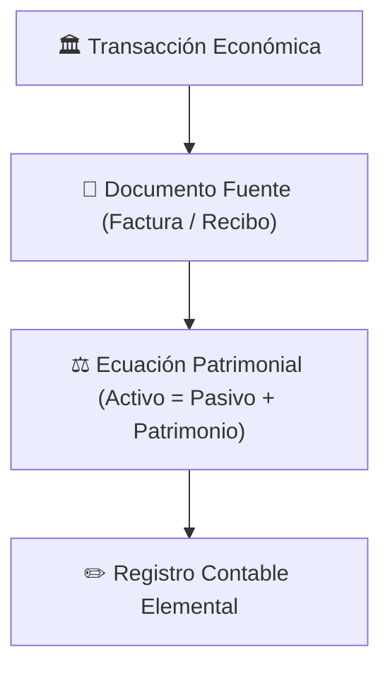

# 📚 01 - Fundamentos y Principios Contables

**Autora:** Caro Nuga (Contabletip)  
**Total de Publicaciones y Guías:** 36  
**Blog Oficial:** [contabletip.blogspot.com](https://contabletip.blogspot.com/)  
**Índice General del Vault:** [[00 - Índice General]]

> [!abstract] 🎯 Descripción del Módulo
> Introducción a la ciencia contable, principios de contabilidad generalmente aceptados (PCGA), objetivos de la información financiera, la ecuación contable básica (Activo = Pasivo + Patrimonio) y usuarios de la información contable.

---

## 📑 Directorio Cronológico de Publicaciones del Módulo

| # | Fecha | Título del Artículo | Categorías / Etiquetas | YouTube | Nota en Obsidian |
| :-: | :---: | :--- | :--- | :---: | :--- |
| 01 | `2016-02-01` | **ORIGEN DE LA PALABRA CONTABILIDAD** | `Contabilidad Básica`, `Tema 1 Fundamentos Básicos` | [Ver Vídeo ↗](https://www.youtube.com/watch?v=4d0N8q3x-5M) | 📑 [[2016-02-01 ORIGEN DE LA PALABRA CONTABILIDAD\|Abrir Guía ↗]] |
| 02 | `2016-02-02` | **CONCEPTO DE CONTABILIDAD** | `Contabilidad Básica`, `Tema 1 Fundamentos Básicos` | [Ver Vídeo ↗](https://www.youtube.com/watch?v=e1nt1aNcrug) | 📑 [[2016-02-02 CONCEPTO DE CONTABILIDAD\|Abrir Guía ↗]] |
| 03 | `2016-02-03` | **QUÉ ES EL MÉTODO CONTABLE** | `Contabilidad Básica`, `Tema 1 Fundamentos Básicos` | [Ver Vídeo ↗](https://www.youtube.com/watch?v=eOvJ5XhrKfU) | 📑 [[2016-02-03 QUÉ ES EL MÉTODO CONTABLE\|Abrir Guía ↗]] |
| 04 | `2016-02-04` | **USUARIOS DE LA CONTABILIDAD** | `Contabilidad Básica`, `Tema 1 Fundamentos Básicos` | [Ver Vídeo ↗](https://www.youtube.com/watch?v=6OjPWvYl_TM) | 📑 [[2016-02-04 USUARIOS DE LA CONTABILIDAD\|Abrir Guía ↗]] |
| 05 | `2016-02-05` | **CIENCIAS AFINES A LA CONTABILIDAD** | `Contabilidad Básica`, `Tema 1 Fundamentos Básicos` | [Ver Vídeo ↗](https://www.youtube.com/watch?v=CAKA-IRh15Q) | 📑 [[2016-02-05 CIENCIAS AFINES A LA CONTABILIDAD\|Abrir Guía ↗]] |
| 06 | `2016-02-08` | **TIPOS DE CONTABILIDAD** | `Contabilidad Básica`, `Tema 1 Fundamentos Básicos` | [Ver Vídeo ↗](https://www.youtube.com/watch?v=5aNbTtQpowk) | 📑 [[2016-02-08 TIPOS DE CONTABILIDAD\|Abrir Guía ↗]] |
| 07 | `2016-02-11` | **MARCO CONCEPTUAL - CONTABILIDAD** | `Contabilidad Básica`, `Tema 1 Fundamentos Básicos` | [Ver Vídeo ↗](https://www.youtube.com/watch?v=avzuhvTwZmQ) | 📑 [[2016-02-11 MARCO CONCEPTUAL - CONTABILIDAD\|Abrir Guía ↗]] |
| 08 | `2016-02-12` | **DIFERENCIAS ENTRE GRANDES EMPRESAS Y PYMES** | `Contabilidad Básica`, `Tema 1 Fundamentos Básicos` | [Ver Vídeo ↗](https://www.youtube.com/watch?v=HazVdl9t5B4) | 📑 [[2016-02-12 DIFERENCIAS ENTRE GRANDES EMPRESAS Y PYMES\|Abrir Guía ↗]] |
| 09 | `2016-02-16` | **¿CUÁNDO SE RECONOCEN LAS CUENTAS EN LOS ESTADOS FINANCIEROS?** | `Contabilidad Básica`, `Tema 1 Fundamentos Básicos` | [Ver Vídeo ↗](https://www.youtube.com/watch?v=5JbwXPVI848) | 📑 [[2016-02-16 ¿CUÁNDO SE RECONOCEN LAS CUENTAS EN LOS ESTADOS FINANCIEROS\|Abrir Guía ↗]] |
| 10 | `2016-02-18` | **PRINCIPIO DE COMPRENSIBILIDAD** | `Contabilidad Básica`, `Tema 1 Fundamentos Básicos` | [Ver Vídeo ↗](https://www.youtube.com/watch?v=BrYMztjfL48) | 📑 [[2016-02-18 PRINCIPIO DE COMPRENSIBILIDAD\|Abrir Guía ↗]] |
| 11 | `2016-02-19` | **PRINCIPIO DE RELEVANCIA** | `Contabilidad Básica`, `Tema 1 Fundamentos Básicos` | [Ver Vídeo ↗](https://www.youtube.com/watch?v=zl3B5Xl8-cQ) | 📑 [[2016-02-19 PRINCIPIO DE RELEVANCIA\|Abrir Guía ↗]] |
| 12 | `2016-02-22` | **PRINCIPIO DE MATERIALIDAD O IMPORTANCIA RELATIVA** | `Contabilidad Básica`, `Tema 1 Fundamentos Básicos` | [Ver Vídeo ↗](https://www.youtube.com/watch?v=oF1EMZbJQh8) | 📑 [[2016-02-22 PRINCIPIO DE MATERIALIDAD O IMPORTANCIA RELATIVA\|Abrir Guía ↗]] |
| 13 | `2016-02-23` | **PRINCIPIO DE FIABILIDAD** | `Contabilidad Básica`, `Tema 1 Fundamentos Básicos` | [Ver Vídeo ↗](https://www.youtube.com/watch?v=PJYzRLjLYJ0) | 📑 [[2016-02-23 PRINCIPIO DE FIABILIDAD\|Abrir Guía ↗]] |
| 14 | `2016-02-24` | **PRINCIPIO DE LA ESENCIA SOBRE LA FORMA** | `Contabilidad Básica`, `Tema 1 Fundamentos Básicos` | [Ver Vídeo ↗](https://www.youtube.com/watch?v=uq4etJBfltg) | 📑 [[2016-02-24 PRINCIPIO DE LA ESENCIA SOBRE LA FORMA\|Abrir Guía ↗]] |
| 15 | `2016-02-25` | **PRINCIPIO DE PRUDENCIA** | `Contabilidad Básica`, `Tema 1 Fundamentos Básicos` | [Ver Vídeo ↗](https://www.youtube.com/watch?v=6Inrc0ZCLyc) | 📑 [[2016-02-25 PRINCIPIO DE PRUDENCIA\|Abrir Guía ↗]] |
| 16 | `2016-02-26` | **PRINCIPIO DE COMPARABILIDAD** | `Contabilidad Básica`, `Tema 1 Fundamentos Básicos` | [Ver Vídeo ↗](https://www.youtube.com/watch?v=iS6V_pqXA2A) | 📑 [[2016-02-26 PRINCIPIO DE COMPARABILIDAD\|Abrir Guía ↗]] |
| 17 | `2016-02-29` | **PRINCIPIO DE OPORTUNIDAD** | `Contabilidad Básica`, `Tema 1 Fundamentos Básicos` | [Ver Vídeo ↗](https://www.youtube.com/watch?v=jTMp3GY7lFM) | 📑 [[2016-02-29 PRINCIPIO DE OPORTUNIDAD\|Abrir Guía ↗]] |
| 18 | `2016-03-07` | **BASE DE ACUMULACION O DEVENGO - PRINCIPIO DE CAUSACIÓN** | `Contabilidad Básica`, `Tema 1 Fundamentos Básicos` | [Ver Vídeo ↗](https://www.youtube.com/watch?v=kzDUcCPEVW0) | 📑 [[2016-03-07 BASE DE ACUMULACION O DEVENGO - PRINCIPIO DE CAUSACIÓN\|Abrir Guía ↗]] |
| 19 | `2016-03-09` | **PRINCIPIO DE NEGOCIO EN MARCHA** | `Contabilidad Básica`, `Tema 1 Fundamentos Básicos` | [Ver Vídeo ↗](https://www.youtube.com/watch?v=BpgTyHtDiIc) | 📑 [[2016-03-09 PRINCIPIO DE NEGOCIO EN MARCHA\|Abrir Guía ↗]] |
| 20 | `2016-03-14` | **FRECUENCIA DE PRESENTACIÓN DE LA INFORMACIÓN - CONTABILIDAD** | `Contabilidad Básica`, `Tema 1 Fundamentos Básicos` | [Ver Vídeo ↗](https://www.youtube.com/watch?v=MknLaKXcfOw) | 📑 [[2016-03-14 FRECUENCIA DE PRESENTACIÓN DE LA INFORMACIÓN - CONTABILIDAD\|Abrir Guía ↗]] |
| 21 | `2016-03-16` | **CUESTIONARIO TEMA Nº 1 - FUNDAMENTOS DE CONTABILIDAD** | `Contabilidad Básica`, `Tema 1 Fundamentos Básicos` | [Ver Vídeo ↗](https://www.youtube.com/watch?v=xt5XRnfE4kQ) | 📑 [[2016-03-16 CUESTIONARIO TEMA Nº 1 - FUNDAMENTOS DE CONTABILIDAD\|Abrir Guía ↗]] |
| 22 | `2016-03-22` | **EVALUACIÓN FUNDAMENTOS DE CONTABILIDAD** | `Contabilidad Básica`, `Tema 1 Fundamentos Básicos` | [Ver Vídeo ↗](https://www.youtube.com/watch?v=Y83JM0tC1ZU) | 📑 [[2016-03-22 EVALUACIÓN FUNDAMENTOS DE CONTABILIDAD\|Abrir Guía ↗]] |
| 23 | `2022-01-10` | **BIENVENIDO 2022 - AGENDA CONTABILIDAD - CONSULTAS - TEMAS BASICOS** | `Bienvenido 2022` | [Ver Vídeo ↗](https://www.youtube.com/watch?v=GjMaYYB07m0) | 📑 [[2022-01-10 BIENVENIDO 2022 - AGENDA CONTABILIDAD - CONSULTAS - TEMAS BASICOS\|Abrir Guía ↗]] |
| 24 | `2022-01-20` | **¿QUÉ SE REGISTRA EN EL DEBE?** | `Contabilidad Básica`, `Tema 1 Fundamentos Básicos` | [Ver Vídeo ↗](https://www.youtube.com/watch?v=tcIxzxm4oXw) | 📑 [[2022-01-20 ¿QUÉ SE REGISTRA EN EL DEBE\|Abrir Guía ↗]] |
| 25 | `2022-01-27` | **¿QUÉ SE REGISTRA EN EL HABER?** | `Contabilidad Básica` | [Ver Vídeo ↗](https://www.youtube.com/watch?v=BHWGd-wX6yU) | 📑 [[2022-01-27 ¿QUÉ SE REGISTRA EN EL HABER\|Abrir Guía ↗]] |
| 26 | `2022-02-21` | **¿QUÉ SON LOS INSTRUMENTOS FINANCIEROS?** | `Contabilidad Básica` | [Ver Vídeo ↗](https://www.youtube.com/watch?v=dK2aQx_dYEM) | 📑 [[2022-02-21 ¿QUÉ SON LOS INSTRUMENTOS FINANCIEROS\|Abrir Guía ↗]] |
| 27 | `2024-01-16` | **EJERCICIO 1 ECUACIÓN PATRIMONIAL** | `Contabilidad Básica`, `Ejercicios de Contabilidad` | [Ver Vídeo ↗](https://www.youtube.com/watch?v=q7qpfRt-4ZY) | 📑 [[2024-01-16 EJERCICIO 1 ECUACIÓN PATRIMONIAL\|Abrir Guía ↗]] |
| 28 | `2024-01-18` | **EJERCICIO 2 ECUACIÓN PATRIMONIAL** | `Contabilidad Basica`, `Ejercicios de Contabilidad` | [Ver Vídeo ↗](https://www.youtube.com/watch?v=yuv4WCiyh84) | 📑 [[2024-01-18 EJERCICIO 2 ECUACIÓN PATRIMONIAL\|Abrir Guía ↗]] |
| 29 | `2024-01-23` | **EJERCICIO 3 ECUACIÓN PATRIMONIAL** | `Contabilidad Basica`, `Ejercicios de Contabilidad` | [Ver Vídeo ↗](https://www.youtube.com/watch?v=Wg6Ejwa1LPc) | 📑 [[2024-01-23 EJERCICIO 3 ECUACIÓN PATRIMONIAL\|Abrir Guía ↗]] |
| 30 | `2024-01-25` | **EJERCICIO 4 ECUACIÓN PATRIMONIAL** | `Contabilidad Basica`, `Ejercicios de Contabilidad` | [Ver Vídeo ↗](https://www.youtube.com/watch?v=KqB7_8_vZ6U) | 📑 [[2024-01-25 EJERCICIO 4 ECUACIÓN PATRIMONIAL\|Abrir Guía ↗]] |
| 31 | `2024-01-29` | **EJERCICIO 5 ECUACIÓN PATRIMONIAL** | `Contabilidad Basica`, `Ejercicios de Contabilidad` | [Ver Vídeo ↗](https://www.youtube.com/watch?v=2OsxWLDbdqs) | 📑 [[2024-01-29 EJERCICIO 5 ECUACIÓN PATRIMONIAL\|Abrir Guía ↗]] |
| 32 | `2024-01-31` | **EJERCICIO 6 ECUACION PATRIMONIAL** | `Contabilidad Basica`, `Ejercicios de Contabilidad` | [Ver Vídeo ↗](https://www.youtube.com/watch?v=b6_vHq81CQY) | 📑 [[2024-01-31 EJERCICIO 6 ECUACION PATRIMONIAL\|Abrir Guía ↗]] |
| 33 | `2024-02-07` | **APRENDE A CREAR UN PLAN DE CUENTAS CONTABLE** | `Contabilidad Básica`, `Ejercicios de Contabilidad` | [Ver Vídeo ↗](https://www.youtube.com/watch?v=gPA0ncFn4Q0) | 📑 [[2024-02-07 APRENDE A CREAR UN PLAN DE CUENTAS CONTABLE\|Abrir Guía ↗]] |
| 34 | `2024-02-21` | **¿CÓMO LLEVAR LA CONTABILIDAD DE UNA PERSONA FÍSICA?** | `Contabilidad Basica`, `Ejercicios de Contabilidad` | [Ver Vídeo ↗](https://www.youtube.com/watch?v=i-W98dIfX8w) | 📑 [[2024-02-21 ¿CÓMO LLEVAR LA CONTABILIDAD DE UNA PERSONA FÍSICA\|Abrir Guía ↗]] |
| 35 | `2024-02-28` | **¿COMO LLEVAR LA CONTABILIDAD DE UNA EMPRESA DE SERVICIOS?** | `Contabilidad Básica`, `Ejercicios de Contabilidad` | [Ver Vídeo ↗](https://www.youtube.com/watch?v=rP0JcgyRzZw) | 📑 [[2024-02-28 ¿COMO LLEVAR LA CONTABILIDAD DE UNA EMPRESA DE SERVICIOS\|Abrir Guía ↗]] |
| 36 | `2024-03-06` | **EJERCICIOS CUENTAS T** | `Contabilidad Básica`, `Ejercicios de Contabilidad` | [Ver Vídeo ↗](https://www.youtube.com/watch?v=NdWjwfE9Er4) | 📑 [[2024-03-06 EJERCICIOS CUENTAS T\|Abrir Guía ↗]] |

---
> [!tip] 💡 Consejo de Contabletip
> *"Recuerda que la contabilidad no se aprende únicamente leyendo: toma lápiz, papel o tu hoja de cálculo y realiza los asientos contables hasta dominar la partida doble."*
