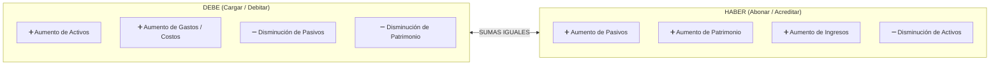

# 📚 02 - La Partida Doble y Asientos Contables

**Autora:** Caro Nuga (Contabletip)  
**Total de Publicaciones y Guías:** 44  
**Blog Oficial:** [contabletip.blogspot.com](https://contabletip.blogspot.com/)  
**Índice General del Vault:** [[00 - Índice General]]

> [!abstract] 🎯 Descripción del Módulo
> La regla de oro de la contabilidad: la teoría del cargo y del abono (Partida Doble). Asientos simples, compuestos y mixtos, dinámica de cuentas de activo, pasivo, patrimonio, ingresos y gastos.

---

## 📑 Directorio Cronológico de Publicaciones del Módulo

| # | Fecha | Título del Artículo | Categorías / Etiquetas | YouTube | Nota en Obsidian |
| :-: | :---: | :--- | :--- | :---: | :--- |
| 01 | `2016-06-13` | **CONCEPTO DE CUENTA - IDENTIFICACIÓN DEL DEBE Y EL HABER** | `Contabilidad Básica`, `tema 2` | [Ver Vídeo ↗](https://www.youtube.com/watch?v=uahdeK9p3QA) | 📑 [[2016-06-13 CONCEPTO DE CUENTA - IDENTIFICACIÓN DEL DEBE Y EL HABER\|Abrir Guía ↗]] |
| 02 | `2016-06-15` | **CUENTAS DE ACTIVOS - CONCEPTO, NATURALEZA DE LAS CUENTAS, CLASIFICACION** | `Contabilidad Básica`, `tema 2` | [Ver Vídeo ↗](https://www.youtube.com/watch?v=dC_rwW-vCWw) | 📑 [[2016-06-15 CUENTAS DE ACTIVOS - CONCEPTO, NATURALEZA DE LAS CUENTAS, CLASIFICACION\|Abrir Guía ↗]] |
| 03 | `2016-06-22` | **CUENTAS DE INGRESOS** | `Contabilidad Básica`, `tema 2` | [Ver Vídeo ↗](https://www.youtube.com/watch?v=Q7k9ti0s60w) | 📑 [[2016-06-22 CUENTAS DE INGRESOS\|Abrir Guía ↗]] |
| 04 | `2016-06-24` | **CUENTAS DE GASTOS** | `Contabilidad Básica`, `tema 2` | [Ver Vídeo ↗](https://www.youtube.com/watch?v=VcDvsRvr7d0) | 📑 [[2016-06-24 CUENTAS DE GASTOS\|Abrir Guía ↗]] |
| 05 | `2016-06-29` | **CLASIFICACIÓN DE LAS CUENTAS POR SU TEMPORALIDAD** | `Contabilidad Básica`, `tema 2` | [Ver Vídeo ↗](https://www.youtube.com/watch?v=4QHg23-BM0A) | 📑 [[2016-06-29 CLASIFICACIÓN DE LAS CUENTAS POR SU TEMPORALIDAD\|Abrir Guía ↗]] |
| 06 | `2016-07-01` | **¿CÓMO CREAR UN PLAN DE CUENTAS?** | `Contabilidad Básica`, `tema 2` | [Ver Vídeo ↗](https://www.youtube.com/watch?v=DWuIXTG9l7w) | 📑 [[2016-07-01 ¿CÓMO CREAR UN PLAN DE CUENTAS\|Abrir Guía ↗]] |
| 07 | `2016-07-04` | **PLAN GENERAL DE CONTABILIDAD EN ESPAÑA - PGC** | `Contabilidad Básica`, `tema 2` | [Ver Vídeo ↗](https://www.youtube.com/watch?v=BPQMIeodi7A) | 📑 [[2016-07-04 PLAN GENERAL DE CONTABILIDAD EN ESPAÑA - PGC\|Abrir Guía ↗]] |
| 08 | `2016-07-06` | **PLAN GENERAL DE CONTABILIDAD - CUADRO DE CUENTAS** | `Contabilidad Básica`, `tema 2` | [Ver Vídeo ↗](https://www.youtube.com/watch?v=1tOMTNWbxuE) | 📑 [[2016-07-06 PLAN GENERAL DE CONTABILIDAD - CUADRO DE CUENTAS\|Abrir Guía ↗]] |
| 09 | `2016-07-08` | **¿COMO HALLAR LAS CUENTAS EN EL PGC?** | `Contabilidad Básica`, `tema 2` | [Ver Vídeo ↗](https://www.youtube.com/watch?v=zvtqRVMIVuY) | 📑 [[2016-07-08 ¿COMO HALLAR LAS CUENTAS EN EL PGC\|Abrir Guía ↗]] |
| 10 | `2016-07-11` | **ECUACIÓN PATRIMONIAL - CONTABILIDAD** | `Contabilidad Básica`, `tema 2` | [Ver Vídeo ↗](https://www.youtube.com/watch?v=h-5z1pQDfqc) | 📑 [[2016-07-11 ECUACIÓN PATRIMONIAL - CONTABILIDAD\|Abrir Guía ↗]] |
| 11 | `2016-07-13` | **ECUACIÓN PATRIMONIAL AMPLIADA - EJEMPLOS** | `Contabilidad Básica`, `tema 2` | [Ver Vídeo ↗](https://www.youtube.com/watch?v=Y1TGbssBYgI) | 📑 [[2016-07-13 ECUACIÓN PATRIMONIAL AMPLIADA - EJEMPLOS\|Abrir Guía ↗]] |
| 12 | `2016-07-15` | **TEORÍA DEL CARGO Y EL ABONO - CONTABILIDAD** | `Contabilidad Básica`, `tema 2` | [Ver Vídeo ↗](https://www.youtube.com/watch?v=lpNC1qZ412g) | 📑 [[2016-07-15 TEORÍA DEL CARGO Y EL ABONO - CONTABILIDAD\|Abrir Guía ↗]] |
| 13 | `2016-07-27` | **ERRORES AUNQUE EL BALANCE CUADRE ¿ES POSIBLE?** | `Contabilidad Básica`, `tema 2` | [Ver Vídeo ↗](https://www.youtube.com/watch?v=8l2qtZckT38) | 📑 [[2016-07-27 ERRORES AUNQUE EL BALANCE CUADRE ¿ES POSIBLE\|Abrir Guía ↗]] |
| 14 | `2016-08-17` | **EJERCICIO CUENTAS T** | `Contabilidad Básica`, `tema 2` | [Ver Vídeo ↗](https://www.youtube.com/watch?v=_UkQE1gF3CI) | 📑 [[2016-08-17 EJERCICIO CUENTAS T\|Abrir Guía ↗]] |
| 15 | `2016-08-19` | **EJERCICIO MAYOR ANALÍTICO** | `Contabilidad Básica`, `tema 2` | [Ver Vídeo ↗](https://www.youtube.com/watch?v=R3Q39SIDLPs) | 📑 [[2016-08-19 EJERCICIO MAYOR ANALÍTICO\|Abrir Guía ↗]] |
| 16 | `2016-08-22` | **CUESTIONARIO TEMA Nº 2 LA CUENTA** | `Contabilidad Básica`, `tema 2` | [Ver Vídeo ↗](https://www.youtube.com/watch?v=GD8lTGrgqsU) | 📑 [[2016-08-22 CUESTIONARIO TEMA Nº 2 LA CUENTA\|Abrir Guía ↗]] |
| 17 | `2016-08-26` | **EVALUACIÓN TEMA LA CUENTA - PREGUNTA UNO** | `Contabilidad Básica`, `tema 2` | [Ver Vídeo ↗](https://www.youtube.com/watch?v=mZaEAeMvGkA) | 📑 [[2016-08-26 EVALUACIÓN TEMA LA CUENTA - PREGUNTA UNO\|Abrir Guía ↗]] |
| 18 | `2016-08-29` | **EVALUACIÓN TEMA LA CUENTA - PREGUNTA DOS** | `Contabilidad Básica`, `tema 2` | [Ver Vídeo ↗](https://www.youtube.com/watch?v=sXacg0zUAFc) | 📑 [[2016-08-29 EVALUACIÓN TEMA LA CUENTA - PREGUNTA DOS\|Abrir Guía ↗]] |
| 19 | `2016-08-31` | **EVALUACIÓN TEMA LA CUENTA - PREGUNTA TRES** | `Contabilidad Básica`, `tema 2` | [Ver Vídeo ↗](https://www.youtube.com/watch?v=kom33Y-gEg4) | 📑 [[2016-08-31 EVALUACIÓN TEMA LA CUENTA - PREGUNTA TRES\|Abrir Guía ↗]] |
| 20 | `2020-02-03` | **¿CÓMO SE REGISTRA UNA VENTA DE CONTADO?** | `asientos contables basicos`, `Contabilidad Básica` | [Ver Vídeo ↗](https://www.youtube.com/watch?v=4l4cLq6V6kU) | 📑 [[2020-02-03 ¿CÓMO SE REGISTRA UNA VENTA DE CONTADO\|Abrir Guía ↗]] |
| 21 | `2020-02-10` | **¿CÓMO SE REGISTRA UNA VENTA A CRÉDITO?** | `asientos contables basicos`, `Contabilidad Básica` | [Ver Vídeo ↗](https://www.youtube.com/watch?v=eWikzS8PLSE) | 📑 [[2020-02-10 ¿CÓMO SE REGISTRA UNA VENTA A CRÉDITO\|Abrir Guía ↗]] |
| 22 | `2020-02-17` | **¿CÓMO SE REGISTRA UNA VENTA CON COBRO DE CONTADO Y A CRÉDITO?** | `asientos contables basicos`, `Contabilidad Básica` | [Ver Vídeo ↗](https://www.youtube.com/watch?v=a-lInPNxNUU) | 📑 [[2020-02-17 ¿CÓMO SE REGISTRA UNA VENTA CON COBRO DE CONTADO Y A CRÉDITO\|Abrir Guía ↗]] |
| 23 | `2020-02-24` | **¿CÓMO SE REGISTRA EL COBRO DE UNA FACTURA?** | `asientos contables basicos`, `Contabilidad Básica` | [Ver Vídeo ↗](https://www.youtube.com/watch?v=umOgceuZdvc) | 📑 [[2020-02-24 ¿CÓMO SE REGISTRA EL COBRO DE UNA FACTURA\|Abrir Guía ↗]] |
| 24 | `2020-03-02` | **¿CÓMO SE REGISTRA UNA DEVOLUCIÓN EN VENTAS?** | `asientos contables basicos`, `Contabilidad Básica` | [Ver Vídeo ↗](https://www.youtube.com/watch?v=DIpiCAj1_iw) | 📑 [[2020-03-02 ¿CÓMO SE REGISTRA UNA DEVOLUCIÓN EN VENTAS\|Abrir Guía ↗]] |
| 25 | `2020-03-09` | **¿CÓMO SE REGISTRA UN DESCUENTO POR PRONTO PAGO EN VENTAS?** | `asientos contables basicos`, `Contabilidad Básica` | [Ver Vídeo ↗](https://www.youtube.com/watch?v=0t68WMH9n4w) | 📑 [[2020-03-09 ¿CÓMO SE REGISTRA UN DESCUENTO POR PRONTO PAGO EN VENTAS\|Abrir Guía ↗]] |
| 26 | `2020-05-25` | **¿CÓMO SE REGISTRA UN ANTICIPO RECIBIDO DE CLIENTES?** | `asientos contables basicos`, `Contabilidad Básica` | [Ver Vídeo ↗](https://www.youtube.com/watch?v=QSeiyk9tJi8) | 📑 [[2020-05-25 ¿CÓMO SE REGISTRA UN ANTICIPO RECIBIDO DE CLIENTES\|Abrir Guía ↗]] |
| 27 | `2020-06-01` | **¿CÓMO SE REGISTRA UNA VENTA UTILIZANDO ANTICIPO RECIBIDO DE CLIENTES?** | `asientos contables basicos`, `Contabilidad Básica` | [Ver Vídeo ↗](https://www.youtube.com/watch?v=vdk1QDkUuGo) | 📑 [[2020-06-01 ¿CÓMO SE REGISTRA UNA VENTA UTILIZANDO ANTICIPO RECIBIDO DE CLIENTES\|Abrir Guía ↗]] |
| 28 | `2020-06-08` | **¿CÓMO SE REGISTRA UNA COMPRA DE CONTADO?** | `asientos contables basicos`, `Contabilidad Básica` | [Ver Vídeo ↗](https://www.youtube.com/watch?v=-Sy64rLn1KQ) | 📑 [[2020-06-08 ¿CÓMO SE REGISTRA UNA COMPRA DE CONTADO\|Abrir Guía ↗]] |
| 29 | `2020-06-15` | **¿CÓMO SE REGISTRA UNA COMPRA A CRÉDITO?** | `asientos contables basicos`, `Contabilidad Básica` | [Ver Vídeo ↗](https://www.youtube.com/watch?v=PX-CCB5NTTE) | 📑 [[2020-06-15 ¿CÓMO SE REGISTRA UNA COMPRA A CRÉDITO\|Abrir Guía ↗]] |
| 30 | `2020-06-23` | **¿CÓMO SE REGISTRA UNA COMPRA PAGADA PARCIALMENTE?** | `asientos contables basicos`, `Contabilidad Básica` | [Ver Vídeo ↗](https://www.youtube.com/watch?v=DPGtSdfAX80) | 📑 [[2020-06-23 ¿CÓMO SE REGISTRA UNA COMPRA PAGADA PARCIALMENTE\|Abrir Guía ↗]] |
| 31 | `2020-06-30` | **¿CÓMO SE REGISTRA EL PAGO DE UNA FACTURA?** | `asientos contables basicos`, `Contabilidad Básica` | [Ver Vídeo ↗](https://www.youtube.com/watch?v=Z6s2AgEXWUY) | 📑 [[2020-06-30 ¿CÓMO SE REGISTRA EL PAGO DE UNA FACTURA\|Abrir Guía ↗]] |
| 32 | `2020-07-07` | **¿CÓMO SE REGISTRA UNA DEVOLUCIÓN EN COMPRAS?** | `asientos contables basicos`, `Contabilidad Básica` | [Ver Vídeo ↗](https://www.youtube.com/watch?v=vPolROxDt5U) | 📑 [[2020-07-07 ¿CÓMO SE REGISTRA UNA DEVOLUCIÓN EN COMPRAS\|Abrir Guía ↗]] |
| 33 | `2020-07-14` | **¿CÓMO SE REGISTRA UN DESCUENTO POR PRONTO PAGO EN COMPRAS?** | `asientos contables basicos`, `Contabilidad Básica` | [Ver Vídeo ↗](https://www.youtube.com/watch?v=CQ9HXj6Lc84) | 📑 [[2020-07-14 ¿CÓMO SE REGISTRA UN DESCUENTO POR PRONTO PAGO EN COMPRAS\|Abrir Guía ↗]] |
| 34 | `2020-07-28` | **¿CÓMO SE REGISTRA UN ANTICIPO DADO A PROVEEDORES?** | `asientos contables basicos`, `Contabilidad Básica` | [Ver Vídeo ↗](https://www.youtube.com/watch?v=njeCaTKeSDo) | 📑 [[2020-07-28 ¿CÓMO SE REGISTRA UN ANTICIPO DADO A PROVEEDORES\|Abrir Guía ↗]] |
| 35 | `2020-08-04` | **¿CÓMO SE REGISTRA UNA COMPRA USANDO ANTICIPO DADO A PROVEEDORES?** | `asientos contables basicos`, `Contabilidad Básica` | [Ver Vídeo ↗](https://www.youtube.com/watch?v=GgVYvqsFCeE) | 📑 [[2020-08-04 ¿CÓMO SE REGISTRA UNA COMPRA USANDO ANTICIPO DADO A PROVEEDORES\|Abrir Guía ↗]] |
| 36 | `2020-08-11` | **¿CÓMO SE REGISTRAN LOS GASTOS DE SEGURO Y FLETE?** | `asientos contables basicos`, `Contabilidad Básica` | [Ver Vídeo ↗](https://www.youtube.com/watch?v=lbw-AzxlvrY) | 📑 [[2020-08-11 ¿CÓMO SE REGISTRAN LOS GASTOS DE SEGURO Y FLETE\|Abrir Guía ↗]] |
| 37 | `2020-08-18` | **¿CÓMO SE REGISTRA UN GASTO PAGADO DE CONTADO?** | `asientos contables basicos`, `Contabilidad Básica` | [Ver Vídeo ↗](https://www.youtube.com/watch?v=ztv-Ldl--9M) | 📑 [[2020-08-18 ¿CÓMO SE REGISTRA UN GASTO PAGADO DE CONTADO\|Abrir Guía ↗]] |
| 38 | `2020-08-25` | **¿CÓMO SE REGISTRA UN GASTO CAUSADO Y NO PAGADO?** | `asientos contables basicos`, `Contabilidad Básica` | [Ver Vídeo ↗](https://www.youtube.com/watch?v=oD9LhHq9QME) | 📑 [[2020-08-25 ¿CÓMO SE REGISTRA UN GASTO CAUSADO Y NO PAGADO\|Abrir Guía ↗]] |
| 39 | `2020-09-01` | **¿CÓMO SE REGISTRA EL PAGO DE UN GASTO CAUSADO EN PERIODOS ANTERIORES?** | `asientos contables basicos`, `Contabilidad Básica` | [Ver Vídeo ↗](https://www.youtube.com/watch?v=6Csii1UdWcA) | 📑 [[2020-09-01 ¿CÓMO SE REGISTRA EL PAGO DE UN GASTO CAUSADO EN PERIODOS ANTERIORES\|Abrir Guía ↗]] |
| 40 | `2020-09-09` | **¿CÓMO SE REGISTRA UN GASTO PREPAGADO?** | `asientos contables basicos`, `Contabilidad Básica` | [Ver Vídeo ↗](https://www.youtube.com/watch?v=_OQqbCnTGEY) | 📑 [[2020-09-09 ¿CÓMO SE REGISTRA UN GASTO PREPAGADO\|Abrir Guía ↗]] |
| 41 | `2020-09-16` | **¿CÓMO SE AMORTIZA UN GASTO PREPAGADO?** | `asientos contables basicos`, `Contabilidad Básica` | [Ver Vídeo ↗](https://www.youtube.com/watch?v=nI3F_mawksc) | 📑 [[2020-09-16 ¿CÓMO SE AMORTIZA UN GASTO PREPAGADO\|Abrir Guía ↗]] |
| 42 | `2020-09-23` | **¿CÓMO SE REGISTRA UN INGRESO EXTRAORDINARIO COBRADO POR ANTICIPADO?** | `asientos contables basicos`, `Contabilidad Básica` | [Ver Vídeo ↗](https://www.youtube.com/watch?v=8AbwIiKp87w) | 📑 [[2020-09-23 ¿CÓMO SE REGISTRA UN INGRESO EXTRAORDINARIO COBRADO POR ANTICIPADO\|Abrir Guía ↗]] |
| 43 | `2022-01-13` | **¿CÓMO SE AJUSTA UNA CUENTA DE ACTIVO EN MONEDA EXTRANJERA?** | `asientos contables basicos`, `Contabilidad Básica`, `preguntas tipo test` | [Ver Vídeo ↗](https://www.youtube.com/watch?v=IprFfTGSaKU) | 📑 [[2022-01-13 ¿CÓMO SE AJUSTA UNA CUENTA DE ACTIVO EN MONEDA EXTRANJERA\|Abrir Guía ↗]] |
| 44 | `2022-02-01` | **¿CÓMO SE AMORTIZA UN ACTIVO INTANGIBLE?** | `asientos contables basicos`, `Contabilidad Básica` | [Ver Vídeo ↗](https://www.youtube.com/watch?v=qLC2PX_QSZA) | 📑 [[2022-02-01 ¿CÓMO SE AMORTIZA UN ACTIVO INTANGIBLE\|Abrir Guía ↗]] |

---
> [!tip] 💡 Consejo de Contabletip
> *"Recuerda que la contabilidad no se aprende únicamente leyendo: toma lápiz, papel o tu hoja de cálculo y realiza los asientos contables hasta dominar la partida doble."*
