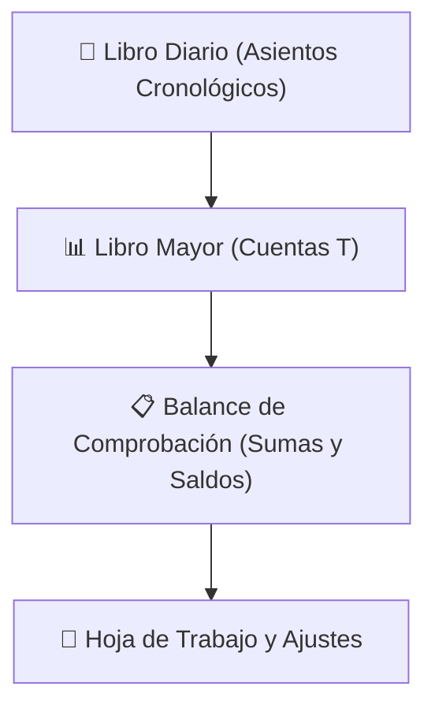

# 📚 03 - Libros Contables y Ciclo Contable

**Autora:** Caro Nuga (Contabletip)  
**Total de Publicaciones y Guías:** 28  
**Blog Oficial:** [contabletip.blogspot.com](https://contabletip.blogspot.com/)  
**Índice General del Vault:** [[00 - Índice General]]

> [!abstract] 🎯 Descripción del Módulo
> Estructura y diligenciamiento de los libros principales y auxiliares: Libro Diario (cronológico), Libro Mayor (sistemático por cuentas T) y Balances de Comprobación previos al cierre.

---

## 📑 Directorio Cronológico de Publicaciones del Módulo

| # | Fecha | Título del Artículo | Categorías / Etiquetas | YouTube | Nota en Obsidian |
| :-: | :---: | :--- | :--- | :---: | :--- |
| 01 | `2016-07-18` | **LIBRO DIARIO - FORMATO Y TIPS PARA SU ELABORACION** | `Contabilidad Básica`, `tema 2` | [Ver Vídeo ↗](https://www.youtube.com/watch?v=PWBqQihRAFw) | 📑 [[2016-07-18 LIBRO DIARIO - FORMATO Y TIPS PARA SU ELABORACION\|Abrir Guía ↗]] |
| 02 | `2016-07-20` | **LIBRO MAYOR -  FORMATO Y TIPS PARA SU ELABORACIÓN** | `Contabilidad Básica`, `tema 2` | [Ver Vídeo ↗](https://www.youtube.com/watch?v=nE6tdEXk96w) | 📑 [[2016-07-20 LIBRO MAYOR - FORMATO Y TIPS PARA SU ELABORACIÓN\|Abrir Guía ↗]] |
| 03 | `2016-07-22` | **BALANCE DE COMPROBACIÓN ¿CÓMO SE ELABORA?** | `Contabilidad Básica`, `tema 2` | [Ver Vídeo ↗](https://www.youtube.com/watch?v=cGgYsYYCQ-c) | 📑 [[2016-07-22 BALANCE DE COMPROBACIÓN ¿CÓMO SE ELABORA\|Abrir Guía ↗]] |
| 04 | `2016-07-25` | **ERRORES EN EL BALANCE DE COMPROBACIÓN ¿QUÉ HACER?** | `Contabilidad Básica`, `tema 2` | [Ver Vídeo ↗](https://www.youtube.com/watch?v=bavPxJO7bSM) | 📑 [[2016-07-25 ERRORES EN EL BALANCE DE COMPROBACIÓN ¿QUÉ HACER\|Abrir Guía ↗]] |
| 05 | `2016-07-29` | **EJERCICIO 1 BALANCE DE COMPROBACIÓN** | `Contabilidad Básica`, `tema 2` | [Ver Vídeo ↗](https://www.youtube.com/watch?v=8Fm7El3ltvI) | 📑 [[2016-07-29 EJERCICIO 1 BALANCE DE COMPROBACIÓN\|Abrir Guía ↗]] |
| 06 | `2016-08-01` | **EJERCICIO 2 BALANCE DE COMPROBACIÓN** | `Contabilidad Básica`, `tema 2` | [Ver Vídeo ↗](https://www.youtube.com/watch?v=j4cPLlCQWxs) | 📑 [[2016-08-01 EJERCICIO 2 BALANCE DE COMPROBACIÓN\|Abrir Guía ↗]] |
| 07 | `2016-08-03` | **EJERCICIO 3 BALANCE DE COMPROBACIÓN** | `Contabilidad Básica`, `tema 2` | [Ver Vídeo ↗](https://www.youtube.com/watch?v=sRDAvAPKf_0) | 📑 [[2016-08-03 EJERCICIO 3 BALANCE DE COMPROBACIÓN\|Abrir Guía ↗]] |
| 08 | `2016-08-05` | **EJERCICIO 4 BALANCE DE COMPROBACIÓN** | `Contabilidad Básica`, `tema 2` | [Ver Vídeo ↗](https://www.youtube.com/watch?v=p3K2nN478Ds) | 📑 [[2016-08-05 EJERCICIO 4 BALANCE DE COMPROBACIÓN\|Abrir Guía ↗]] |
| 09 | `2016-08-08` | **EJERCICIO LIBRO DIARIO** | `Contabilidad Básica`, `tema 2` | [Ver Vídeo ↗](https://www.youtube.com/watch?v=PZwmIErsILI) | 📑 [[2016-08-08 EJERCICIO LIBRO DIARIO\|Abrir Guía ↗]] |
| 10 | `2016-09-05` | **5 LIBROS DE CONTABILIDAD QUE NO TE DEBEN FALTAR** | `Contabilidad Básica`, `Estudiantes`, `tips` | [Ver Vídeo ↗](https://www.youtube.com/watch?v=LO5mvsaXjes) | 📑 [[2016-09-05 5 LIBROS DE CONTABILIDAD QUE NO TE DEBEN FALTAR\|Abrir Guía ↗]] |
| 11 | `2016-09-14` | **IVA - IMPUESTO AL VALOR AGREGADO** | `Contabilidad Basica`, `impuestos`, `tema 3` | [Ver Vídeo ↗](https://www.youtube.com/watch?v=wqXXL8JQ6Yc) | 📑 [[2016-09-14 IVA - IMPUESTO AL VALOR AGREGADO\|Abrir Guía ↗]] |
| 12 | `2016-09-21` | **AGENTE DE PERCEPCIÓN Y AGENTE DE RETENCIÓN - IVA** | `Contabilidad Básica`, `impuestos`, `tema 3` | [Ver Vídeo ↗](https://www.youtube.com/watch?v=scA4Ge3ALCg) | 📑 [[2016-09-21 AGENTE DE PERCEPCIÓN Y AGENTE DE RETENCIÓN - IVA\|Abrir Guía ↗]] |
| 13 | `2016-09-23` | **HECHO IMPONIBLE - IMPUESTO AL VALOR AGREGADO IVA** | `Contabilidad Básica`, `impuestos`, `tema 3` | [Ver Vídeo ↗](https://www.youtube.com/watch?v=3nPGcfXq1e8) | 📑 [[2016-09-23 HECHO IMPONIBLE - IMPUESTO AL VALOR AGREGADO IVA\|Abrir Guía ↗]] |
| 14 | `2016-09-26` | **OPERACIONES NO SUJETAS A IVA** | `Contabilidad Básica`, `impuestos`, `tema 3` | [Ver Vídeo ↗](https://www.youtube.com/watch?v=2JKMUTbo_yQ) | 📑 [[2016-09-26 OPERACIONES NO SUJETAS A IVA\|Abrir Guía ↗]] |
| 15 | `2016-09-28` | **DÉBITOS Y CRÉDITOS FISCALES ¿QUÉ SON?** | `Contabilidad Básica`, `impuestos`, `tema 3` | [Ver Vídeo ↗](https://www.youtube.com/watch?v=tzZ9Ji_kAj8) | 📑 [[2016-09-28 DÉBITOS Y CRÉDITOS FISCALES ¿QUÉ SON\|Abrir Guía ↗]] |
| 16 | `2016-10-03` | **EXENTO Y EXONERADO ¿CUÁL ES LA DIFERENCIA?** | `Contabilidad Básica`, `impuestos`, `tema 3` | [Ver Vídeo ↗](https://www.youtube.com/watch?v=27NbroOW2Pw) | 📑 [[2016-10-03 EXENTO Y EXONERADO ¿CUÁL ES LA DIFERENCIA\|Abrir Guía ↗]] |
| 17 | `2016-10-05` | **¿CÓMO SE CALCULA EL IVA?** | `Contabilidad Básica`, `impuestos`, `tema 3` | [Ver Vídeo ↗](https://www.youtube.com/watch?v=u110GTMXKMw) | 📑 [[2016-10-05 ¿CÓMO SE CALCULA EL IVA\|Abrir Guía ↗]] |
| 18 | `2016-10-07` | **EJERCICIO PRECIO VENTA IVA INCLUIDO** | `Contabilidad Básica`, `impuestos`, `tema 3` | [Ver Vídeo ↗](https://www.youtube.com/watch?v=sxOUKfNb1Ts) | 📑 [[2016-10-07 EJERCICIO PRECIO VENTA IVA INCLUIDO\|Abrir Guía ↗]] |
| 19 | `2016-10-13` | **EJERCICIO IVA VENTAS Y DEVOLUCIONES EN VENTAS: CALCULO Y REGISTRO** | `Contabilidad Básica`, `impuestos`, `tema 3` | [Ver Vídeo ↗](https://www.youtube.com/watch?v=1dtj-9h608I) | 📑 [[2016-10-13 EJERCICIO IVA VENTAS Y DEVOLUCIONES EN VENTAS CALCULO Y REGISTRO\|Abrir Guía ↗]] |
| 20 | `2016-10-17` | **EJERCICIO COMPRAS Y DEVOLUCIONES EN COMPRAS IVA INCLUIDO** | `Contabilidad Básica`, `impuestos`, `tema 3` | [Ver Vídeo ↗](https://www.youtube.com/watch?v=-V6TxI74sbA) | 📑 [[2016-10-17 EJERCICIO COMPRAS Y DEVOLUCIONES EN COMPRAS IVA INCLUIDO\|Abrir Guía ↗]] |
| 21 | `2016-10-21` | **COMPENSACIÓN IVA - DÉBITOS FISCALES MAYORES A CRÉDITOS FISCALES** | `Contabilidad Básica`, `impuestos`, `tema 3` | [Ver Vídeo ↗](https://www.youtube.com/watch?v=HbrdqJStpU8) | 📑 [[2016-10-21 COMPENSACIÓN IVA - DÉBITOS FISCALES MAYORES A CRÉDITOS FISCALES\|Abrir Guía ↗]] |
| 22 | `2016-10-24` | **COMPENSACIÓN IVA - CRÉDITOS FISCALES MAYORES A DÉBITOS FISCALES** | `Contabilidad Básica`, `impuestos`, `tema 3` | [Ver Vídeo ↗](https://www.youtube.com/watch?v=kg9JPLYuJWo) | 📑 [[2016-10-24 COMPENSACIÓN IVA - CRÉDITOS FISCALES MAYORES A DÉBITOS FISCALES\|Abrir Guía ↗]] |
| 23 | `2024-02-14` | **APRENDE A ELABORAR LIBRO DIARIO Y MAYOR ANALITICO** | `Contabilidad Basica`, `Ejercicios de Contabilidad` | [Ver Vídeo ↗](https://www.youtube.com/watch?v=FVUf5U20tjU) | 📑 [[2024-02-14 APRENDE A ELABORAR LIBRO DIARIO Y MAYOR ANALITICO\|Abrir Guía ↗]] |
| 24 | `2024-03-13` | **¿CÓMO CLASIFICAR LAS CUENTAS USANDO EL BALANCE DE COMPROBACIÓN?** | `Contabilidad Basica`, `Ejercicios de Contabilidad` | [Ver Vídeo ↗](https://www.youtube.com/watch?v=rkfC95AVH7o) | 📑 [[2024-03-13 ¿CÓMO CLASIFICAR LAS CUENTAS USANDO EL BALANCE DE COMPROBACIÓN\|Abrir Guía ↗]] |
| 25 | `2024-03-20` | **¿CÓMO CORREGIR ERRORES EN EL BALANCE DE COMPROBACIÓN?** | `Contabilidad Básica`, `Ejercicios de Contabilidad` | [Ver Vídeo ↗](https://www.youtube.com/watch?v=wtT3sKukw9c) | 📑 [[2024-03-20 ¿CÓMO CORREGIR ERRORES EN EL BALANCE DE COMPROBACIÓN\|Abrir Guía ↗]] |
| 26 | `2024-03-27` | **ANÁLISIS DE ERRORES EN EL BALANCE DE COMPROBACIÓN** | `Contabilidad Basica`, `Ejercicios de Contabilidad` | [Ver Vídeo ↗](https://www.youtube.com/watch?v=lMixfMxAroI) | 📑 [[2024-03-27 ANÁLISIS DE ERRORES EN EL BALANCE DE COMPROBACIÓN\|Abrir Guía ↗]] |
| 27 | `2024-04-03` | **AJUSTE DE ERRORES EN EL LIBRO DIARIO** | `Contabilidad Basica`, `Ejercicios de Contabilidad` | [Ver Vídeo ↗](https://www.youtube.com/watch?v=P-rC7V8-JHs) | 📑 [[2024-04-03 AJUSTE DE ERRORES EN EL LIBRO DIARIO\|Abrir Guía ↗]] |
| 28 | `2024-04-17` | **APRENDE A ELABORAR EL ESTADO DE SITUACIÓN FINANCIERA** | `Contabilidad Básica`, `Ejercicios de Contabilidad`, `tema 5` | [Ver Vídeo ↗](https://www.youtube.com/watch?v=I3KisOFlkRQ) | 📑 [[2024-04-17 APRENDE A ELABORAR EL ESTADO DE SITUACIÓN FINANCIERA\|Abrir Guía ↗]] |

---
> [!tip] 💡 Consejo de Contabletip
> *"Recuerda que la contabilidad no se aprende únicamente leyendo: toma lápiz, papel o tu hoja de cálculo y realiza los asientos contables hasta dominar la partida doble."*
