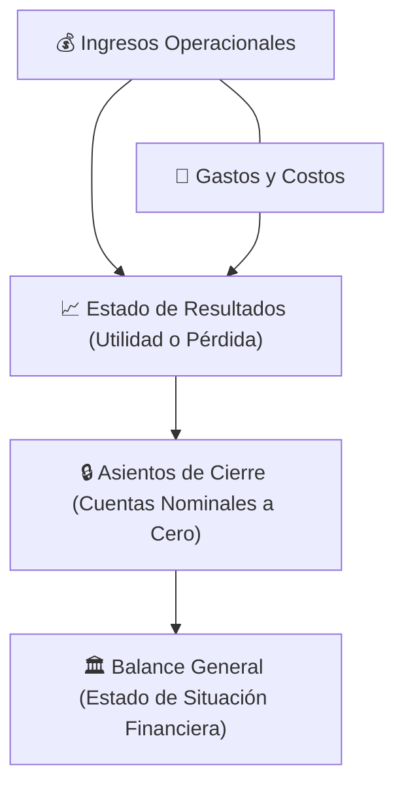

# 📚 04 - Estados Financieros y Cierre Contable

**Autora:** Caro Nuga (Contabletip)  
**Total de Publicaciones y Guías:** 43  
**Blog Oficial:** [contabletip.blogspot.com](https://contabletip.blogspot.com/)  
**Índice General del Vault:** [[00 - Índice General]]

> [!abstract] 🎯 Descripción del Módulo
> Preparación, presentación y análisis de los informes contables principales: Estado de Situación Financiera (Balance General) y Estado de Resultados (Pérdidas y Ganancias), asientos de regularización y cierre del ejercicio económico.

---

## 📑 Directorio Cronológico de Publicaciones del Módulo

| # | Fecha | Título del Artículo | Categorías / Etiquetas | YouTube | Nota en Obsidian |
| :-: | :---: | :--- | :--- | :---: | :--- |
| 01 | `2016-11-02` | **¿QUÉ ES EL ESTADO DE RESULTADOS?** | `Contabilidad Básica`, `estados financieros`, `tema 4` | [Ver Vídeo ↗](https://www.youtube.com/watch?v=JjswpHXB8oY) | 📑 [[2016-11-02 ¿QUÉ ES EL ESTADO DE RESULTADOS\|Abrir Guía ↗]] |
| 02 | `2016-11-04` | **DESGLOSE DE GASTOS POR NATURALEZA** | `Contabilidad Básica`, `estados financieros`, `tema 4` | [Ver Vídeo ↗](https://www.youtube.com/watch?v=hopXhCZJOsE) | 📑 [[2016-11-04 DESGLOSE DE GASTOS POR NATURALEZA\|Abrir Guía ↗]] |
| 03 | `2016-11-07` | **DESGLOSE DE GASTOS POR FUNCIÓN** | `Contabilidad Básica`, `estados financieros`, `tema 4` | [Ver Vídeo ↗](https://www.youtube.com/watch?v=iKi8Kl2Y3zE) | 📑 [[2016-11-07 DESGLOSE DE GASTOS POR FUNCIÓN\|Abrir Guía ↗]] |
| 04 | `2016-11-09` | **COMERCIALIZADORAS / MANUFACTURERAS ¿CUÁL ES LA DIFERENCIA?** | `Contabilidad Básica`, `estados financieros`, `tema 4` | [Ver Vídeo ↗](https://www.youtube.com/watch?v=m9bXR9l66V8) | 📑 [[2016-11-09 COMERCIALIZADORAS MANUFACTURERAS ¿CUÁL ES LA DIFERENCIA\|Abrir Guía ↗]] |
| 05 | `2016-11-18` | **MARGEN DE UTILIDAD % DE LA VENTA** | `Contabilidad Básica`, `estados financieros`, `tema 4` | [Ver Vídeo ↗](https://www.youtube.com/watch?v=WL2EKVELiwU) | 📑 [[2016-11-18 MARGEN DE UTILIDAD % DE LA VENTA\|Abrir Guía ↗]] |
| 06 | `2016-11-21` | **ESTADO DE RESULTADOS INTEGRAL** | `Contabilidad Básica`, `estados financieros`, `tema 4` | [Ver Vídeo ↗](https://www.youtube.com/watch?v=S2M1ApD0A3c) | 📑 [[2016-11-21 ESTADO DE RESULTADOS INTEGRAL\|Abrir Guía ↗]] |
| 07 | `2016-11-24` | **PRESENTACIÓN DEL ESTADO DE RESULTADOS** | `Contabilidad Básica`, `estados financieros`, `tema 4` | [Ver Vídeo ↗](https://www.youtube.com/watch?v=4TdOQ1hQ24E) | 📑 [[2016-11-24 PRESENTACIÓN DEL ESTADO DE RESULTADOS\|Abrir Guía ↗]] |
| 08 | `2016-11-28` | **PERSONAS FÍSICAS O NATURALES ¿SE LES ELABORA ESTADO DE RESULTADOS?** | `Contabilidad Básica`, `estados financieros`, `tema 4` | [Ver Vídeo ↗](https://www.youtube.com/watch?v=A3dAwRSRanw) | 📑 [[2016-11-28 PERSONAS FÍSICAS O NATURALES ¿SE LES ELABORA ESTADO DE RESULTADOS\|Abrir Guía ↗]] |
| 09 | `2016-11-30` | **¿QUÉ ES EL CIERRE DE EJERCICIO ECONÓMICO?** | `Contabilidad Básica`, `estados financieros`, `tema 4` | [Ver Vídeo ↗](https://www.youtube.com/watch?v=l9XfZr25hj0) | 📑 [[2016-11-30 ¿QUÉ ES EL CIERRE DE EJERCICIO ECONÓMICO\|Abrir Guía ↗]] |
| 10 | `2016-12-02` | **¿CÓMO SE ELABORA EL ASIENTO DE CIERRE?** | `Contabilidad Básica`, `estados financieros`, `tema 4` | [Ver Vídeo ↗](https://www.youtube.com/watch?v=DldYmLwGUss) | 📑 [[2016-12-02 ¿CÓMO SE ELABORA EL ASIENTO DE CIERRE\|Abrir Guía ↗]] |
| 11 | `2016-12-05` | **EJERCICIO ESTADO DE RESULTADOS** | `Contabilidad Básica`, `estados financieros`, `tema 4` | [Ver Vídeo ↗](https://www.youtube.com/watch?v=9XY-Yagxp-s) | 📑 [[2016-12-05 EJERCICIO ESTADO DE RESULTADOS\|Abrir Guía ↗]] |
| 12 | `2016-12-07` | **LIBRO DIARIO EJERCICIO ESTADO DE RESULTADOS** | `Contabilidad Básica`, `estados financieros`, `tema 4` | [Ver Vídeo ↗](https://www.youtube.com/watch?v=oZFgQlhOB3w) | 📑 [[2016-12-07 LIBRO DIARIO EJERCICIO ESTADO DE RESULTADOS\|Abrir Guía ↗]] |
| 13 | `2016-12-09` | **EJERCICIO ASIENTO DE CIERRE** | `Contabilidad Básica`, `estados financieros`, `tema 4` | [Ver Vídeo ↗](https://www.youtube.com/watch?v=GUnerqOqzdM) | 📑 [[2016-12-09 EJERCICIO ASIENTO DE CIERRE\|Abrir Guía ↗]] |
| 14 | `2016-12-12` | **EJERCICIO ESTADO DE RESULTADOS EN UNIDADES** | `Contabilidad Básica`, `estados financieros`, `tema 4` | [Ver Vídeo ↗](https://www.youtube.com/watch?v=H3Lto1rvm2s) | 📑 [[2016-12-12 EJERCICIO ESTADO DE RESULTADOS EN UNIDADES\|Abrir Guía ↗]] |
| 15 | `2016-12-15` | **EJERCICIO ESTADO DE RESULTADOS EN UNIDADES SEGUNDA PARTE** | `Contabilidad Básica`, `estados financieros`, `tema 4` | [Ver Vídeo ↗](https://www.youtube.com/watch?v=97mOrifLt-4) | 📑 [[2016-12-15 EJERCICIO ESTADO DE RESULTADOS EN UNIDADES SEGUNDA PARTE\|Abrir Guía ↗]] |
| 16 | `2016-12-19` | **EJERCICIO ESTADO DE RESULTADOS COMPARATIVO** | `Contabilidad Básica`, `estados financieros`, `tema 4` | [Ver Vídeo ↗](https://www.youtube.com/watch?v=x61RyUbNPmM) | 📑 [[2016-12-19 EJERCICIO ESTADO DE RESULTADOS COMPARATIVO\|Abrir Guía ↗]] |
| 17 | `2016-12-22` | **EJERCICIO ESTADO DE RESULTADOS COMPARATIVO PARTE DOS** | `Contabilidad Básica`, `estados financieros`, `tema 4` | [Ver Vídeo ↗](https://www.youtube.com/watch?v=V5isFCqaIJI) | 📑 [[2016-12-22 EJERCICIO ESTADO DE RESULTADOS COMPARATIVO PARTE DOS\|Abrir Guía ↗]] |
| 18 | `2017-01-09` | **¿QUÉ ES EL BALANCE GENERAL O ESTADO DE SITUACIÓN FINANCIERA?** | `Contabilidad Básica`, `estados financieros`, `tema 5` | [Ver Vídeo ↗](https://www.youtube.com/watch?v=ooYmJM6q-nk) | 📑 [[2017-01-09 ¿QUÉ ES EL BALANCE GENERAL O ESTADO DE SITUACIÓN FINANCIERA\|Abrir Guía ↗]] |
| 19 | `2017-01-11` | **¿CUÁL ES LA DIFERENCIA ENTRE CIRCULANTE Y LARGO PLAZO?** | `Contabilidad Básica`, `estados financieros`, `tema 5` | [Ver Vídeo ↗](https://www.youtube.com/watch?v=ipCR6UHLsb0) | 📑 [[2017-01-11 ¿CUÁL ES LA DIFERENCIA ENTRE CIRCULANTE Y LARGO PLAZO\|Abrir Guía ↗]] |
| 20 | `2017-01-13` | **¿CADA CUÁNTO TIEMPO SE PRESENTA EL BALANCE GENERAL?** | `Contabilidad Básica`, `estados financieros`, `tema 5` | [Ver Vídeo ↗](https://www.youtube.com/watch?v=Zp2DVlLhxqY) | 📑 [[2017-01-13 ¿CADA CUÁNTO TIEMPO SE PRESENTA EL BALANCE GENERAL\|Abrir Guía ↗]] |
| 21 | `2017-01-16` | **¿CÓMO SE PRESENTA EL BALANCE GENERAL?** | `Contabilidad Básica`, `estados financieros`, `tema 5` | [Ver Vídeo ↗](https://www.youtube.com/watch?v=aWH6nO7Wtd8) | 📑 [[2017-01-16 ¿CÓMO SE PRESENTA EL BALANCE GENERAL\|Abrir Guía ↗]] |
| 22 | `2017-01-18` | **PERSONAS NATURALES Y BALANCE GENERAL** | `Contabilidad Básica`, `estados financieros`, `tema 5` | [Ver Vídeo ↗](https://www.youtube.com/watch?v=-TXUBalIuiA) | 📑 [[2017-01-18 PERSONAS NATURALES Y BALANCE GENERAL\|Abrir Guía ↗]] |
| 23 | `2017-01-23` | **NOTAS A LOS ESTADOS FINANCIEROS** | `Contabilidad Básica`, `estados financieros`, `tema 5` | [Ver Vídeo ↗](https://www.youtube.com/watch?v=vViqpHTNCv0) | 📑 [[2017-01-23 NOTAS A LOS ESTADOS FINANCIEROS\|Abrir Guía ↗]] |
| 24 | `2017-01-26` | **TIPS PARA RESOLVER EJERCICIOS DE BALANCE GENERAL** | `Contabilidad Básica`, `estados financieros`, `tema 5` | [Ver Vídeo ↗](https://www.youtube.com/watch?v=hnIErmb2LcM) | 📑 [[2017-01-26 TIPS PARA RESOLVER EJERCICIOS DE BALANCE GENERAL\|Abrir Guía ↗]] |
| 25 | `2017-01-30` | **EJERCICIO BALANCE GENERAL - PRACTICA** | `Contabilidad Básica`, `estados financieros`, `tema 5` | [Ver Vídeo ↗](https://www.youtube.com/watch?v=Pt86SpM4Jfg) | 📑 [[2017-01-30 EJERCICIO BALANCE GENERAL - PRACTICA\|Abrir Guía ↗]] |
| 26 | `2017-02-06` | **EJERCICIO II BALANCE GENERAL - PRÁCTICA** | `Contabilidad Básica`, `estados financieros`, `tema 5` | [Ver Vídeo ↗](https://www.youtube.com/watch?v=6eDzv8T5yZo) | 📑 [[2017-02-06 EJERCICIO II BALANCE GENERAL - PRÁCTICA\|Abrir Guía ↗]] |
| 27 | `2017-03-17` | **INFLACIÓN Y  EFECTIVO** | `Contabilidad Básica`, `Finanzas Básicas`, `tema 6` | [Ver Vídeo ↗](https://www.youtube.com/watch?v=HQ5Z8XWiams) | 📑 [[2017-03-17 INFLACIÓN Y EFECTIVO\|Abrir Guía ↗]] |
| 28 | `2017-04-28` | **FACTURAS -  ASPECTOS FORMALES Y CONTROL INTERNO** | `Contabilidad Básica`, `tema 7` | [Ver Vídeo ↗](https://www.youtube.com/watch?v=NtP7ZR4SX6M) | 📑 [[2017-04-28 FACTURAS - ASPECTOS FORMALES Y CONTROL INTERNO\|Abrir Guía ↗]] |
| 29 | `2017-05-01` | **POLÍTICA DE COBRANZA EN LA EMPRESA** | `Contabilidad Básica`, `tema 7` | [Ver Vídeo ↗](https://www.youtube.com/watch?v=1h_NJCTRNbk) | 📑 [[2017-05-01 POLÍTICA DE COBRANZA EN LA EMPRESA\|Abrir Guía ↗]] |
| 30 | `2017-05-05` | **LÍNEA DE TIEMPO - COBRANZA EN LA EMPRESA** | `Contabilidad Básica`, `tema 7` | [Ver Vídeo ↗](https://www.youtube.com/watch?v=jDrg7Ww2o7I) | 📑 [[2017-05-05 LÍNEA DE TIEMPO - COBRANZA EN LA EMPRESA\|Abrir Guía ↗]] |
| 31 | `2017-05-08` | **COBRANZA POR TERCEROS - GIROS AL COBRO Y AL DESCUENTO** | `Contabilidad Básica`, `tema 7` | [Ver Vídeo ↗](https://www.youtube.com/watch?v=ba5RjSuWRDo) | 📑 [[2017-05-08 COBRANZA POR TERCEROS - GIROS AL COBRO Y AL DESCUENTO\|Abrir Guía ↗]] |
| 32 | `2017-05-11` | **¿QUÉ ES EL FACTORING?** | `Contabilidad Básica`, `tema 7` | [Ver Vídeo ↗](https://www.youtube.com/watch?v=N7sgQXP_aR8) | 📑 [[2017-05-11 ¿QUÉ ES EL FACTORING\|Abrir Guía ↗]] |
| 33 | `2017-05-15` | **¿QUÉ CUENTA CONTABLE USAR? ENVÍO DE GIROS AL COBRO O DESCUENTO** | `Contabilidad Básica`, `tema 7` | [Ver Vídeo ↗](https://www.youtube.com/watch?v=mWE1IrgaTl8) | 📑 [[2017-05-15 ¿QUÉ CUENTA CONTABLE USAR ENVÍO DE GIROS AL COBRO O DESCUENTO\|Abrir Guía ↗]] |
| 34 | `2017-05-17` | **REGISTRO CONTABLE GIROS ENVIADOS AL DESCUENTO** | `Contabilidad Básica`, `tema 7` | [Ver Vídeo ↗](https://www.youtube.com/watch?v=wfTsgm6Fg_s) | 📑 [[2017-05-17 REGISTRO CONTABLE GIROS ENVIADOS AL DESCUENTO\|Abrir Guía ↗]] |
| 35 | `2017-05-19` | **REGISTRO CONTABLE GIROS ENVIADOS AL COBRO** | `Contabilidad Básica`, `tema 7` | [Ver Vídeo ↗](https://www.youtube.com/watch?v=R77Rh-SVR7A) | 📑 [[2017-05-19 REGISTRO CONTABLE GIROS ENVIADOS AL COBRO\|Abrir Guía ↗]] |
| 36 | `2017-05-22` | **¿QUÉ ES LA PROVISIÓN PARA CUENTAS DE COBRO DUDOSO?** | `Contabilidad Básica`, `tema 7` | [Ver Vídeo ↗](https://www.youtube.com/watch?v=0Eu3CJb7Fuc) | 📑 [[2017-05-22 ¿QUÉ ES LA PROVISIÓN PARA CUENTAS DE COBRO DUDOSO\|Abrir Guía ↗]] |
| 37 | `2017-05-24` | **MÉTODOS PARA CALCULAR LA PROVISIÓN CUENTAS COBRO DUDOSO** | `Contabilidad Básica`, `tema 7` | [Ver Vídeo ↗](https://www.youtube.com/watch?v=aFlBQZpdgnY) | 📑 [[2017-05-24 MÉTODOS PARA CALCULAR LA PROVISIÓN CUENTAS COBRO DUDOSO\|Abrir Guía ↗]] |
| 38 | `2017-05-26` | **REGISTRO PROVISIÓN CUENTA COBRO DUDOSO** | `Contabilidad Básica`, `tema 7` | [Ver Vídeo ↗](https://www.youtube.com/watch?v=_i0K4xNCVRo) | 📑 [[2017-05-26 REGISTRO PROVISIÓN CUENTA COBRO DUDOSO\|Abrir Guía ↗]] |
| 39 | `2017-05-29` | **¿CÓMO RESTAR FECHAS DE FORMA MANUAL?** | `Contabilidad Básica`, `Finanzas Básicas`, `tema 7` | [Ver Vídeo ↗](https://www.youtube.com/watch?v=2ROHIhPKers) | 📑 [[2017-05-29 ¿CÓMO RESTAR FECHAS DE FORMA MANUAL\|Abrir Guía ↗]] |
| 40 | `2017-06-05` | **EJERCICIO VENTA Y COBRANZA EN PERIODOS ECONÓMICOS DISTINTOS** | `Contabilidad Básica`, `tema 7` | [Ver Vídeo ↗](https://www.youtube.com/watch?v=ZtKAWN1lHSk) | 📑 [[2017-06-05 EJERCICIO VENTA Y COBRANZA EN PERIODOS ECONÓMICOS DISTINTOS\|Abrir Guía ↗]] |
| 41 | `2017-06-12` | **EJERCICIO GIROS ENVIADOS AL COBRO** | `Contabilidad Básica`, `tema 7` | [Ver Vídeo ↗](https://www.youtube.com/watch?v=0k8wWrFEOfI) | 📑 [[2017-06-12 EJERCICIO GIROS ENVIADOS AL COBRO\|Abrir Guía ↗]] |
| 42 | `2017-06-14` | **EJERCICIO GIROS DESCONTADOS** | `Contabilidad Básica`, `tema 7` | [Ver Vídeo ↗](https://www.youtube.com/watch?v=Z6wQ42pMBC4) | 📑 [[2017-06-14 EJERCICIO GIROS DESCONTADOS\|Abrir Guía ↗]] |
| 43 | `2024-04-10` | **APRENDE A ELABORAR EL ESTADO DE RESULTADOS** | `Contabilidad Básica`, `Ejercicios de Contabilidad`, `tema 4` | [Ver Vídeo ↗](https://www.youtube.com/watch?v=4YzIZDSXM7I) | 📑 [[2024-04-10 APRENDE A ELABORAR EL ESTADO DE RESULTADOS\|Abrir Guía ↗]] |

---
> [!tip] 💡 Consejo de Contabletip
> *"Recuerda que la contabilidad no se aprende únicamente leyendo: toma lápiz, papel o tu hoja de cálculo y realiza los asientos contables hasta dominar la partida doble."*
