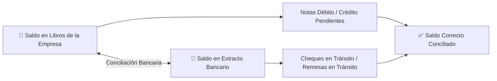

# 📚 05 - Efectivo, Bancos y Conciliaciones

**Autora:** Caro Nuga (Contabletip)  
**Total de Publicaciones y Guías:** 19  
**Blog Oficial:** [contabletip.blogspot.com](https://contabletip.blogspot.com/)  
**Índice General del Vault:** [[00 - Índice General]]

> [!abstract] 🎯 Descripción del Módulo
> Administración del disponible: control de caja chica (fondo fijo, arqueos, reposiciones), gestión de cuentas corrientes y elaboración técnica de la conciliación bancaria.

---

## 📑 Directorio Cronológico de Publicaciones del Módulo

| # | Fecha | Título del Artículo | Categorías / Etiquetas | YouTube | Nota en Obsidian |
| :-: | :---: | :--- | :--- | :---: | :--- |
| 01 | `2017-02-20` | **CAJA, CONCEPTO Y GENERALIDADES** | `Contabilidad Básica`, `tema 6` | [Ver Vídeo ↗](https://www.youtube.com/watch?v=zleFI1Edo1E) | 📑 [[2017-02-20 CAJA, CONCEPTO Y GENERALIDADES\|Abrir Guía ↗]] |
| 02 | `2017-02-22` | **ARQUEO DE CAJA** | `Contabilidad Básica`, `tema 6` | [Ver Vídeo ↗](https://www.youtube.com/watch?v=RntlNCOSz0U) | 📑 [[2017-02-22 ARQUEO DE CAJA\|Abrir Guía ↗]] |
| 03 | `2017-02-24` | **MEDIDAS DE CONTROL INTERNO CUENTA DE CAJA** | `Contabilidad Básica`, `tema 6` | [Ver Vídeo ↗](https://www.youtube.com/watch?v=z3MKYqv6zq8) | 📑 [[2017-02-24 MEDIDAS DE CONTROL INTERNO CUENTA DE CAJA\|Abrir Guía ↗]] |
| 04 | `2017-02-27` | **EJERCICIO CUENTA DE CAJA** | `Contabilidad Básica`, `tema 6` | [Ver Vídeo ↗](https://www.youtube.com/watch?v=7IFeYjSMMhw) | 📑 [[2017-02-27 EJERCICIO CUENTA DE CAJA\|Abrir Guía ↗]] |
| 05 | `2017-03-03` | **EJERCICIO ARQUEO DE CAJA** | `Contabilidad Básica`, `tema 6` | [Ver Vídeo ↗](https://www.youtube.com/watch?v=VbMzKCnYjWg) | 📑 [[2017-03-03 EJERCICIO ARQUEO DE CAJA\|Abrir Guía ↗]] |
| 06 | `2017-03-09` | **EJERCICIO CAJA MONEDA EXTRANJERA** | `Contabilidad Básica`, `tema 6` | [Ver Vídeo ↗](https://www.youtube.com/watch?v=LgTRSE4xoIg) | 📑 [[2017-03-09 EJERCICIO CAJA MONEDA EXTRANJERA\|Abrir Guía ↗]] |
| 07 | `2017-03-13` | **BANCO CONCEPTO Y GENERALIDADES** | `Contabilidad Básica`, `tema 6` | [Ver Vídeo ↗](https://www.youtube.com/watch?v=v2m8nD56UlQ) | 📑 [[2017-03-13 BANCO CONCEPTO Y GENERALIDADES\|Abrir Guía ↗]] |
| 08 | `2017-03-20` | **¿QUÉ ES LA CONCILIACIÓN BANCARIA?** | `Contabilidad Básica`, `tema 6` | [Ver Vídeo ↗](https://www.youtube.com/watch?v=QqAA3qkq7Cs) | 📑 [[2017-03-20 ¿QUÉ ES LA CONCILIACIÓN BANCARIA\|Abrir Guía ↗]] |
| 09 | `2017-03-22` | **¿CUÁLES SON LOS PASOS PARA ELABORAR UNA CONCILIACIÓN BANCARIA?** | `Contabilidad Básica`, `tema 6` | [Ver Vídeo ↗](https://www.youtube.com/watch?v=NnmgiYebg_Y) | 📑 [[2017-03-22 ¿CUÁLES SON LOS PASOS PARA ELABORAR UNA CONCILIACIÓN BANCARIA\|Abrir Guía ↗]] |
| 10 | `2017-03-24` | **MÉTODOS DE CONCILIACIÓN BANCARIA** | `Contabilidad Básica`, `tema 6` | [Ver Vídeo ↗](https://www.youtube.com/watch?v=g_TCGO4CQCE) | 📑 [[2017-03-24 MÉTODOS DE CONCILIACIÓN BANCARIA\|Abrir Guía ↗]] |
| 11 | `2017-03-27` | **REGLA DE LOS SIGNOS - CONCILIACIÓN SALDOS ENCONTRADOS** | `Contabilidad Básica`, `tema 6` | [Ver Vídeo ↗](https://www.youtube.com/watch?v=F2Q8mdq1548) | 📑 [[2017-03-27 REGLA DE LOS SIGNOS - CONCILIACIÓN SALDOS ENCONTRADOS\|Abrir Guía ↗]] |
| 12 | `2017-03-29` | **EJERCICIO CONCILIACIÓN SALDOS AJUSTADOS** | `Contabilidad Básica`, `tema 6` | [Ver Vídeo ↗](https://www.youtube.com/watch?v=-QyEwIX6TYk) | 📑 [[2017-03-29 EJERCICIO CONCILIACIÓN SALDOS AJUSTADOS\|Abrir Guía ↗]] |
| 13 | `2017-04-03` | **ASIENTOS DE AJUSTE - CONCILIACIÓN SALDOS AJUSTADOS** | `Contabilidad Básica`, `tema 6` | [Ver Vídeo ↗](https://www.youtube.com/watch?v=GVWLuTj_yWc) | 📑 [[2017-04-03 ASIENTOS DE AJUSTE - CONCILIACIÓN SALDOS AJUSTADOS\|Abrir Guía ↗]] |
| 14 | `2017-04-07` | **EJERCICIO DE CONCILIACIÓN SALDOS ENCONTRADOS** | `Contabilidad Básica`, `tema 6` | [Ver Vídeo ↗](https://www.youtube.com/watch?v=spKeR6lXWWQ) | 📑 [[2017-04-07 EJERCICIO DE CONCILIACIÓN SALDOS ENCONTRADOS\|Abrir Guía ↗]] |
| 15 | `2017-04-10` | **¿CÓMO CONCILIAR VARIOS BANCOS A LA VEZ?** | `Contabilidad Básica`, `tema 6` | [Ver Vídeo ↗](https://www.youtube.com/watch?v=NA0ObJMJs3Q) | 📑 [[2017-04-10 ¿CÓMO CONCILIAR VARIOS BANCOS A LA VEZ\|Abrir Guía ↗]] |
| 16 | `2017-04-12` | **EJERCICIO DE CONCILIACION BANCARIA SALDOS AJUSTADOS EN EXCEL** | `Contabilidad Básica`, `tema 6` | [Ver Vídeo ↗](https://www.youtube.com/watch?v=JtTCxAscefs) | 📑 [[2017-04-12 EJERCICIO DE CONCILIACION BANCARIA SALDOS AJUSTADOS EN EXCEL\|Abrir Guía ↗]] |
| 17 | `2019-02-27` | **EJERCICIO VALOR NETO DE REALIZACIÓN** | `Contabilidad Básica`, `tema 8` | [Ver Vídeo ↗](https://www.youtube.com/watch?v=BmDA9p_eK7Y) | 📑 [[2019-02-27 EJERCICIO VALOR NETO DE REALIZACIÓN\|Abrir Guía ↗]] |
| 18 | `2022-02-03` | **¿CÓMO SE CALCULA UN AJUSTE EN LA CUENTA DE BANCOS?** | `asientos contables basicos`, `Contabilidad Básica`, `preguntas tipo test` | [Ver Vídeo ↗](https://www.youtube.com/watch?v=YmKbVpHs7ak) | 📑 [[2022-02-03 ¿CÓMO SE CALCULA UN AJUSTE EN LA CUENTA DE BANCOS\|Abrir Guía ↗]] |
| 19 | `2024-05-22` | **** | `Contabilidad Basica`, `tema 8` | [Ver Vídeo ↗](https://www.youtube.com/watch?v=E1NP9bgI0gA) | 📑 [[2024-05-22\|Abrir Guía ↗]] |

---
> [!tip] 💡 Consejo de Contabletip
> *"Recuerda que la contabilidad no se aprende únicamente leyendo: toma lápiz, papel o tu hoja de cálculo y realiza los asientos contables hasta dominar la partida doble."*
