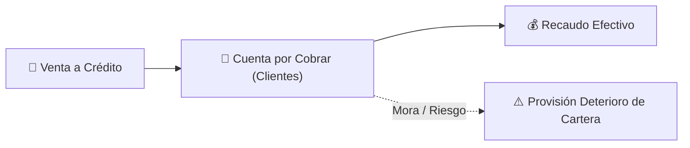

# 📚 06 - Cuentas por Cobrar e Inversiones

**Autora:** Caro Nuga (Contabletip)  
**Total de Publicaciones y Guías:** 11  
**Blog Oficial:** [contabletip.blogspot.com](https://contabletip.blogspot.com/)  
**Índice General del Vault:** [[00 - Índice General]]

> [!abstract] 🎯 Descripción del Módulo
> Tratamiento contable de los derechos de cobro: clientes, documentos por cobrar, estimación y cálculo del deterioro de cartera (provisión para cuentas incobrables) e inversiones financieras en acciones o bonos.

---

## 📑 Directorio Cronológico de Publicaciones del Módulo

| # | Fecha | Título del Artículo | Categorías / Etiquetas | YouTube | Nota en Obsidian |
| :-: | :---: | :--- | :--- | :---: | :--- |
| 01 | `2016-08-23` | **¿POR QUÉ NO SE DEPRECIAN LOS TERRENOS?** | `Contabilidad Básica`, `tema 2`, `tema 9` | — | 📑 [[2016-08-23 ¿POR QUÉ NO SE DEPRECIAN LOS TERRENOS\|Abrir Guía ↗]] |
| 02 | `2017-04-24` | **CUENTAS POR COBRAR CONCEPTO Y GENERALIDADES** | `Contabilidad Básica`, `tema 7` | [Ver Vídeo ↗](https://www.youtube.com/watch?v=Ymvs2v-9b8Y) | 📑 [[2017-04-24 CUENTAS POR COBRAR CONCEPTO Y GENERALIDADES\|Abrir Guía ↗]] |
| 03 | `2017-04-26` | **¿CUÁL ES LA DIFERENCIA ENTRE UNA CUENTA Y UN EFECTO POR COBRAR?** | `Contabilidad Básica`, `tema 7` | [Ver Vídeo ↗](https://www.youtube.com/watch?v=KRDbgplunQo) | 📑 [[2017-04-26 ¿CUÁL ES LA DIFERENCIA ENTRE UNA CUENTA Y UN EFECTO POR COBRAR\|Abrir Guía ↗]] |
| 04 | `2017-05-31` | **EJERCICIO CUENTAS POR COBRAR** | `Contabilidad Básica`, `tema 7` | [Ver Vídeo ↗](https://www.youtube.com/watch?v=u5SUbpTVW64) | 📑 [[2017-05-31 EJERCICIO CUENTAS POR COBRAR\|Abrir Guía ↗]] |
| 05 | `2019-04-12` | **¿EL TERRENO SE DEPRECIA?** | `Contabilidad Básica`, `tema 9` | [Ver Vídeo ↗](https://www.youtube.com/watch?v=tO8Jb0LNvVw) | 📑 [[2019-04-12 ¿EL TERRENO SE DEPRECIA\|Abrir Guía ↗]] |
| 06 | `2019-10-15` | **¿CÓMO RESTAR FECHAS EN EXCEL?** | `Contabilidad Básica`, `Finanzas Básicas`, `tema 9` | [Ver Vídeo ↗](https://www.youtube.com/watch?v=2RHsS0MnWzE) | 📑 [[2019-10-15 ¿CÓMO RESTAR FECHAS EN EXCEL\|Abrir Guía ↗]] |
| 07 | `2020-01-21` | **¿CUÁNTO COBRAR POR HONORARIOS?** | `Freelance`, `Profesión Contable`, `tips` | [Ver Vídeo ↗](https://www.youtube.com/watch?v=ZxozmVFK9Ps) | 📑 [[2020-01-21 ¿CUÁNTO COBRAR POR HONORARIOS\|Abrir Guía ↗]] |
| 08 | `2020-01-23` | **¿CÓMO CALCULAR LA TARIFA A COBRAR A TUS CLIENTES?** | `Freelance`, `Profesión Contable`, `tips` | [Ver Vídeo ↗](https://www.youtube.com/watch?v=xHx12yK--aM) | 📑 [[2020-01-23 ¿CÓMO CALCULAR LA TARIFA A COBRAR A TUS CLIENTES\|Abrir Guía ↗]] |
| 09 | `2024-04-24` | **¿CÓMO SE REGISTRA UNA GANANCIA EN VENTA DE ACTIVOS?** | `asientos contables basicos`, `Contabilidad Basica`, `tema 9` | [Ver Vídeo ↗](https://www.youtube.com/watch?v=AdQu-V3LwhE) | 📑 [[2024-04-24 ¿CÓMO SE REGISTRA UNA GANANCIA EN VENTA DE ACTIVOS\|Abrir Guía ↗]] |
| 10 | `2024-05-01` | **¿CÓMO SE REGISTRA UNA PÉRDIDA EN VENTA DE ACTIVOS?** | `asientos contables basicos`, `Contabilidad Básica`, `tema 9` | [Ver Vídeo ↗](https://www.youtube.com/watch?v=HAgPo2QMRWQ) | 📑 [[2024-05-01 ¿CÓMO SE REGISTRA UNA PÉRDIDA EN VENTA DE ACTIVOS\|Abrir Guía ↗]] |
| 11 | `2024-05-08` | **¿CÓMO SE REGISTRA UNA GANANCIA EN CANJE DE ACTIVOS?** | `asientos contables basicos`, `tema 9` | [Ver Vídeo ↗](https://www.youtube.com/watch?v=cGufFLrI2GY) | 📑 [[2024-05-08 ¿CÓMO SE REGISTRA UNA GANANCIA EN CANJE DE ACTIVOS\|Abrir Guía ↗]] |

---
> [!tip] 💡 Consejo de Contabletip
> *"Recuerda que la contabilidad no se aprende únicamente leyendo: toma lápiz, papel o tu hoja de cálculo y realiza los asientos contables hasta dominar la partida doble."*
