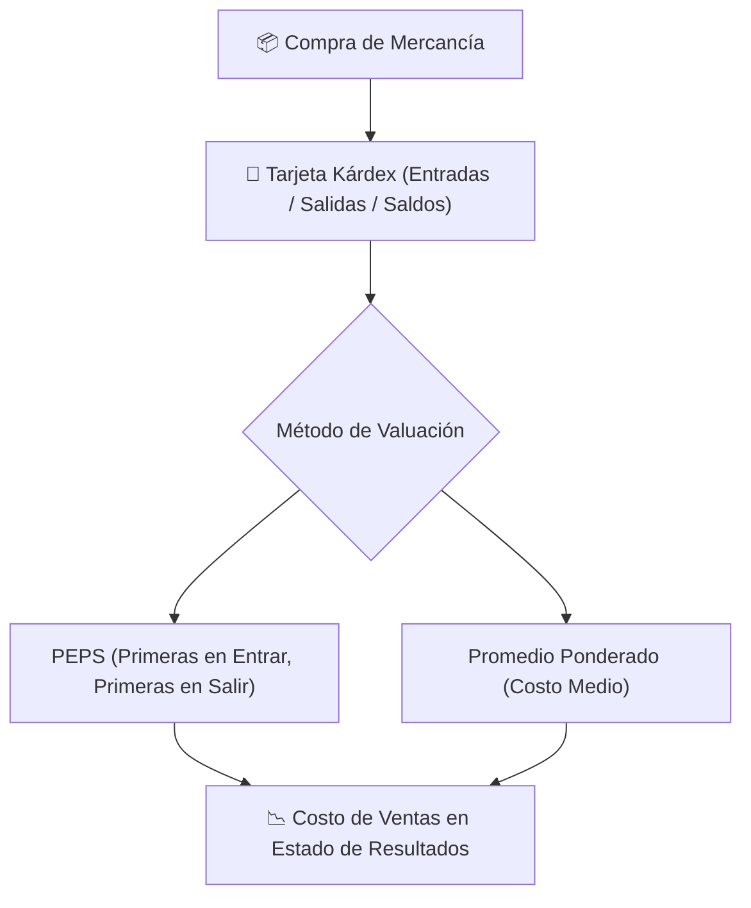

# 📚 07 - Inventarios y Métodos de Valuación

**Autora:** Caro Nuga (Contabletip)  
**Total de Publicaciones y Guías:** 27  
**Blog Oficial:** [contabletip.blogspot.com](https://contabletip.blogspot.com/)  
**Índice General del Vault:** [[00 - Índice General]]

> [!abstract] 🎯 Descripción del Módulo
> Control y valuación de existencias de mercancías: sistemas de inventario periódico y permanente (perpetuo), métodos de valuación (PEPS / FIFO, Promedio Ponderado), tarjetas Kárdex y ajuste por faltantes o sobrantes.

---

## 📑 Directorio Cronológico de Publicaciones del Módulo

| # | Fecha | Título del Artículo | Categorías / Etiquetas | YouTube | Nota en Obsidian |
| :-: | :---: | :--- | :--- | :---: | :--- |
| 01 | `2017-06-19` | **INVENTARIO CONCEPTO Y GENERALIDADES** | `Contabilidad Básica`, `tema 8` | [Ver Vídeo ↗](https://www.youtube.com/watch?v=uqdI5Y8NVNo) | 📑 [[2017-06-19 INVENTARIO CONCEPTO Y GENERALIDADES\|Abrir Guía ↗]] |
| 02 | `2017-06-21` | **¿ES INVENTARIO O NO?** | `Contabilidad Básica`, `tema 8` | [Ver Vídeo ↗](https://www.youtube.com/watch?v=M9NUDo1qhTo) | 📑 [[2017-06-21 ¿ES INVENTARIO O NO\|Abrir Guía ↗]] |
| 03 | `2017-06-26` | **¿CÓMO SE VALORAN LOS INVENTARIOS?** | `Contabilidad Básica`, `tema 8` | [Ver Vídeo ↗](https://www.youtube.com/watch?v=BmDA9p_eK7Y) | 📑 [[2017-06-26 ¿CÓMO SE VALORAN LOS INVENTARIOS\|Abrir Guía ↗]] |
| 04 | `2017-06-28` | **PÉRDIDA POR DETERIORO DE INVENTARIOS** | `Contabilidad Básica`, `tema 8` | [Ver Vídeo ↗](https://www.youtube.com/watch?v=WdN2ynVYTlE) | 📑 [[2017-06-28 PÉRDIDA POR DETERIORO DE INVENTARIOS\|Abrir Guía ↗]] |
| 05 | `2017-06-30` | **INFORMACIÓN A REVELAR SOBRE LOS INVENTARIOS** | `Contabilidad Básica`, `tema 8` | [Ver Vídeo ↗](https://www.youtube.com/watch?v=damZj1ILfmE) | 📑 [[2017-06-30 INFORMACIÓN A REVELAR SOBRE LOS INVENTARIOS\|Abrir Guía ↗]] |
| 06 | `2017-07-03` | **KARDEX DE INVENTARIO O CUADRO DE ENTRADAS Y SALIDAS** | `Contabilidad Básica`, `tema 8` | [Ver Vídeo ↗](https://www.youtube.com/watch?v=gfSRV8p8NoI) | 📑 [[2017-07-03 KARDEX DE INVENTARIO O CUADRO DE ENTRADAS Y SALIDAS\|Abrir Guía ↗]] |
| 07 | `2017-07-05` | **METODO DE UNIDADES ESPECIFICAS - VALORACION DE INVENTARIOS** | `Contabilidad Básica`, `tema 8` | [Ver Vídeo ↗](https://www.youtube.com/watch?v=PLREIMmeoX0) | 📑 [[2017-07-05 METODO DE UNIDADES ESPECIFICAS - VALORACION DE INVENTARIOS\|Abrir Guía ↗]] |
| 08 | `2019-01-09` | **MÉTODO DE PROMEDIO PONDERADO - VALORACIÓN DE INVENTARIOS** | `Contabilidad Básica`, `tema 8` | [Ver Vídeo ↗](https://www.youtube.com/watch?v=a1fGY78NBx8) | 📑 [[2019-01-09 MÉTODO DE PROMEDIO PONDERADO - VALORACIÓN DE INVENTARIOS\|Abrir Guía ↗]] |
| 09 | `2019-01-11` | **EJERCICIO 1 - VALORACIÓN DE INVENTARIOS PROMEDIO PONDERADO** | `Contabilidad Básica`, `tema 8` | [Ver Vídeo ↗](https://www.youtube.com/watch?v=HgexMi2Nguc) | 📑 [[2019-01-11 EJERCICIO 1 - VALORACIÓN DE INVENTARIOS PROMEDIO PONDERADO\|Abrir Guía ↗]] |
| 10 | `2019-01-16` | **EJERCICIO 2 VALORACIÓN INVENTARIO PROMEDIO PONDERADO** | `Contabilidad Básica`, `tema 8` | [Ver Vídeo ↗](https://www.youtube.com/watch?v=QDvVRHQ1Z7A) | 📑 [[2019-01-16 EJERCICIO 2 VALORACIÓN INVENTARIO PROMEDIO PONDERADO\|Abrir Guía ↗]] |
| 11 | `2019-01-18` | **MÉTODO DE VALORACIÓN PEPS O FIFO** | `Contabilidad Básica`, `tema 8` | [Ver Vídeo ↗](https://www.youtube.com/watch?v=D-TTYPqL0I4) | 📑 [[2019-01-18 MÉTODO DE VALORACIÓN PEPS O FIFO\|Abrir Guía ↗]] |
| 12 | `2019-01-23` | **EJERCICIO METODO DE VALORACIÓN INVENTARIOS PEPS O FIFO** | `Contabilidad Básica`, `tema 8` | [Ver Vídeo ↗](https://www.youtube.com/watch?v=latG0Ji06Bg) | 📑 [[2019-01-23 EJERCICIO METODO DE VALORACIÓN INVENTARIOS PEPS O FIFO\|Abrir Guía ↗]] |
| 13 | `2019-01-25` | **¿CÓMO RESOLVER UN EJERCICIO DE VALORACIÓN DE INVENTARIOS METODO PEPS SIN KARDEX?** | `Contabilidad Básica`, `tema 8` | [Ver Vídeo ↗](https://www.youtube.com/watch?v=uGqvxIKoXGs) | 📑 [[2019-01-25 ¿CÓMO RESOLVER UN EJERCICIO DE VALORACIÓN DE INVENTARIOS METODO PEPS SIN KARDEX\|Abrir Guía ↗]] |
| 14 | `2019-01-30` | **MÉTODO DE REGISTRO DE INVENTARIO PERIODICO** | `Contabilidad Básica`, `tema 8` | [Ver Vídeo ↗](https://www.youtube.com/watch?v=kAuAaUNTIis) | 📑 [[2019-01-30 MÉTODO DE REGISTRO DE INVENTARIO PERIODICO\|Abrir Guía ↗]] |
| 15 | `2019-02-08` | **EJERCICIO MÉTODO DE REGISTRO DE INVENTARIO PERIODICO** | `Contabilidad Básica`, `tema 8` | [Ver Vídeo ↗](https://www.youtube.com/watch?v=latG0Ji06Bg) | 📑 [[2019-02-08 EJERCICIO MÉTODO DE REGISTRO DE INVENTARIO PERIODICO\|Abrir Guía ↗]] |
| 16 | `2019-02-13` | **MÉTODO DE REGISTRO DE INVENTARIO PERPETUO** | `Contabilidad Básica`, `tema 8` | [Ver Vídeo ↗](https://www.youtube.com/watch?v=YSk95zKT-3U) | 📑 [[2019-02-13 MÉTODO DE REGISTRO DE INVENTARIO PERPETUO\|Abrir Guía ↗]] |
| 17 | `2019-02-15` | **EJERCICIO MÉTODO DE REGISTRO DE INVENTARIO PERPETUO** | `Contabilidad Básica`, `tema 8` | [Ver Vídeo ↗](https://www.youtube.com/watch?v=HgexMi2Nguc) | 📑 [[2019-02-15 EJERCICIO MÉTODO DE REGISTRO DE INVENTARIO PERPETUO\|Abrir Guía ↗]] |
| 18 | `2019-02-20` | **EJERCICIO SINIESTRO DE INVENTARIO** | `Contabilidad Básica`, `tema 8` | [Ver Vídeo ↗](https://www.youtube.com/watch?v=PW60QS4_17E) | 📑 [[2019-02-20 EJERCICIO SINIESTRO DE INVENTARIO\|Abrir Guía ↗]] |
| 19 | `2020-05-20` | **CUENTAS POR PAGAR PROVEEDORES O COMERCIALES** | `Contabilidad Básica`, `tema 10` | [Ver Vídeo ↗](https://www.youtube.com/watch?v=wxB3JyQLWSg) | 📑 [[2020-05-20 CUENTAS POR PAGAR PROVEEDORES O COMERCIALES\|Abrir Guía ↗]] |
| 20 | `2020-05-27` | **EJERCICIO CUENTAS POR PAGAR PROVEEDORES O COMERCIALES** | `Contabilidad Básica`, `tema 10` | [Ver Vídeo ↗](https://www.youtube.com/watch?v=4QNXIpR0DMI) | 📑 [[2020-05-27 EJERCICIO CUENTAS POR PAGAR PROVEEDORES O COMERCIALES\|Abrir Guía ↗]] |
| 21 | `2020-06-03` | **PRÉSTAMOS BANCARIOS ¿QUÉ SON? ¿CÓMO SE REGISTRAN?** | `Contabilidad Básica`, `tema 10` | [Ver Vídeo ↗](https://www.youtube.com/watch?v=wBVDAGz3F0k) | 📑 [[2020-06-03 PRÉSTAMOS BANCARIOS ¿QUÉ SON ¿CÓMO SE REGISTRAN\|Abrir Guía ↗]] |
| 22 | `2020-07-23` | **¿QUÉ SON LAS RETENCIONES LABORALES?** | `Contabilidad Básica`, `Empresas`, `tema 10` | [Ver Vídeo ↗](https://www.youtube.com/watch?v=FAUytaTA5ew) | 📑 [[2020-07-23 ¿QUÉ SON LAS RETENCIONES LABORALES\|Abrir Guía ↗]] |
| 23 | `2020-07-30` | **EJERCICIO CÁLCULO DE RETENCIONES LABORALES** | `Contabilidad Básica`, `Empresas`, `tema 10` | [Ver Vídeo ↗](https://www.youtube.com/watch?v=xoY70Zq9VXw) | 📑 [[2020-07-30 EJERCICIO CÁLCULO DE RETENCIONES LABORALES\|Abrir Guía ↗]] |
| 24 | `2020-08-20` | **¿QUÉ ES EL FINIQUITO O LIQUIDACIÓN DEL EMPLEADO?** | `Contabilidad Básica`, `Empresas`, `tema 10` | [Ver Vídeo ↗](https://www.youtube.com/watch?v=tM9UoEXPaEE) | 📑 [[2020-08-20 ¿QUÉ ES EL FINIQUITO O LIQUIDACIÓN DEL EMPLEADO\|Abrir Guía ↗]] |
| 25 | `2020-08-27` | **¿CÓMO SE CALCULA EL FINIQUITO POR RENUNCIA O FINALIZACIÓN DE CONTRATO?** | `Contabilidad Básica`, `Empresas`, `tema 10` | [Ver Vídeo ↗](https://www.youtube.com/watch?v=A9s59wExbQw) | 📑 [[2020-08-27 ¿CÓMO SE CALCULA EL FINIQUITO POR RENUNCIA O FINALIZACIÓN DE CONTRATO\|Abrir Guía ↗]] |
| 26 | `2020-09-03` | **¿CÓMO SE CALCULA EL FINIQUITO POR DESPIDO IMPROCEDENTE?** | `Contabilidad Básica`, `Empresas`, `tema 10` | [Ver Vídeo ↗](https://www.youtube.com/watch?v=giziPT1NCys) | 📑 [[2020-09-03 ¿CÓMO SE CALCULA EL FINIQUITO POR DESPIDO IMPROCEDENTE\|Abrir Guía ↗]] |
| 27 | `2024-05-29` | **METODO DE  LA UTILIDAD BRUTA PARA LA ESTIMACION DE INVENTARIOS** | `Contabilidad Basica`, `tema 8` | [Ver Vídeo ↗](https://www.youtube.com/watch?v=Ol1AZ-tbBjs) | 📑 [[2024-05-29 METODO DE LA UTILIDAD BRUTA PARA LA ESTIMACION DE INVENTARIOS\|Abrir Guía ↗]] |

---
> [!tip] 💡 Consejo de Contabletip
> *"Recuerda que la contabilidad no se aprende únicamente leyendo: toma lápiz, papel o tu hoja de cálculo y realiza los asientos contables hasta dominar la partida doble."*
