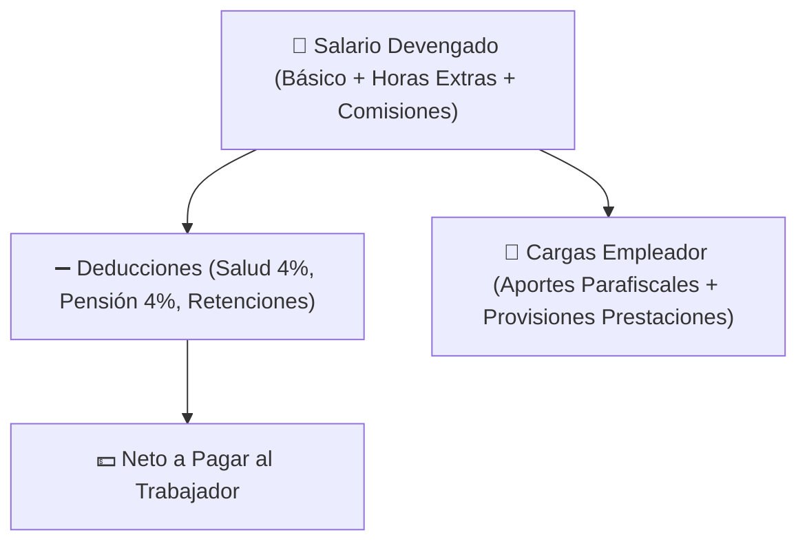

# 📚 09 - Pasivos, Nómina y Obligaciones

**Autora:** Caro Nuga (Contabletip)  
**Total de Publicaciones y Guías:** 17  
**Blog Oficial:** [contabletip.blogspot.com](https://contabletip.blogspot.com/)  
**Índice General del Vault:** [[00 - Índice General]]

> [!abstract] 🎯 Descripción del Módulo
> Obligaciones presentes de la empresa: pasivos corrientes y no corrientes, proveedores, acreedores, liquidación integral de nómina, aportes a seguridad social, retenciones en la fuente y prestaciones sociales.

---

## 📑 Directorio Cronológico de Publicaciones del Módulo

| # | Fecha | Título del Artículo | Categorías / Etiquetas | YouTube | Nota en Obsidian |
| :-: | :---: | :--- | :--- | :---: | :--- |
| 01 | `2016-06-16` | **DIFERENCIAS ENTRE CUENTAS REALES Y NOMINALES** | `Contabilidad Básica`, `tema 2` | — | 📑 [[2016-06-16 DIFERENCIAS ENTRE CUENTAS REALES Y NOMINALES\|Abrir Guía ↗]] |
| 02 | `2016-06-17` | **CUENTAS DE PASIVO** | `Contabilidad Básica`, `tema 2` | [Ver Vídeo ↗](https://www.youtube.com/watch?v=OCvvts9kfA8) | 📑 [[2016-06-17 CUENTAS DE PASIVO\|Abrir Guía ↗]] |
| 03 | `2016-09-19` | **SUJETO ACTIVO Y PASIVO - IVA** | `Contabilidad Básica`, `impuestos`, `tema 3` | [Ver Vídeo ↗](https://www.youtube.com/watch?v=4DnvT9Deg30) | 📑 [[2016-09-19 SUJETO ACTIVO Y PASIVO - IVA\|Abrir Guía ↗]] |
| 04 | `2017-01-20` | **COMPENSACIÓN DE ACTIVOS Y PASIVOS ¿SE REALIZA?** | `Contabilidad Básica`, `estados financieros`, `tema 5` | [Ver Vídeo ↗](https://www.youtube.com/watch?v=EVNn1XSpSPQ) | 📑 [[2017-01-20 COMPENSACIÓN DE ACTIVOS Y PASIVOS ¿SE REALIZA\|Abrir Guía ↗]] |
| 05 | `2017-03-15` | **SOBREGIRO BANCARIO ¿ACTIVO O PASIVO?** | `Contabilidad Básica`, `tema 6` | [Ver Vídeo ↗](https://www.youtube.com/watch?v=xVCWA5ZHCMM) | 📑 [[2017-03-15 SOBREGIRO BANCARIO ¿ACTIVO O PASIVO\|Abrir Guía ↗]] |
| 06 | `2020-04-01` | **PASIVOS, CONCEPTO Y GENERALIDADES** | `Contabilidad Básica`, `tema 10` | [Ver Vídeo ↗](https://www.youtube.com/watch?v=pVQHxU1bJ68) | 📑 [[2020-04-01 PASIVOS, CONCEPTO Y GENERALIDADES\|Abrir Guía ↗]] |
| 07 | `2020-06-25` | **PASIVOS EN MONEDA EXTRANJERA** | `Contabilidad Básica`, `tema 10` | [Ver Vídeo ↗](https://www.youtube.com/watch?v=zsQqvgJlLNM) | 📑 [[2020-06-25 PASIVOS EN MONEDA EXTRANJERA\|Abrir Guía ↗]] |
| 08 | `2020-07-02` | **EJERCICIO PASIVO EN MONEDA EXTRANJERA** | `Contabilidad Básica`, `tema 10` | [Ver Vídeo ↗](https://www.youtube.com/watch?v=2RCg4_wLVi4) | 📑 [[2020-07-02 EJERCICIO PASIVO EN MONEDA EXTRANJERA\|Abrir Guía ↗]] |
| 09 | `2020-07-09` | **¿QUÉ SON LOS PASIVOS LABORALES?** | `Contabilidad Básica`, `Empresas`, `tema 10` | [Ver Vídeo ↗](https://www.youtube.com/watch?v=UHo6Rljb4vk) | 📑 [[2020-07-09 ¿QUÉ SON LOS PASIVOS LABORALES\|Abrir Guía ↗]] |
| 10 | `2020-07-16` | **EJERCICIO PASIVOS LABORALES** | `Contabilidad Básica`, `Empresas`, `tema 10` | [Ver Vídeo ↗](https://www.youtube.com/watch?v=gVKsRQzS4FA) | 📑 [[2020-07-16 EJERCICIO PASIVOS LABORALES\|Abrir Guía ↗]] |
| 11 | `2020-08-06` | **¿CÓMO CALCULAR LA NÓMINA?** | `Contabilidad Básica`, `Empresas`, `tema 10` | [Ver Vídeo ↗](https://www.youtube.com/watch?v=ptmumXBbd_U) | 📑 [[2020-08-06 ¿CÓMO CALCULAR LA NÓMINA\|Abrir Guía ↗]] |
| 12 | `2020-08-13` | **¿CÓMO SE ELABORA UN RECIBO DE NÓMINA?** | `Contabilidad Básica`, `Empresas`, `tema 10` | [Ver Vídeo ↗](https://www.youtube.com/watch?v=kl2UBDgIqmk) | 📑 [[2020-08-13 ¿CÓMO SE ELABORA UN RECIBO DE NÓMINA\|Abrir Guía ↗]] |
| 13 | `2022-02-24` | **¿QUÉ SON LOS CRITERIOS DE VALORACIÓN CONTABLE?** | `Contabilidad Básica`, `tema 12` | [Ver Vídeo ↗](https://www.youtube.com/watch?v=4bG74C_d8Pw) | 📑 [[2022-02-24 ¿QUÉ SON LOS CRITERIOS DE VALORACIÓN CONTABLE\|Abrir Guía ↗]] |
| 14 | `2022-03-15` | **¿QUÉ ES EL VALOR RAZONABLE?** | `Contabilidad Básica`, `Tema 1 Fundamentos Básicos`, `tema 12` | [Ver Vídeo ↗](https://www.youtube.com/watch?v=5mZUMMQjgBE) | 📑 [[2022-03-15 ¿QUÉ ES EL VALOR RAZONABLE\|Abrir Guía ↗]] |
| 15 | `2022-03-17` | **¿QUÉ ES EL VALOR NETO REALIZABLE?** | `Contabilidad Básica`, `Tema 1 Fundamentos Básicos`, `tema 12` | [Ver Vídeo ↗](https://www.youtube.com/watch?v=s3VYXFwCtLM) | 📑 [[2022-03-17 ¿QUÉ ES EL VALOR NETO REALIZABLE\|Abrir Guía ↗]] |
| 16 | `2022-04-04` | **¿QUÉ ES EL VALOR EN USO?** | `Contabilidad Básica`, `tema 1`, `tema 12` | [Ver Vídeo ↗](https://www.youtube.com/watch?v=EvMxhLDgcqA) | 📑 [[2022-04-04 ¿QUÉ ES EL VALOR EN USO\|Abrir Guía ↗]] |
| 17 | `2022-04-07` | **DETERIORO DE LA PROPIEDAD, PLANTA Y EQUIPO** | `Contabilidad Básica`, `tema 12`, `tema 9` | [Ver Vídeo ↗](https://www.youtube.com/watch?v=Yc1HTojkiBY) | 📑 [[2022-04-07 DETERIORO DE LA PROPIEDAD, PLANTA Y EQUIPO\|Abrir Guía ↗]] |

---
> [!tip] 💡 Consejo de Contabletip
> *"Recuerda que la contabilidad no se aprende únicamente leyendo: toma lápiz, papel o tu hoja de cálculo y realiza los asientos contables hasta dominar la partida doble."*
