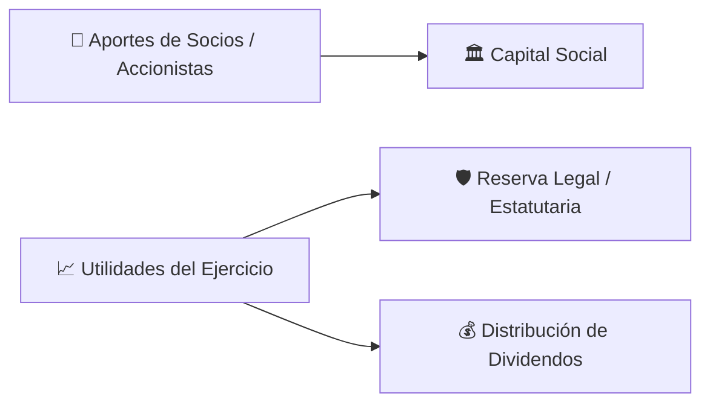

# 📚 10 - Patrimonio, Capital y Reservas

**Autora:** Caro Nuga (Contabletip)  
**Total de Publicaciones y Guías:** 40  
**Blog Oficial:** [contabletip.blogspot.com](https://contabletip.blogspot.com/)  
**Índice General del Vault:** [[00 - Índice General]]

> [!abstract] 🎯 Descripción del Módulo
> La inversión de los propietarios: capital social, emisión de acciones, reservas obligatorias y estatutarias, utilidades retenidas, distribución de dividendos y variaciones en el patrimonio neto.

---

## 📑 Directorio Cronológico de Publicaciones del Módulo

| # | Fecha | Título del Artículo | Categorías / Etiquetas | YouTube | Nota en Obsidian |
| :-: | :---: | :--- | :--- | :---: | :--- |
| 01 | `2016-06-20` | **CUENTAS DE PATRIMONIO** | `Contabilidad Básica`, `tema 2` | [Ver Vídeo ↗](https://www.youtube.com/watch?v=Dz8OhpyWbws) | 📑 [[2016-06-20 CUENTAS DE PATRIMONIO\|Abrir Guía ↗]] |
| 02 | `2020-09-18` | **PATRIMONIO, CONCEPTO Y GENERALIDADES** | `Contabilidad Básica`, `tema 11` | [Ver Vídeo ↗](https://www.youtube.com/watch?v=J4hGz8QSJFk) | 📑 [[2020-09-18 PATRIMONIO, CONCEPTO Y GENERALIDADES\|Abrir Guía ↗]] |
| 03 | `2020-09-25` | **PRINCIPIOS LEGALES QUE REGULAN EL CAPITAL SOCIAL** | `Contabilidad Básica`, `tema 11` | [Ver Vídeo ↗](https://www.youtube.com/watch?v=cTpTUrxuxcA) | 📑 [[2020-09-25 PRINCIPIOS LEGALES QUE REGULAN EL CAPITAL SOCIAL\|Abrir Guía ↗]] |
| 04 | `2020-10-02` | **¿QUÉ SON LAS ACCIONES? ASPECTOS LEGALES Y CARACTERÍSTICAS** | `Contabilidad Básica`, `tema 11` | [Ver Vídeo ↗](https://www.youtube.com/watch?v=mUm5AZVXvrM) | 📑 [[2020-10-02 ¿QUÉ SON LAS ACCIONES ASPECTOS LEGALES Y CARACTERÍSTICAS\|Abrir Guía ↗]] |
| 05 | `2020-10-09` | **¿QUÉ SE REGISTRA EN LA CUENTA DE CAPITAL SOCIAL?** | `Contabilidad Basica`, `tema 11` | [Ver Vídeo ↗](https://www.youtube.com/watch?v=2OPU6CHHhp8) | 📑 [[2020-10-09 ¿QUÉ SE REGISTRA EN LA CUENTA DE CAPITAL SOCIAL\|Abrir Guía ↗]] |
| 06 | `2020-10-16` | **¿QUÉ CUENTA DE CAPITAL USAN LAS EMPRESAS SIN FINES DE LUCRO?** | `Contabilidad Básica`, `tema 11` | [Ver Vídeo ↗](https://www.youtube.com/watch?v=T6JXtzurUmE) | 📑 [[2020-10-16 ¿QUÉ CUENTA DE CAPITAL USAN LAS EMPRESAS SIN FINES DE LUCRO\|Abrir Guía ↗]] |
| 07 | `2020-10-23` | **¿QUÉ CUENTA DE CAPITAL USA UN AUTÓNOMO O FREELANCE?** | `Contabilidad Basica`, `Contabilidad Básica`, `Profesión Contable` | [Ver Vídeo ↗](https://www.youtube.com/watch?v=0xtju3zMN_0) | 📑 [[2020-10-23 ¿QUÉ CUENTA DE CAPITAL USA UN AUTÓNOMO O FREELANCE\|Abrir Guía ↗]] |
| 08 | `2020-10-28` | **¿CÓMO SE CALCULA EL CAPITAL SOCIAL DE UNA EMPRESA?** | `Contabilidad Básica`, `preguntas tipo test` | [Ver Vídeo ↗](https://www.youtube.com/watch?v=la2yDZ2lbxE) | 📑 [[2020-10-28 ¿CÓMO SE CALCULA EL CAPITAL SOCIAL DE UNA EMPRESA\|Abrir Guía ↗]] |
| 09 | `2020-10-30` | **PATRIMONIO, INFORMACIÓN A REVELAR** | `Contabilidad Básica`, `tema 11` | [Ver Vídeo ↗](https://www.youtube.com/watch?v=gASJBgrVpAs) | 📑 [[2020-10-30 PATRIMONIO, INFORMACIÓN A REVELAR\|Abrir Guía ↗]] |
| 10 | `2020-11-04` | **¿QUÉ SON LAS ACCIONES COMUNES?** | `Contabilidad Básica`, `tema 11` | [Ver Vídeo ↗](https://www.youtube.com/watch?v=lJiOE3oYMSM) | 📑 [[2020-11-04 ¿QUÉ SON LAS ACCIONES COMUNES\|Abrir Guía ↗]] |
| 11 | `2020-12-10` | **EJERCICIO ACCIONES COMUNES A VALOR PAR O NOMINAL** | `Contabilidad Básica`, `tema 11` | [Ver Vídeo ↗](https://www.youtube.com/watch?v=5_jwTHVjHfQ) | 📑 [[2020-12-10 EJERCICIO ACCIONES COMUNES A VALOR PAR O NOMINAL\|Abrir Guía ↗]] |
| 12 | `2020-12-17` | **EJERCICIO PRIMA EN ACCIONES COMUNES** | `Contabilidad Básica`, `tema 11` | [Ver Vídeo ↗](https://www.youtube.com/watch?v=3JuIjtywbIs) | 📑 [[2020-12-17 EJERCICIO PRIMA EN ACCIONES COMUNES\|Abrir Guía ↗]] |
| 13 | `2021-01-07` | **EJERCICIO PAGO PARCIAL DE CAPITAL SOCIAL** | `Contabilidad Básica`, `tema 11` | [Ver Vídeo ↗](https://www.youtube.com/watch?v=3WWVmE5tvyk) | 📑 [[2021-01-07 EJERCICIO PAGO PARCIAL DE CAPITAL SOCIAL\|Abrir Guía ↗]] |
| 14 | `2021-11-08` | **DIFERENCIAS ENTRE ACCIONES COMUNES Y PREFERENTES** | `Contabilidad Básica`, `tema 11` | — | 📑 [[2021-11-08 DIFERENCIAS ENTRE ACCIONES COMUNES Y PREFERENTES\|Abrir Guía ↗]] |
| 15 | `2021-11-09` | **¿QUÉ SON LAS ACCIONES PREFERENTES?** | `Contabilidad Básica`, `tema 11` | [Ver Vídeo ↗](https://www.youtube.com/watch?v=BWNgT6iRNHM) | 📑 [[2021-11-09 ¿QUÉ SON LAS ACCIONES PREFERENTES\|Abrir Guía ↗]] |
| 16 | `2021-11-16` | **EJERCICIO ACCIONES PREFERENTES** | `Contabilidad Básica`, `tema 11` | [Ver Vídeo ↗](https://www.youtube.com/watch?v=FXnpmoyp4HM) | 📑 [[2021-11-16 EJERCICIO ACCIONES PREFERENTES\|Abrir Guía ↗]] |
| 17 | `2021-11-23` | **¿QUÉ SON LAS ACCIONES EN TESORERÍA?** | `Contabilidad Básica`, `tema 11` | [Ver Vídeo ↗](https://www.youtube.com/watch?v=BMGWhpcRjdw) | 📑 [[2021-11-23 ¿QUÉ SON LAS ACCIONES EN TESORERÍA\|Abrir Guía ↗]] |
| 18 | `2021-11-30` | **¿QUÉ ES UN SPLIT DE ACCIONES?** | `Contabilidad Básica`, `tema 11` | [Ver Vídeo ↗](https://www.youtube.com/watch?v=vtXqk3iKM8I) | 📑 [[2021-11-30 ¿QUÉ ES UN SPLIT DE ACCIONES\|Abrir Guía ↗]] |
| 19 | `2021-12-21` | **¿CUÁLES SON LAS CUENTAS DE RESERVA EN EL PATRIMONIO?** | `Contabilidad Básica`, `tema 11` | [Ver Vídeo ↗](https://www.youtube.com/watch?v=LYryitMUc1c) | 📑 [[2021-12-21 ¿CUÁLES SON LAS CUENTAS DE RESERVA EN EL PATRIMONIO\|Abrir Guía ↗]] |
| 20 | `2022-01-04` | **ESTADO DE MOVIMIENTO DE PATRIMONIO** | `Contabilidad Básica`, `tema 11` | [Ver Vídeo ↗](https://www.youtube.com/watch?v=SzEvtnmjX68) | 📑 [[2022-01-04 ESTADO DE MOVIMIENTO DE PATRIMONIO\|Abrir Guía ↗]] |
| 21 | `2022-05-04` | **¿QUÉ ES UN ERROR CONTABLE?** | `Contabilidad Básica`, `tema 13` | [Ver Vídeo ↗](https://www.youtube.com/watch?v=DKo1e8LryJk) | 📑 [[2022-05-04 ¿QUÉ ES UN ERROR CONTABLE\|Abrir Guía ↗]] |
| 22 | `2022-05-11` | **¿QUÉ ES UNA ESTIMACIÓN CONTABLE?** | `Contabilidad Básica`, `tema 13` | [Ver Vídeo ↗](https://www.youtube.com/watch?v=xkES81TLv20) | 📑 [[2022-05-11 ¿QUÉ ES UNA ESTIMACIÓN CONTABLE\|Abrir Guía ↗]] |
| 23 | `2022-05-18` | **¿QUÉ ES UNA POLITICA CONTABLE?** | `Contabilidad Básica`, `tema 13` | [Ver Vídeo ↗](https://www.youtube.com/watch?v=PYjBH9f2ZVA) | 📑 [[2022-05-18 ¿QUÉ ES UNA POLITICA CONTABLE\|Abrir Guía ↗]] |
| 24 | `2022-05-25` | **¿QUÉ ES UN AJUSTE CONTABLE?** | `Contabilidad Básica`, `tema 13` | [Ver Vídeo ↗](https://www.youtube.com/watch?v=StiD6WwUPvE) | 📑 [[2022-05-25 ¿QUÉ ES UN AJUSTE CONTABLE\|Abrir Guía ↗]] |
| 25 | `2022-05-31` | **¿CÓMO SE AJUSTA UN GASTO CUANDO SE CAUSA?** | `Contabilidad Básica`, `tema 13` | [Ver Vídeo ↗](https://www.youtube.com/watch?v=C0kjxURuFNo) | 📑 [[2022-05-31 ¿CÓMO SE AJUSTA UN GASTO CUANDO SE CAUSA\|Abrir Guía ↗]] |
| 26 | `2022-06-07` | **¿CÓMO SE AJUSTA UN INGRESO CUANDO SE CAUSA?** | `Contabilidad Básica`, `tema 13` | [Ver Vídeo ↗](https://www.youtube.com/watch?v=lJWUaJmZqB4) | 📑 [[2022-06-07 ¿CÓMO SE AJUSTA UN INGRESO CUANDO SE CAUSA\|Abrir Guía ↗]] |
| 27 | `2022-06-14` | **¿CÓMO SE AJUSTA UN GASTO DIFERIDO?** | `Contabilidad Básica`, `tema 13` | [Ver Vídeo ↗](https://www.youtube.com/watch?v=9LtMItZ9Sm4) | 📑 [[2022-06-14 ¿CÓMO SE AJUSTA UN GASTO DIFERIDO\|Abrir Guía ↗]] |
| 28 | `2022-06-21` | **¿COMO SE AJUSTA LA PROPIEDAD, PLANTA Y EQUIPO Y LOS ACTIVOS INTANGIBLES?** | `Contabilidad Básica`, `tema 13` | [Ver Vídeo ↗](https://www.youtube.com/watch?v=QKfj7xONQUg) | 📑 [[2022-06-21 ¿COMO SE AJUSTA LA PROPIEDAD, PLANTA Y EQUIPO Y LOS ACTIVOS INTANGIBLES\|Abrir Guía ↗]] |
| 29 | `2022-06-28` | **¿CÓMO SE AJUSTA UN INGRESO DIFERIDO?** | `Contabilidad Básica`, `tema 13` | [Ver Vídeo ↗](https://www.youtube.com/watch?v=QJ3oLFk-zpY) | 📑 [[2022-06-28 ¿CÓMO SE AJUSTA UN INGRESO DIFERIDO\|Abrir Guía ↗]] |
| 30 | `2022-07-06` | **AJUSTE POR DIFERENCIAL CAMBIARIO: CUENTAS DE ACTIVO** | `Contabilidad Básica`, `tema 13` | [Ver Vídeo ↗](https://www.youtube.com/watch?v=59JXASO-A0o) | 📑 [[2022-07-06 AJUSTE POR DIFERENCIAL CAMBIARIO CUENTAS DE ACTIVO\|Abrir Guía ↗]] |
| 31 | `2022-07-12` | **AJUSTE POR DIFERENCIAL CAMBIARIO: CUENTAS DE PASIVO** | `Contabilidad Básica`, `tema 13` | [Ver Vídeo ↗](https://www.youtube.com/watch?v=cYA6kOSSyow) | 📑 [[2022-07-12 AJUSTE POR DIFERENCIAL CAMBIARIO CUENTAS DE PASIVO\|Abrir Guía ↗]] |
| 32 | `2023-01-11` | **EJERCICIO AJUSTES** | `Contabilidad Basica`, `tema 13` | [Ver Vídeo ↗](https://www.youtube.com/watch?v=776H5xyCK60) | 📑 [[2023-01-11 EJERCICIO AJUSTES\|Abrir Guía ↗]] |
| 33 | `2023-01-18` | **EJERCICIO BALANCE DE COMPROBACIÓN AJUSTADO** | `Contabilidad Básica`, `tema 13` | [Ver Vídeo ↗](https://www.youtube.com/watch?v=fvB58AUR978) | 📑 [[2023-01-18 EJERCICIO BALANCE DE COMPROBACIÓN AJUSTADO\|Abrir Guía ↗]] |
| 34 | `2023-01-24` | **¿QUE ES LA HOJA DE TRABAJO? TIPS PARA SU ELABORACION** | `Contabilidad Básica`, `tema 13` | [Ver Vídeo ↗](https://www.youtube.com/watch?v=eL_8DVhFCsU) | 📑 [[2023-01-24 ¿QUE ES LA HOJA DE TRABAJO TIPS PARA SU ELABORACION\|Abrir Guía ↗]] |
| 35 | `2023-01-26` | **¿COMO ELABORAR EL FORMATO HOJA DE TRABAJO EN EXCEL?** | `Contabilidad Básica`, `tema 13` | [Ver Vídeo ↗](https://www.youtube.com/watch?v=OGGgadg1Ug4) | 📑 [[2023-01-26 ¿COMO ELABORAR EL FORMATO HOJA DE TRABAJO EN EXCEL\|Abrir Guía ↗]] |
| 36 | `2023-01-31` | **EJERCICIO HOJA DE TRABAJO** | `Contabilidad Básica`, `tema 13` | [Ver Vídeo ↗](https://www.youtube.com/watch?v=776H5xyCK60) | 📑 [[2023-01-31 EJERCICIO HOJA DE TRABAJO\|Abrir Guía ↗]] |
| 37 | `2024-06-05` | **¿COMO SE REGISTRA LA COMPRA DE INVERSION EN ACCIONES DISPONIBLES PARA LA VENTA?** | `asientos contables basicos`, `Contabilidad Básica` | [Ver Vídeo ↗](https://www.youtube.com/watch?v=NsrAPbzLsQ8) | 📑 [[2024-06-05 ¿COMO SE REGISTRA LA COMPRA DE INVERSION EN ACCIONES DISPONIBLES PARA LA VENTA\|Abrir Guía ↗]] |
| 38 | `2024-06-12` | **COBRO DE DIVIDENDOS DE UNA INVERSION EN ACCIONES** | `asientos contables basicos`, `Contabilidad Basica` | [Ver Vídeo ↗](https://www.youtube.com/watch?v=z_AjP3ac_Bw) | 📑 [[2024-06-12 COBRO DE DIVIDENDOS DE UNA INVERSION EN ACCIONES\|Abrir Guía ↗]] |
| 39 | `2024-11-26` | **¿COMO SE REGISTRA EL AJUSTE AL CIERRE DE UNA INVERSION EN ACCIONES MANTE...** | `asientos contables basicos`, `Contabilidad Básica` | [Ver Vídeo ↗](https://www.youtube.com/watch?v=SJa0O4yDBQA) | 📑 [[2024-11-26 ¿COMO SE REGISTRA EL AJUSTE AL CIERRE DE UNA INVERSION EN ACCIONES MANTE...\|Abrir Guía ↗]] |
| 40 | `2024-11-28` | **¿COMO SE REGISTRA UNA VENTA DE INVERSION EN ACCIONES?** | `asientos contables basicos`, `Contabilidad Basica` | [Ver Vídeo ↗](https://www.youtube.com/watch?v=fYRlN9u9a-A) | 📑 [[2024-11-28 ¿COMO SE REGISTRA UNA VENTA DE INVERSION EN ACCIONES\|Abrir Guía ↗]] |

---
> [!tip] 💡 Consejo de Contabletip
> *"Recuerda que la contabilidad no se aprende únicamente leyendo: toma lápiz, papel o tu hoja de cálculo y realiza los asientos contables hasta dominar la partida doble."*
