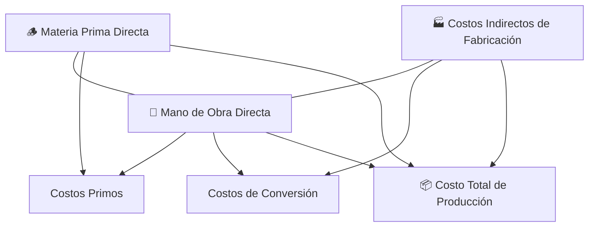

# 📚 11 - Contabilidad de Costos

**Autora:** Caro Nuga (Contabletip)  
**Total de Publicaciones y Guías:** 22  
**Blog Oficial:** [contabletip.blogspot.com](https://contabletip.blogspot.com/)  
**Índice General del Vault:** [[00 - Índice General]]

> [!abstract] 🎯 Descripción del Módulo
> Fundamentos de la contabilidad analítica industrial: los tres elementos del costo (Materia Prima Directa, Mano de Obra Directa y Costos Indirectos de Fabricación CIF), costos fijos y variables, y punto de equilibrio.

---

## 📑 Directorio Cronológico de Publicaciones del Módulo

| # | Fecha | Título del Artículo | Categorías / Etiquetas | YouTube | Nota en Obsidian |
| :-: | :---: | :--- | :--- | :---: | :--- |
| 01 | `2016-02-16` | **COSTO HISTÓRICO Y VALOR RAZONABLE** | `Contabilidad Básica`, `Tema 1 Fundamentos Básicos` | [Ver Vídeo ↗](https://www.youtube.com/watch?v=yWENqinwQZw) | 📑 [[2016-02-16 COSTO HISTÓRICO Y VALOR RAZONABLE\|Abrir Guía ↗]] |
| 02 | `2016-06-27` | **DIFERENCIA ENTRE COSTOS Y GASTOS** | `Contabilidad Básica`, `tema 2` | [Ver Vídeo ↗](https://www.youtube.com/watch?v=oxULUUqQ7z4) | 📑 [[2016-06-27 DIFERENCIA ENTRE COSTOS Y GASTOS\|Abrir Guía ↗]] |
| 03 | `2016-11-11` | **¿CÓMO HALLAR EL COSTO DE VENTAS?** | `Contabilidad Básica`, `estados financieros`, `tema 4` | [Ver Vídeo ↗](https://www.youtube.com/watch?v=1ehkzv-lA0w) | 📑 [[2016-11-11 ¿CÓMO HALLAR EL COSTO DE VENTAS\|Abrir Guía ↗]] |
| 04 | `2016-11-14` | **VENTAS Y COSTO DE VENTAS EN UNIDADES** | `Contabilidad Básica`, `estados financieros`, `tema 4` | [Ver Vídeo ↗](https://www.youtube.com/watch?v=Kf5Q21sABq4) | 📑 [[2016-11-14 VENTAS Y COSTO DE VENTAS EN UNIDADES\|Abrir Guía ↗]] |
| 05 | `2016-11-16` | **MARGEN DE UTILIDAD % DEL COSTO** | `Contabilidad Básica`, `estados financieros`, `tema 4` | [Ver Vídeo ↗](https://www.youtube.com/watch?v=HOhZS7-qyQY) | 📑 [[2016-11-16 MARGEN DE UTILIDAD % DEL COSTO\|Abrir Guía ↗]] |
| 06 | `2017-06-23` | **¿QUÉ FORMA PARTE DEL COSTO DE INVENTARIO?** | `Contabilidad Básica`, `tema 8` | [Ver Vídeo ↗](https://www.youtube.com/watch?v=fK6YKrnWJTY) | 📑 [[2017-06-23 ¿QUÉ FORMA PARTE DEL COSTO DE INVENTARIO\|Abrir Guía ↗]] |
| 07 | `2019-03-08` | **RECONOCIMIENTO INICIAL Y ELEMENTOS DEL COSTO EN LA PROPIEDAD, PLANTA Y EQUIPO** | `Contabilidad Básica`, `tema 9` | [Ver Vídeo ↗](https://www.youtube.com/watch?v=iBl-mglWvCI) | 📑 [[2019-03-08 RECONOCIMIENTO INICIAL Y ELEMENTOS DEL COSTO EN LA PROPIEDAD, PLANTA Y EQUIPO\|Abrir Guía ↗]] |
| 08 | `2019-10-08` | **¿CÓMO HALLAR EL COSTO DE LA PROPIEDAD, PLANTA Y EQUIPO?** | `Contabilidad Básica`, `tema 9` | [Ver Vídeo ↗](https://www.youtube.com/watch?v=slvxCV5D_3U) | 📑 [[2019-10-08 ¿CÓMO HALLAR EL COSTO DE LA PROPIEDAD, PLANTA Y EQUIPO\|Abrir Guía ↗]] |
| 09 | `2019-10-10` | **EJERCICIO: CÁLCULO COSTO DE ACTIVO FIJO CUANDO ES IMPORTADO** | `Contabilidad Básica`, `tema 9` | [Ver Vídeo ↗](https://www.youtube.com/watch?v=qw_5ygbCJuA) | 📑 [[2019-10-10 EJERCICIO CÁLCULO COSTO DE ACTIVO FIJO CUANDO ES IMPORTADO\|Abrir Guía ↗]] |
| 10 | `2020-09-28` | **CONTABILIDAD DE COSTOS ¿CON QUÉ LIBROS ESTUDIAR?** | `Contabilidad de Costos`, `Estudiantes`, `tips` | [Ver Vídeo ↗](https://www.youtube.com/watch?v=LO5mvsaXjes) | 📑 [[2020-09-28 CONTABILIDAD DE COSTOS ¿CON QUÉ LIBROS ESTUDIAR\|Abrir Guía ↗]] |
| 11 | `2020-10-26` | **¿CUÁLES SON LOS COSTOS DE LA INFLACIÓN?** | `Curso Finanzas Básicas` | [Ver Vídeo ↗](https://www.youtube.com/watch?v=qJaN6nzptpU) | 📑 [[2020-10-26 ¿CUÁLES SON LOS COSTOS DE LA INFLACIÓN\|Abrir Guía ↗]] |
| 12 | `2022-03-03` | **COSTO HISTÓRICO DE ADQUIRIR UN ACTIVO** | `Contabilidad Básica`, `tema 12` | [Ver Vídeo ↗](https://www.youtube.com/watch?v=O20iQVfEiUI) | 📑 [[2022-03-03 COSTO HISTÓRICO DE ADQUIRIR UN ACTIVO\|Abrir Guía ↗]] |
| 13 | `2022-03-08` | **COSTO HISTÓRICO DE PRODUCIR UN ACTIVO** | `Contabilidad Básica`, `tema 12` | [Ver Vídeo ↗](https://www.youtube.com/watch?v=oGmO7mBWXZk) | 📑 [[2022-03-08 COSTO HISTÓRICO DE PRODUCIR UN ACTIVO\|Abrir Guía ↗]] |
| 14 | `2022-03-10` | **COSTO HISTORICO DE UN PASIVO** | `Contabilidad Básica`, `tema 12` | [Ver Vídeo ↗](https://www.youtube.com/watch?v=OZM1TsWw8Go) | 📑 [[2022-03-10 COSTO HISTORICO DE UN PASIVO\|Abrir Guía ↗]] |
| 15 | `2022-04-20` | **COSTO AMORTIZADO** | `Contabilidad Básica`, `Matemáticas Básicas`, `tema 1` | [Ver Vídeo ↗](https://www.youtube.com/watch?v=nxoeaXNfHdo) | 📑 [[2022-04-20 COSTO AMORTIZADO\|Abrir Guía ↗]] |
| 16 | `2023-02-10` | **¿QUE ES EL ESTADO DE FLUJO DE EFECTIVO?** | `tema 14` | [Ver Vídeo ↗](https://www.youtube.com/watch?v=CceRuMQKvBs) | 📑 [[2023-02-10 ¿QUE ES EL ESTADO DE FLUJO DE EFECTIVO\|Abrir Guía ↗]] |
| 17 | `2023-02-16` | **¿COMO SE CLASIFICAN LAS ACTIVIDADES EN EL ESTADO FLUJO DE EFECTIVO?** | `Contabilidad Básica`, `tema 14` | [Ver Vídeo ↗](https://www.youtube.com/watch?v=xtM3CZA8AyM) | 📑 [[2023-02-16 ¿COMO SE CLASIFICAN LAS ACTIVIDADES EN EL ESTADO FLUJO DE EFECTIVO\|Abrir Guía ↗]] |
| 18 | `2023-02-23` | **EJERCICIO CLASIFICACION ACTIVIDADES EN EL ESTADO DE FLUJO DE EFECTIVO** | `tema 14` | [Ver Vídeo ↗](https://www.youtube.com/watch?v=LftbIPUsHjQ) | 📑 [[2023-02-23 EJERCICIO CLASIFICACION ACTIVIDADES EN EL ESTADO DE FLUJO DE EFECTIVO\|Abrir Guía ↗]] |
| 19 | `2023-03-02` | **ESTADO DE FLUJO DE EFECTIVO METODO INDIRECTO** | `Contabilidad Básica`, `tema 14` | [Ver Vídeo ↗](https://www.youtube.com/watch?v=7wyH-BDftP8) | 📑 [[2023-03-02 ESTADO DE FLUJO DE EFECTIVO METODO INDIRECTO\|Abrir Guía ↗]] |
| 20 | `2023-03-09` | **EJERCICIO ESTADO FLUJO DE EFECTIVO METODO INDIRECTO** | `Contabilidad Básica`, `tema 14` | [Ver Vídeo ↗](https://www.youtube.com/watch?v=LftbIPUsHjQ) | 📑 [[2023-03-09 EJERCICIO ESTADO FLUJO DE EFECTIVO METODO INDIRECTO\|Abrir Guía ↗]] |
| 21 | `2023-03-16` | **ESTADO DE FLUJO DE EFECTIVO METODO DIRECTO** | `Contabilidad Básica`, `tema 14` | [Ver Vídeo ↗](https://www.youtube.com/watch?v=7wyH-BDftP8) | 📑 [[2023-03-16 ESTADO DE FLUJO DE EFECTIVO METODO DIRECTO\|Abrir Guía ↗]] |
| 22 | `2023-03-23` | **EJERCICIO ESTADO DE FLUJO DE EFECTIVO METODO DIRECTO** | `Contabilidad Básica`, `tema 14` | [Ver Vídeo ↗](https://www.youtube.com/watch?v=aSGBFQhLF7I) | 📑 [[2023-03-23 EJERCICIO ESTADO DE FLUJO DE EFECTIVO METODO DIRECTO\|Abrir Guía ↗]] |

---
> [!tip] 💡 Consejo de Contabletip
> *"Recuerda que la contabilidad no se aprende únicamente leyendo: toma lápiz, papel o tu hoja de cálculo y realiza los asientos contables hasta dominar la partida doble."*
