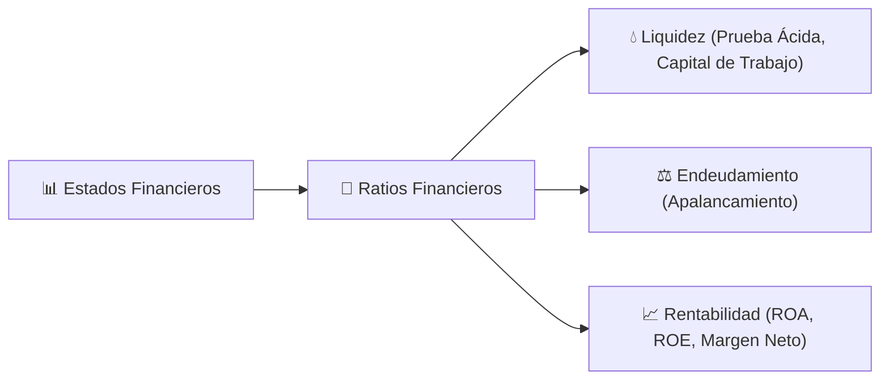

# 📚 12 - Finanzas y Análisis Financiero

**Autora:** Caro Nuga (Contabletip)  
**Total de Publicaciones y Guías:** 59  
**Blog Oficial:** [contabletip.blogspot.com](https://contabletip.blogspot.com/)  
**Índice General del Vault:** [[00 - Índice General]]

> [!abstract] 🎯 Descripción del Módulo
> Herramientas de evaluación financiera y matemática empresarial: análisis vertical y horizontal de estados financieros, ratios de liquidez, rentabilidad, endeudamiento, interés simple, compuesto y amortización.

---

## 📑 Directorio Cronológico de Publicaciones del Módulo

| # | Fecha | Título del Artículo | Categorías / Etiquetas | YouTube | Nota en Obsidian |
| :-: | :---: | :--- | :--- | :---: | :--- |
| 01 | `2017-05-03` | **INTERESES DE MORA - FORMULA DE INTERÉS SIMPLE** | `Contabilidad Básica`, `tema 7` | [Ver Vídeo ↗](https://www.youtube.com/watch?v=Sqc2we8DG80) | 📑 [[2017-05-03 INTERESES DE MORA - FORMULA DE INTERÉS SIMPLE\|Abrir Guía ↗]] |
| 02 | `2020-02-07` | **EJERCICIO ECUACIÓN DE PRIMER GRADO** | `Matematicas`, `Matemáticas Básicas` | [Ver Vídeo ↗](https://www.youtube.com/watch?v=lImomtnv04E) | 📑 [[2020-02-07 EJERCICIO ECUACIÓN DE PRIMER GRADO\|Abrir Guía ↗]] |
| 03 | `2020-02-14` | **EJERCICIO CÁLCULO PORCENTAJE** | `Matematicas`, `Matemáticas Básicas` | [Ver Vídeo ↗](https://www.youtube.com/watch?v=D_lr92bicIM) | 📑 [[2020-02-14 EJERCICIO CÁLCULO PORCENTAJE\|Abrir Guía ↗]] |
| 04 | `2020-02-21` | **EJERCICIO REGLA DE TRES DIRECTA** | `Matematicas`, `Matemáticas Básicas` | [Ver Vídeo ↗](https://www.youtube.com/watch?v=SLNV6ufQjDQ) | 📑 [[2020-02-21 EJERCICIO REGLA DE TRES DIRECTA\|Abrir Guía ↗]] |
| 05 | `2020-02-28` | **EJERCICIO DIVISIÓN CON DECIMALES** | `Matematicas`, `Matemáticas Básicas` | [Ver Vídeo ↗](https://www.youtube.com/watch?v=sq-6GKv--uE) | 📑 [[2020-02-28 EJERCICIO DIVISIÓN CON DECIMALES\|Abrir Guía ↗]] |
| 06 | `2020-03-06` | **EJERCICIO SUCESIÓN DE NÚMEROS NATURALES** | `Matematicas`, `Matemáticas Básicas` | [Ver Vídeo ↗](https://www.youtube.com/watch?v=Coqq7DzOhH0) | 📑 [[2020-03-06 EJERCICIO SUCESIÓN DE NÚMEROS NATURALES\|Abrir Guía ↗]] |
| 07 | `2020-04-03` | **EJERCICIO ECUACIÓN EQUIVALENTE** | `Matematicas`, `Matemáticas Básicas` | [Ver Vídeo ↗](https://www.youtube.com/watch?v=JqLIIaWLFGE) | 📑 [[2020-04-03 EJERCICIO ECUACIÓN EQUIVALENTE\|Abrir Guía ↗]] |
| 08 | `2020-04-07` | **¿CÓMO SE REGISTRA EL COBRO DE UNA FACTURA VENCIDA CON INTERESES DE MORA?** | `asientos contables basicos`, `Contabilidad Básica` | [Ver Vídeo ↗](https://www.youtube.com/watch?v=tGM9u4mlpN0) | 📑 [[2020-04-07 ¿CÓMO SE REGISTRA EL COBRO DE UNA FACTURA VENCIDA CON INTERESES DE MORA\|Abrir Guía ↗]] |
| 09 | `2020-05-22` | **EJERCICIO REGLA DE TRES INVERSA** | `Matematicas`, `Matemáticas Básicas` | [Ver Vídeo ↗](https://www.youtube.com/watch?v=5inpiTr9pqw) | 📑 [[2020-05-22 EJERCICIO REGLA DE TRES INVERSA\|Abrir Guía ↗]] |
| 10 | `2020-05-29` | **EJERCICIO PROGRESIÓN GEOMÉTRICA** | `Matematicas`, `Matemáticas Básicas` | [Ver Vídeo ↗](https://www.youtube.com/watch?v=XFcbxB8InJk) | 📑 [[2020-05-29 EJERCICIO PROGRESIÓN GEOMÉTRICA\|Abrir Guía ↗]] |
| 11 | `2020-06-05` | **EJERCICIO SUMA DE FRACCIONES CON DISTINTO DENOMINADOR** | `Matematicas`, `Matemáticas Básicas` | [Ver Vídeo ↗](https://www.youtube.com/watch?v=Wr_ZBXfAmDE) | 📑 [[2020-06-05 EJERCICIO SUMA DE FRACCIONES CON DISTINTO DENOMINADOR\|Abrir Guía ↗]] |
| 12 | `2020-06-10` | **EJERCICIO PRÉSTAMOS BANCARIOS CON INTERESES AL VENCIMIENTO** | `Contabilidad Básica`, `tema 10` | [Ver Vídeo ↗](https://www.youtube.com/watch?v=YkohTMqlom0) | 📑 [[2020-06-10 EJERCICIO PRÉSTAMOS BANCARIOS CON INTERESES AL VENCIMIENTO\|Abrir Guía ↗]] |
| 13 | `2020-06-12` | **EJERCICIO EXPRESIÓN EN TÉRMINOS DECIMALES** | `Matematicas`, `Matemáticas Básicas` | [Ver Vídeo ↗](https://www.youtube.com/watch?v=n0OjJAoynGE) | 📑 [[2020-06-12 EJERCICIO EXPRESIÓN EN TÉRMINOS DECIMALES\|Abrir Guía ↗]] |
| 14 | `2020-06-17` | **EJERCICIO PRÉSTAMO BANCARIO CON INTERESES COBRADOS POR ANTICIPADO** | `Contabilidad Básica`, `tema 10` | [Ver Vídeo ↗](https://www.youtube.com/watch?v=a8anMJbBlGE) | 📑 [[2020-06-17 EJERCICIO PRÉSTAMO BANCARIO CON INTERESES COBRADOS POR ANTICIPADO\|Abrir Guía ↗]] |
| 15 | `2020-06-19` | **EJERCICIO SUSTITUCION DE VALORES EN EXPRESIONES ALGEBRAICAS** | `Matematicas`, `Matemáticas Básicas` | [Ver Vídeo ↗](https://www.youtube.com/watch?v=RfntKH74Ffk) | 📑 [[2020-06-19 EJERCICIO SUSTITUCION DE VALORES EN EXPRESIONES ALGEBRAICAS\|Abrir Guía ↗]] |
| 16 | `2020-07-21` | **¿CÓMO SE REGISTRA EL PAGO DE UNA FACTURA VENCIDA CON INTERESES DE MORA?** | `asientos contables basicos`, `Contabilidad Básica` | [Ver Vídeo ↗](https://www.youtube.com/watch?v=9DYP0D9blmo) | 📑 [[2020-07-21 ¿CÓMO SE REGISTRA EL PAGO DE UNA FACTURA VENCIDA CON INTERESES DE MORA\|Abrir Guía ↗]] |
| 17 | `2020-10-05` | **¿POR QUÉ ESTUDIAR FINANZAS?** | `Curso Finanzas Básicas` | [Ver Vídeo ↗](https://www.youtube.com/watch?v=3bGgIGMWFw0) | 📑 [[2020-10-05 ¿POR QUÉ ESTUDIAR FINANZAS\|Abrir Guía ↗]] |
| 18 | `2020-10-07` | **¿CÓMO SE CALCULAN LOS INTERESES DE MORA?** | `Contabilidad Basica`, `preguntas tipo test` | [Ver Vídeo ↗](https://www.youtube.com/watch?v=gK6f-XTEtEk) | 📑 [[2020-10-07 ¿CÓMO SE CALCULAN LOS INTERESES DE MORA\|Abrir Guía ↗]] |
| 19 | `2020-10-12` | **¿QUÉ ES EL DINERO?** | `Curso Finanzas Básicas` | [Ver Vídeo ↗](https://www.youtube.com/watch?v=GY_HqpXsTko) | 📑 [[2020-10-12 ¿QUÉ ES EL DINERO\|Abrir Guía ↗]] |
| 20 | `2020-10-19` | **¿QUÉ ES LA INFLACIÓN?** | `Curso Finanzas Básicas` | [Ver Vídeo ↗](https://www.youtube.com/watch?v=kAQz3nY_2YQ) | 📑 [[2020-10-19 ¿QUÉ ES LA INFLACIÓN\|Abrir Guía ↗]] |
| 21 | `2020-11-02` | **¿QUÉ HACER SI HAY HIPERINFLACIÓN?** | `Curso Finanzas Básicas` | [Ver Vídeo ↗](https://www.youtube.com/watch?v=0M2HbCHJcCc) | 📑 [[2020-11-02 ¿QUÉ HACER SI HAY HIPERINFLACIÓN\|Abrir Guía ↗]] |
| 22 | `2020-12-15` | **FUENTES DE INGRESO: TRABAJO POR CUENTA AJENA O BAJO RELACIÓN DE DEPENDENCIA** | `Curso Finanzas Básicas` | [Ver Vídeo ↗](https://www.youtube.com/watch?v=DdJ2m8yTYos) | 📑 [[2020-12-15 FUENTES DE INGRESO TRABAJO POR CUENTA AJENA O BAJO RELACIÓN DE DEPENDENCIA\|Abrir Guía ↗]] |
| 23 | `2020-12-22` | **FUENTES DE INGRESO: TRABAJO COMO AUTÓNOMO O FREELANCE** | `Curso Finanzas Básicas` | [Ver Vídeo ↗](https://www.youtube.com/watch?v=DtvQKnxyOrs) | 📑 [[2020-12-22 FUENTES DE INGRESO TRABAJO COMO AUTÓNOMO O FREELANCE\|Abrir Guía ↗]] |
| 24 | `2021-01-05` | **FUENTES DE INGRESOS: SER EMPRESARIO** | `Curso Finanzas Básicas` | [Ver Vídeo ↗](https://www.youtube.com/watch?v=aMCfwy3rKLI) | 📑 [[2021-01-05 FUENTES DE INGRESOS SER EMPRESARIO\|Abrir Guía ↗]] |
| 25 | `2022-02-08` | **¿EN QUÉ INVERTIR?** | `Curso Finanzas Básicas` | [Ver Vídeo ↗](https://www.youtube.com/watch?v=LjMY7lsVWkY) | 📑 [[2022-02-08 ¿EN QUÉ INVERTIR\|Abrir Guía ↗]] |
| 26 | `2022-02-10` | **¿CÓMO ORGANIZAR TUS GASTOS?** | `Curso Finanzas Básicas` | [Ver Vídeo ↗](https://www.youtube.com/watch?v=npFpiAzixsc) | 📑 [[2022-02-10 ¿CÓMO ORGANIZAR TUS GASTOS\|Abrir Guía ↗]] |
| 27 | `2022-02-14` | **¿CÓMO ELABORAR TU FLUJO DE CAJA?** | `Curso Finanzas Básicas` | [Ver Vídeo ↗](https://www.youtube.com/watch?v=04Un1oW3m2E) | 📑 [[2022-02-14 ¿CÓMO ELABORAR TU FLUJO DE CAJA\|Abrir Guía ↗]] |
| 28 | `2022-02-22` | **¿CÓMO ELABORAR TU BALANCE PERSONAL?** | `Contabilidad Básica`, `Curso Finanzas Básicas`, `tema 5` | [Ver Vídeo ↗](https://www.youtube.com/watch?v=PoberUMlAUE) | 📑 [[2022-02-22 ¿CÓMO ELABORAR TU BALANCE PERSONAL\|Abrir Guía ↗]] |
| 29 | `2022-03-21` | **VALOR ACTUAL O VALOR PRESENTE - CÁLCULO MANUAL** | `Contabilidad Básica`, `Matematicas`, `tema 1` | [Ver Vídeo ↗](https://www.youtube.com/watch?v=EDyqxxoJRZM) | 📑 [[2022-03-21 VALOR ACTUAL O VALOR PRESENTE - CÁLCULO MANUAL\|Abrir Guía ↗]] |
| 30 | `2022-03-24` | **VALOR ACTUAL CUANDO LOS TÉRMINOS Y LA TASA ES CONSTANTE, FÓRMULA EXCEL: VA** | `Contabilidad Básica`, `Matematicas`, `tema 1` | [Ver Vídeo ↗](https://www.youtube.com/watch?v=3cw9gwBqZ6Y) | 📑 [[2022-03-24 VALOR ACTUAL CUANDO LOS TÉRMINOS Y LA TASA ES CONSTANTE, FÓRMULA EXCEL VA\|Abrir Guía ↗]] |
| 31 | `2022-03-28` | **VALOR ACTUAL CUANDO LOS TÉRMINOS SON VARIABLES, EQUIDISTANTES Y LA TASA ES CONSTANTE, FÓRMULA EXCEL: VNA** | `Contabilidad Básica`, `Matematicas`, `tema 1` | [Ver Vídeo ↗](https://www.youtube.com/watch?v=wO-8QyLeR50) | 📑 [[2022-03-28 VALOR ACTUAL CUANDO LOS TÉRMINOS SON VARIABLES, EQUIDISTANTES Y LA TASA ES CONSTANTE, FÓRMULA EXCEL VNA\|Abrir Guía ↗]] |
| 32 | `2022-03-31` | **VALOR ACTUAL CUANDO LOS TÉRMINOS SON VARIABLES, NO EQUIDISTANTES Y LA TASA ES CONSTANTE, FÓRMULA EXCEL: VNA.NO.PER** | `Contabilidad Básica`, `Matematicas`, `tema 1` | [Ver Vídeo ↗](https://www.youtube.com/watch?v=IpUQkDZ5GsQ) | 📑 [[2022-03-31 VALOR ACTUAL CUANDO LOS TÉRMINOS SON VARIABLES, NO EQUIDISTANTES Y LA TASA ES CONSTANTE, FÓRMULA EXCEL VNA.NO\|Abrir Guía ↗]] |
| 33 | `2022-04-11` | **¿QUÉ ES LA TASA DE INTERÉS EFECTIVA O TIR?** | `Contabilidad Básica`, `Matemáticas Básicas`, `tema 1` | [Ver Vídeo ↗](https://www.youtube.com/watch?v=ujKHfSQhI6U) | 📑 [[2022-04-11 ¿QUÉ ES LA TASA DE INTERÉS EFECTIVA O TIR\|Abrir Guía ↗]] |
| 34 | `2022-04-13` | **TASA DE INTERÉS EFECTIVA CUANDO LOS FLUJOS NO SON PERIODICOS** | `Contabilidad Básica`, `Matematicas`, `tema 1` | [Ver Vídeo ↗](https://www.youtube.com/watch?v=uU4tpSxx0oI) | 📑 [[2022-04-13 TASA DE INTERÉS EFECTIVA CUANDO LOS FLUJOS NO SON PERIODICOS\|Abrir Guía ↗]] |
| 35 | `2023-03-30` | **ANALISIS DE ESTADOS FINANCIEROS** | `Contabilidad Básica`, `estados financieros`, `tema 15` | [Ver Vídeo ↗](https://www.youtube.com/watch?v=5WZi8-yjblo) | 📑 [[2023-03-30 ANALISIS DE ESTADOS FINANCIEROS\|Abrir Guía ↗]] |
| 36 | `2023-04-05` | **ANALISIS HORIZONTAL DE LOS ESTADOS FINANCIEROS** | `Contabilidad Básica`, `tema 15` | [Ver Vídeo ↗](https://www.youtube.com/watch?v=EoJhJfIsnbY) | 📑 [[2023-04-05 ANALISIS HORIZONTAL DE LOS ESTADOS FINANCIEROS\|Abrir Guía ↗]] |
| 37 | `2023-04-12` | **ANALISIS VERTICAL ESTADOS FINANCIEROS** | `Contabilidad Básica`, `tema 15` | [Ver Vídeo ↗](https://www.youtube.com/watch?v=13D6V2L2YPw) | 📑 [[2023-04-12 ANALISIS VERTICAL ESTADOS FINANCIEROS\|Abrir Guía ↗]] |
| 38 | `2023-04-19` | **ESTADOS FINANCIEROS DE BASE COMUN** | `Contabilidad Básica`, `tema 15` | [Ver Vídeo ↗](https://www.youtube.com/watch?v=13D6V2L2YPw) | 📑 [[2023-04-19 ESTADOS FINANCIEROS DE BASE COMUN\|Abrir Guía ↗]] |
| 39 | `2023-04-27` | **¿QUE ES UNA RAZON FINANCIERA?** | `Contabilidad Básica`, `tema 15` | [Ver Vídeo ↗](https://www.youtube.com/watch?v=Hj7iv2SnCRE) | 📑 [[2023-04-27 ¿QUE ES UNA RAZON FINANCIERA\|Abrir Guía ↗]] |
| 40 | `2023-05-04` | **TIPOS DE RAZONES FINANCIERAS** | `Contabilidad Básica`, `tema 15` | [Ver Vídeo ↗](https://www.youtube.com/watch?v=p4bMC7Rguho) | 📑 [[2023-05-04 TIPOS DE RAZONES FINANCIERAS\|Abrir Guía ↗]] |
| 41 | `2023-05-18` | **RAZON DE LIQUIDEZ** | `Contabilidad Básica`, `tema 15` | [Ver Vídeo ↗](https://www.youtube.com/watch?v=Gc-CU8YXsv0) | 📑 [[2023-05-18 RAZON DE LIQUIDEZ\|Abrir Guía ↗]] |
| 42 | `2023-05-24` | **¿COMO CALCULAR LA PRUEBA ACIDA? ANALISIS DE ESTADOS FINANCIEROS** | `Contabilidad Básica`, `tema 15` | [Ver Vídeo ↗](https://www.youtube.com/watch?v=-rx3VTkuMAI) | 📑 [[2023-05-24 ¿COMO CALCULAR LA PRUEBA ACIDA ANALISIS DE ESTADOS FINANCIEROS\|Abrir Guía ↗]] |
| 43 | `2023-05-31` | **¿COMO SE CALCULA LA ROTACION DE CUENTAS POR COBRAR?** | `Contabilidad Básica`, `tema 15` | [Ver Vídeo ↗](https://www.youtube.com/watch?v=6R0KS7Mwv5M) | 📑 [[2023-05-31 ¿COMO SE CALCULA LA ROTACION DE CUENTAS POR COBRAR\|Abrir Guía ↗]] |
| 44 | `2023-06-08` | **¿COMO CALCULAR LOS DIAS DE CUENTAS POR COBRAR?** | `Contabilidad Básica`, `tema 15` | [Ver Vídeo ↗](https://www.youtube.com/watch?v=39XL0Qyj21U) | 📑 [[2023-06-08 ¿COMO CALCULAR LOS DIAS DE CUENTAS POR COBRAR\|Abrir Guía ↗]] |
| 45 | `2023-06-14` | **ANALISIS CUENTAS POR COBRAR VENCIDAS** | `Contabilidad Básica`, `tema 15` | [Ver Vídeo ↗](https://www.youtube.com/watch?v=sqHTAbx3TPs) | 📑 [[2023-06-14 ANALISIS CUENTAS POR COBRAR VENCIDAS\|Abrir Guía ↗]] |
| 46 | `2023-06-21` | **¿COMO CALCULAR LA ROTACION DE INVENTARIOS?** | `Contabilidad Básica`, `tema 15` | [Ver Vídeo ↗](https://www.youtube.com/watch?v=rBkTZUYH_kk) | 📑 [[2023-06-21 ¿COMO CALCULAR LA ROTACION DE INVENTARIOS\|Abrir Guía ↗]] |
| 47 | `2023-06-28` | **¿COMO CALCULAR LOS DIAS DE INVENTARIOS?** | `Contabilidad Básica`, `tema 15` | [Ver Vídeo ↗](https://www.youtube.com/watch?v=WQfJEnsHI6E) | 📑 [[2023-06-28 ¿COMO CALCULAR LOS DIAS DE INVENTARIOS\|Abrir Guía ↗]] |
| 48 | `2023-07-05` | **CICLO DE OPERACION DE UNA EMPRESA** | `Contabilidad Básica`, `tema 15` | [Ver Vídeo ↗](https://www.youtube.com/watch?v=u_RxnoRJQkA) | 📑 [[2023-07-05 CICLO DE OPERACION DE UNA EMPRESA\|Abrir Guía ↗]] |
| 49 | `2023-07-12` | **¿QUE ES EL APALANCAMIENTO FINANCIERO?** | `Contabilidad Básica`, `tema 15` | [Ver Vídeo ↗](https://www.youtube.com/watch?v=tNCWhzD3hfY) | 📑 [[2023-07-12 ¿QUE ES EL APALANCAMIENTO FINANCIERO\|Abrir Guía ↗]] |
| 50 | `2023-07-19` | **ROTACION DE ACTIVOS TOTALES** | `Contabilidad Básica`, `tema 15` | [Ver Vídeo ↗](https://www.youtube.com/watch?v=IGScOZ7dGVw) | 📑 [[2023-07-19 ROTACION DE ACTIVOS TOTALES\|Abrir Guía ↗]] |
| 51 | `2023-07-26` | **¿COMO SE CALCULA LA RAZON DEUDA Y ACTIVOS TOTALES?** | `Contabilidad Básica`, `tema 15` | [Ver Vídeo ↗](https://www.youtube.com/watch?v=GHfWObm4SXg) | 📑 [[2023-07-26 ¿COMO SE CALCULA LA RAZON DEUDA Y ACTIVOS TOTALES\|Abrir Guía ↗]] |
| 52 | `2023-11-27` | **RAZONES DE COBERTURA** | `Contabilidad Básica`, `tema 15` | [Ver Vídeo ↗](https://www.youtube.com/watch?v=k-k53SngNNI) | 📑 [[2023-11-27 RAZONES DE COBERTURA\|Abrir Guía ↗]] |
| 53 | `2023-11-29` | **RAZONES DE RENTABILIDAD** | `Contabilidad Basica`, `Contabilidad Básica`, `tema 15` | [Ver Vídeo ↗](https://www.youtube.com/watch?v=Hmk0E1UDOGA) | 📑 [[2023-11-29 RAZONES DE RENTABILIDAD\|Abrir Guía ↗]] |
| 54 | `2023-12-07` | **¿QUÉ ES EL MARGEN DE GANANCIA NETA?** | `Contabilidad Basica`, `Contabilidad Básica`, `tema 15` | [Ver Vídeo ↗](https://www.youtube.com/watch?v=NPBHkUiRs4M) | 📑 [[2023-12-07 ¿QUÉ ES EL MARGEN DE GANANCIA NETA\|Abrir Guía ↗]] |
| 55 | `2023-12-13` | **RENTABILIDAD EN RELACION CON LA INVERSION** | `Contabilidad Basica`, `Contabilidad Básica`, `tema 15` | [Ver Vídeo ↗](https://www.youtube.com/watch?v=n1PWWnwsBko) | 📑 [[2023-12-13 RENTABILIDAD EN RELACION CON LA INVERSION\|Abrir Guía ↗]] |
| 56 | `2023-12-21` | **¿QUE ES EL ROE? RENDIMIENTO SOBRE EL CAPITAL** | `Contabilidad Basica`, `Contabilidad Básica`, `tema 15` | [Ver Vídeo ↗](https://www.youtube.com/watch?v=BpbjvIseOOg) | 📑 [[2023-12-21 ¿QUE ES EL ROE RENDIMIENTO SOBRE EL CAPITAL\|Abrir Guía ↗]] |
| 57 | `2024-01-03` | **ANALISIS DE DUPONT** | `Contabilidad Básica`, `tema 15` | [Ver Vídeo ↗](https://www.youtube.com/watch?v=WrjqoTh7ay0) | 📑 [[2024-01-03 ANALISIS DE DUPONT\|Abrir Guía ↗]] |
| 58 | `2024-01-09` | **EJERCICIO COMPLETO ANÁLISIS DE ESTADOS FINANCIEROS** | `Contabilidad Básica`, `tema 15` | [Ver Vídeo ↗](https://www.youtube.com/watch?v=fVGne9pIAio) | 📑 [[2024-01-09 EJERCICIO COMPLETO ANÁLISIS DE ESTADOS FINANCIEROS\|Abrir Guía ↗]] |
| 59 | `2024-10-24` | **GERENTE DE FINANZAS ¿QUE HACE EN SU DIA A DIA?** | `Contabilidad Basica`, `tips` | [Ver Vídeo ↗](https://www.youtube.com/watch?v=-mnuu6x4JUw) | 📑 [[2024-10-24 GERENTE DE FINANZAS ¿QUE HACE EN SU DIA A DIA\|Abrir Guía ↗]] |

---
> [!tip] 💡 Consejo de Contabletip
> *"Recuerda que la contabilidad no se aprende únicamente leyendo: toma lápiz, papel o tu hoja de cálculo y realiza los asientos contables hasta dominar la partida doble."*
