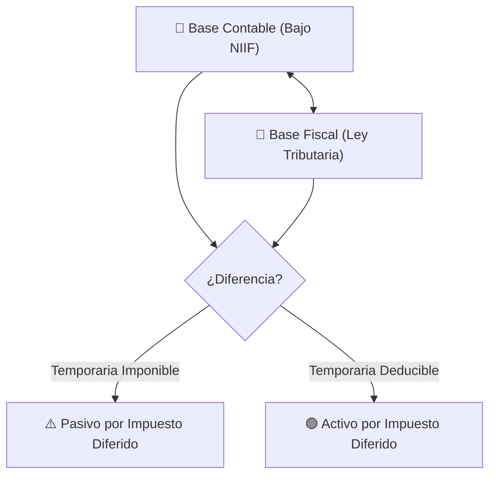

# 📚 13 - Normas Internacionales NIIF e Impuesto Diferido

**Autora:** Caro Nuga (Contabletip)  
**Total de Publicaciones y Guías:** 11  
**Blog Oficial:** [contabletip.blogspot.com](https://contabletip.blogspot.com/)  
**Índice General del Vault:** [[00 - Índice General]]

> [!abstract] 🎯 Descripción del Módulo
> El lenguaje contable global bajo estándares NIIF / IFRS (Plenas y PYMES): marco conceptual, diferencias temporarias y permanentes, base contable vs base fiscal, y cálculo del Impuesto Diferido (NIC 12).

---

## 📑 Directorio Cronológico de Publicaciones del Módulo

| # | Fecha | Título del Artículo | Categorías / Etiquetas | YouTube | Nota en Obsidian |
| :-: | :---: | :--- | :--- | :---: | :--- |
| 01 | `2016-02-10` | **¿QUE ES EL IASB? ¿CUÁL ES EL SIGNIFICADO DE LAS SIGLAS NIC Y NIIF?** | `Contabilidad Básica`, `Tema 1 Fundamentos Básicos` | [Ver Vídeo ↗](https://www.youtube.com/watch?v=ISCFgP64z0k) | 📑 [[2016-02-10 ¿QUE ES EL IASB ¿CUÁL ES EL SIGNIFICADO DE LAS SIGLAS NIC Y NIIF\|Abrir Guía ↗]] |
| 02 | `2022-04-27` | **TOP 5 LIBROS DE CONTABILIDAD CON ENFOQUE NIIF** | `Contabilidad Básica`, `Estudiantes`, `Profesión Contable` | [Ver Vídeo ↗](https://www.youtube.com/watch?v=DL4lyqufOFY) | 📑 [[2022-04-27 TOP 5 LIBROS DE CONTABILIDAD CON ENFOQUE NIIF\|Abrir Guía ↗]] |
| 03 | `2024-10-01` | **¿QUE ES EL IMPUESTO CORRIENTE? IMPUESTO A LAS RENTAS** | `Contabilidad Basica`, `tema 16` | [Ver Vídeo ↗](https://www.youtube.com/watch?v=7Y7J_wzGjw4) | 📑 [[2024-10-01 ¿QUE ES EL IMPUESTO CORRIENTE IMPUESTO A LAS RENTAS\|Abrir Guía ↗]] |
| 04 | `2024-10-08` | **IMPUESTOS DISTINTOS AL IMPUESTO A LAS GANANCIAS** | `Contabilidad Basica`, `tema 16` | [Ver Vídeo ↗](https://www.youtube.com/watch?v=9aZRLvs0VSs) | 📑 [[2024-10-08 IMPUESTOS DISTINTOS AL IMPUESTO A LAS GANANCIAS\|Abrir Guía ↗]] |
| 05 | `2024-10-15` | **¿COMO SE RECONOCE EL IMPUESTO CORRIENTE?** | `Contabilidad Básica`, `tema 16` | [Ver Vídeo ↗](https://www.youtube.com/watch?v=fwOevd_wdxI) | 📑 [[2024-10-15 ¿COMO SE RECONOCE EL IMPUESTO CORRIENTE\|Abrir Guía ↗]] |
| 06 | `2024-10-22` | **¿QUE ES EL IMPUESTO DIFERIDO?** | `Contabilidad Básica`, `tema 16` | [Ver Vídeo ↗](https://www.youtube.com/watch?v=ek3w6NKkm-g) | 📑 [[2024-10-22 ¿QUE ES EL IMPUESTO DIFERIDO\|Abrir Guía ↗]] |
| 07 | `2024-10-29` | **¿CUANDO SE RECONOCEN LOS IMPUESTOS DIFERIDOS?** | `Contabilidad Basica`, `tema 16` | [Ver Vídeo ↗](https://www.youtube.com/watch?v=LG1JHwZI9GQ) | 📑 [[2024-10-29 ¿CUANDO SE RECONOCEN LOS IMPUESTOS DIFERIDOS\|Abrir Guía ↗]] |
| 08 | `2024-11-05` | **DIFERENCIAS PERMANENTES - IMPUESTO DIFERIDO** | `Contabilidad Basica`, `tema 16` | [Ver Vídeo ↗](https://www.youtube.com/watch?v=71acNIpP9uY) | 📑 [[2024-11-05 DIFERENCIAS PERMANENTES - IMPUESTO DIFERIDO\|Abrir Guía ↗]] |
| 09 | `2024-11-12` | **¿QUE ES LA BASE FISCAL EN EL IMPUESTO DIFERIDO?** | `Contabilidad Basica`, `tema 16` | [Ver Vídeo ↗](https://www.youtube.com/watch?v=o-Ze-DBo0AI) | 📑 [[2024-11-12 ¿QUE ES LA BASE FISCAL EN EL IMPUESTO DIFERIDO\|Abrir Guía ↗]] |
| 10 | `2024-11-14` | **LIBROS CONTABILIDAD CON ENFOQUE NIIF** | `Contabilidad Básica`, `tema 16` | [Ver Vídeo ↗](https://www.youtube.com/watch?v=E8FHNWdla6E) | 📑 [[2024-11-14 LIBROS CONTABILIDAD CON ENFOQUE NIIF\|Abrir Guía ↗]] |
| 11 | `2024-11-19` | **DIFERENCIAS TEMPORARIAS EN EL IMPUESTO DIFERIDO** | `Contabilidad Básica`, `tema 16` | [Ver Vídeo ↗](https://www.youtube.com/watch?v=nalKdXLdt7g) | 📑 [[2024-11-19 DIFERENCIAS TEMPORARIAS EN EL IMPUESTO DIFERIDO\|Abrir Guía ↗]] |

---
> [!tip] 💡 Consejo de Contabletip
> *"Recuerda que la contabilidad no se aprende únicamente leyendo: toma lápiz, papel o tu hoja de cálculo y realiza los asientos contables hasta dominar la partida doble."*
