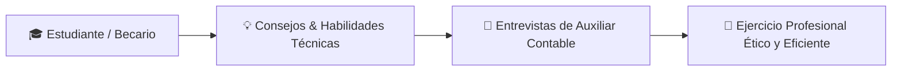

# 📚 14 - Consejos, Pasantes y Profesión Contable

**Autora:** Caro Nuga (Contabletip)  
**Total de Publicaciones y Guías:** 33  
**Blog Oficial:** [contabletip.blogspot.com](https://contabletip.blogspot.com/)  
**Índice General del Vault:** [[00 - Índice General]]

> [!abstract] 🎯 Descripción del Módulo
> Orientación práctica de Caro Nuga para estudiantes, pasantes, auxiliares y profesionales contables: cómo buscar empleo, preguntas de entrevistas técnicas, errores comunes de principiantes y ética profesional.

---

## 📑 Directorio Cronológico de Publicaciones del Módulo

| # | Fecha | Título del Artículo | Categorías / Etiquetas | YouTube | Nota en Obsidian |
| :-: | :---: | :--- | :--- | :---: | :--- |
| 01 | `2016-02-01` | ***** Bienvenido a Contable Tip ***** | `Contabilidad Básica`, `Estudiantes`, `Profesión Contable` | [Ver Vídeo ↗](https://www.youtube.com/watch?v=tN2cxR4WaEQ) | 📑 [[2016-02-01 Bienvenido a Contable Tip\|Abrir Guía ↗]] |
| 02 | `2016-02-09` | **¿QUÉ ESTUDIO? ¿CUÁNTO GANA UN CONTABLE?** | `Estudiantes`, `Profesión Contable`, `tips` | [Ver Vídeo ↗](https://www.youtube.com/watch?v=X1QQaqE5LwI) | 📑 [[2016-02-09 ¿QUÉ ESTUDIO ¿CUÁNTO GANA UN CONTABLE\|Abrir Guía ↗]] |
| 03 | `2016-09-09` | **COMO SER UN ESTUDIANTE DE CONTABILIDAD EXITOSO** | `Estudiantes`, `tips` | [Ver Vídeo ↗](https://www.youtube.com/watch?v=DGFCiWBVTfI) | 📑 [[2016-09-09 COMO SER UN ESTUDIANTE DE CONTABILIDAD EXITOSO\|Abrir Guía ↗]] |
| 04 | `2016-09-12` | **5 HERRAMIENTAS PARA ESTUDIAR CONTABILIDAD** | `Estudiantes`, `tips` | [Ver Vídeo ↗](https://www.youtube.com/watch?v=xe0QeMo8QiI) | 📑 [[2016-09-12 5 HERRAMIENTAS PARA ESTUDIAR CONTABILIDAD\|Abrir Guía ↗]] |
| 05 | `2016-10-26` | **10 TIPS PARA ESTUDIAR MEJOR** | `Estudiantes`, `tips` | [Ver Vídeo ↗](https://www.youtube.com/watch?v=lzMUxRq3Gb4) | 📑 [[2016-10-26 10 TIPS PARA ESTUDIAR MEJOR\|Abrir Guía ↗]] |
| 06 | `2016-10-28` | **¿CUAL ES LA MEJOR HORA PARA ESTUDIAR?** | `Estudiantes`, `tips` | [Ver Vídeo ↗](https://www.youtube.com/watch?v=2GKmOlMnrC8) | 📑 [[2016-10-28 ¿CUAL ES LA MEJOR HORA PARA ESTUDIAR\|Abrir Guía ↗]] |
| 07 | `2016-10-31` | **ESTUDIAR CON MÚSICA ¿SI O NO?** | `Estudiantes`, `tips` | [Ver Vídeo ↗](https://www.youtube.com/watch?v=wwL_7AgNHTE) | 📑 [[2016-10-31 ESTUDIAR CON MÚSICA ¿SI O NO\|Abrir Guía ↗]] |
| 08 | `2016-12-26` | **TIPS PARA ESTUDIAR EN VACACIONES** | `Estudiantes`, `tips` | [Ver Vídeo ↗](https://www.youtube.com/watch?v=XiteCmBgHVQ) | 📑 [[2016-12-26 TIPS PARA ESTUDIAR EN VACACIONES\|Abrir Guía ↗]] |
| 09 | `2016-12-29` | **MITOS SOBRE LOS CONTADORES** | `Profesión Contable`, `tips` | [Ver Vídeo ↗](https://www.youtube.com/watch?v=4lF1HpJzZLE) | 📑 [[2016-12-29 MITOS SOBRE LOS CONTADORES\|Abrir Guía ↗]] |
| 10 | `2017-02-13` | **CONSEJOS PARA LEVANTARTE MAS TEMPRANO** | `Estudiantes`, `Freelance`, `tips` | [Ver Vídeo ↗](https://www.youtube.com/watch?v=A0QxRovTiB0) | 📑 [[2017-02-13 CONSEJOS PARA LEVANTARTE MAS TEMPRANO\|Abrir Guía ↗]] |
| 11 | `2017-02-16` | **CONSEJOS PARA CONCENTRARTE Y SACAR MEJORES NOTAS** | `Estudiantes`, `tips` | [Ver Vídeo ↗](https://www.youtube.com/watch?v=zhyr0jNlvjk) | 📑 [[2017-02-16 CONSEJOS PARA CONCENTRARTE Y SACAR MEJORES NOTAS\|Abrir Guía ↗]] |
| 12 | `2020-01-08` | **Feliz 2020!!!** | `Contabilidad Básica`, `Estudiantes`, `Profesión Contable` | [Ver Vídeo ↗](https://www.youtube.com/watch?v=LuKZ_BMgnjU) | 📑 [[2020-01-08 Feliz 2020!!!\|Abrir Guía ↗]] |
| 13 | `2020-01-14` | **¿CUÁNTO GANA UN CONTABLE?** | `Profesión Contable`, `tips` | [Ver Vídeo ↗](https://www.youtube.com/watch?v=RSgAQvgRCmw) | 📑 [[2020-01-14 ¿CUÁNTO GANA UN CONTABLE\|Abrir Guía ↗]] |
| 14 | `2020-03-04` | **TIPS PARA EMPEZAR A TRABAJAR COMO CONTADOR INDEPENDIENTE O AUTÓNOMO** | `Freelance`, `Profesión Contable`, `tips` | [Ver Vídeo ↗](https://www.youtube.com/watch?v=KBibL7t-qhk) | 📑 [[2020-03-04 TIPS PARA EMPEZAR A TRABAJAR COMO CONTADOR INDEPENDIENTE O AUTÓNOMO\|Abrir Guía ↗]] |
| 15 | `2020-03-11` | **¿QUÉ SOFTWARE O PROGRAMA DE CONTABILIDAD ELEGIR?** | `Freelance`, `Profesión Contable`, `tips` | [Ver Vídeo ↗](https://www.youtube.com/watch?v=CrG0bPMK-_8) | 📑 [[2020-03-11 ¿QUÉ SOFTWARE O PROGRAMA DE CONTABILIDAD ELEGIR\|Abrir Guía ↗]] |
| 16 | `2020-09-07` | **BIENVENIDA AL NUEVO CURSO 2020 - 2021** | `Contabilidad Básica`, `Estudiantes`, `Profesión Contable` | [Ver Vídeo ↗](https://www.youtube.com/watch?v=vkvA1Asc5DA) | 📑 [[2020-09-07 BIENVENIDA AL NUEVO CURSO 2020 - 2021\|Abrir Guía ↗]] |
| 17 | `2020-09-14` | **¿CÓMO HOMOLOGAR TU TÍTULO EN ESPAÑA?** | `Estudiantes`, `Profesión Contable`, `tips` | [Ver Vídeo ↗](https://www.youtube.com/watch?v=6iVh2RsgR-4) | 📑 [[2020-09-14 ¿CÓMO HOMOLOGAR TU TÍTULO EN ESPAÑA\|Abrir Guía ↗]] |
| 18 | `2020-09-21` | **TIPS PARA TRABAJAR DESDE CASA... Y NO FRACASAR EN EL INTENTO** | `Empresas`, `Freelance`, `tips` | [Ver Vídeo ↗](https://www.youtube.com/watch?v=1Dun5blyTPU) | 📑 [[2020-09-21 TIPS PARA TRABAJAR DESDE CASA... Y NO FRACASAR EN EL INTENTO\|Abrir Guía ↗]] |
| 19 | `2020-10-01` | **5 BENEFICIOS DE SER EMPÁTICOS EN EL TRABAJO** | `Empresas`, `Profesión Contable`, `tips` | — | 📑 [[2020-10-01 5 BENEFICIOS DE SER EMPÁTICOS EN EL TRABAJO\|Abrir Guía ↗]] |
| 20 | `2020-12-29` | **BIENVENIDO 2021 !!!** | `tips` | [Ver Vídeo ↗](https://www.youtube.com/watch?v=BNOV1P_MWWw) | 📑 [[2020-12-29 BIENVENIDO 2021 !!!\|Abrir Guía ↗]] |
| 21 | `2022-03-01` | **DIFERENCIAS ENTRE LA CONTABILIDAD EN LATINOAMÉRICA Y ESPAÑA** | `Contabilidad Básica`, `tips` | [Ver Vídeo ↗](https://www.youtube.com/watch?v=eksQDXs0-DI) | 📑 [[2022-03-01 DIFERENCIAS ENTRE LA CONTABILIDAD EN LATINOAMÉRICA Y ESPAÑA\|Abrir Guía ↗]] |
| 22 | `2023-02-02` | **¿POR QUE ESTUDIAR UN MASTER?** | `Contabilidad Básica`, `tips` | [Ver Vídeo ↗](https://www.youtube.com/watch?v=HDDZfPhbwSU) | 📑 [[2023-02-02 ¿POR QUE ESTUDIAR UN MASTER\|Abrir Guía ↗]] |
| 23 | `2023-05-09` | **GOOGLE CLASSROOM CONTABLE TIP** | `Contabilidad Básica`, `tips` | [Ver Vídeo ↗](https://www.youtube.com/watch?v=mBSyIR-RiY8) | 📑 [[2023-05-09 GOOGLE CLASSROOM CONTABLE TIP\|Abrir Guía ↗]] |
| 24 | `2024-10-03` | **¿EN QUE PUEDO TRABAJAR SI ESTUDIO CONTABILIDAD?** | `Contabilidad Basica`, `tips` | [Ver Vídeo ↗](https://www.youtube.com/watch?v=Cz4qMjzDK4o) | 📑 [[2024-10-03 ¿EN QUE PUEDO TRABAJAR SI ESTUDIO CONTABILIDAD\|Abrir Guía ↗]] |
| 25 | `2024-10-10` | **7 HABILIDADES QUE DEBE TENER UN CONTADOR** | `Contabilidad Basica`, `tips` | [Ver Vídeo ↗](https://www.youtube.com/watch?v=wbNFFNEUrSk) | 📑 [[2024-10-10 7 HABILIDADES QUE DEBE TENER UN CONTADOR\|Abrir Guía ↗]] |
| 26 | `2024-10-17` | **¿A QUE SE DEDICA UN CONTADOR EN SU DIA A DIA?** | `Contabilidad Básica`, `Profesión Contable`, `tips` | [Ver Vídeo ↗](https://www.youtube.com/watch?v=Zigy93mzbww) | 📑 [[2024-10-17 ¿A QUE SE DEDICA UN CONTADOR EN SU DIA A DIA\|Abrir Guía ↗]] |
| 27 | `2024-10-31` | **¿POR QUE ESTUDIAR CONTABILIDAD?** | `Contabilidad Basica`, `tips` | [Ver Vídeo ↗](https://www.youtube.com/watch?v=Ej83BGMyfLQ) | 📑 [[2024-10-31 ¿POR QUE ESTUDIAR CONTABILIDAD\|Abrir Guía ↗]] |
| 28 | `2024-11-07` | **¿COMO CONSEGUIR TU PRIMER EMPLEO COMO CONTABLE?** | `Contabilidad Basica`, `tips` | [Ver Vídeo ↗](https://www.youtube.com/watch?v=-iPmkDgTuYo) | 📑 [[2024-11-07 ¿COMO CONSEGUIR TU PRIMER EMPLEO COMO CONTABLE\|Abrir Guía ↗]] |
| 29 | `2024-11-21` | **¿QUE HACE UN AUXILIAR CONTABLE?** | `Contabilidad Basica`, `tips` | [Ver Vídeo ↗](https://www.youtube.com/watch?v=e1FHUeJLu7s) | 📑 [[2024-11-21 ¿QUE HACE UN AUXILIAR CONTABLE\|Abrir Guía ↗]] |
| 30 | `2024-12-03` | **7 PREGUNTAS QUE TE HARAN SI QUIERES SER PASANTE O BECARIO DE CONTABILIDAD** | `Contabilidad Basica`, `tips` | [Ver Vídeo ↗](https://www.youtube.com/watch?v=zHLMER4TpHY) | 📑 [[2024-12-03 7 PREGUNTAS QUE TE HARAN SI QUIERES SER PASANTE O BECARIO DE CONTABILIDAD\|Abrir Guía ↗]] |
| 31 | `2024-12-05` | **¿COMO SE CONTABILIZA LA CENA DE NAVIDAD?** | `Contabilidad Básica`, `Empresas`, `tips` | [Ver Vídeo ↗](https://www.youtube.com/watch?v=Di1DKkvG1yU) | 📑 [[2024-12-05 ¿COMO SE CONTABILIZA LA CENA DE NAVIDAD\|Abrir Guía ↗]] |
| 32 | `2024-12-10` | **BUSCAR EMPLEO COMO CONTABLE EN NAVIDAD ¿SI O NO?** | `Contabilidad Basica`, `tips` | [Ver Vídeo ↗](https://www.youtube.com/watch?v=08NH7OgA5Yc) | 📑 [[2024-12-10 BUSCAR EMPLEO COMO CONTABLE EN NAVIDAD ¿SI O NO\|Abrir Guía ↗]] |
| 33 | `2024-12-19` | **TIPS PARA ESTUDIAR CONTABILIDAD EN NAVIDAD** | `Contabilidad Básica`, `tips` | [Ver Vídeo ↗](https://www.youtube.com/watch?v=BlEOu6djEzA) | 📑 [[2024-12-19 TIPS PARA ESTUDIAR CONTABILIDAD EN NAVIDAD\|Abrir Guía ↗]] |

---
> [!tip] 💡 Consejo de Contabletip
> *"Recuerda que la contabilidad no se aprende únicamente leyendo: toma lápiz, papel o tu hoja de cálculo y realiza los asientos contables hasta dominar la partida doble."*
