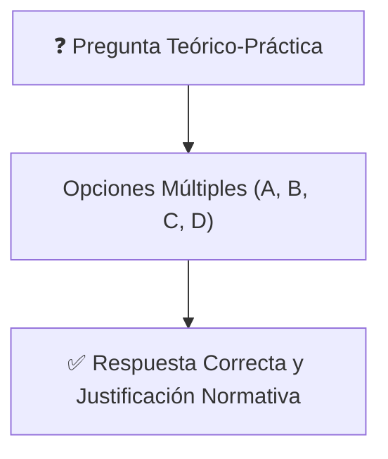

# 📚 15 - Evaluaciones y Preguntas Tipo Test

**Autora:** Caro Nuga (Contabletip)  
**Total de Publicaciones y Guías:** 5  
**Blog Oficial:** [contabletip.blogspot.com](https://contabletip.blogspot.com/)  
**Índice General del Vault:** [[00 - Índice General]]

> [!abstract] 🎯 Descripción del Módulo
> Cuestionarios de autoevaluación, exámenes resueltos y preguntas tipo test para comprobar y consolidar el dominio teórico y práctico de los temas contables aprendidos.

---

## 📑 Directorio Cronológico de Publicaciones del Módulo

| # | Fecha | Título del Artículo | Categorías / Etiquetas | YouTube | Nota en Obsidian |
| :-: | :---: | :--- | :--- | :---: | :--- |
| 01 | `2020-10-14` | **¿CÓMO SE AJUSTA UNA PROVISIÓN PARA CUENTA DE COBRO DUDOSO?** | `Contabilidad Basica`, `Contabilidad Básica`, `preguntas tipo test` | [Ver Vídeo ↗](https://www.youtube.com/watch?v=pDSzKgUY8Gw) | 📑 [[2020-10-14 ¿CÓMO SE AJUSTA UNA PROVISIÓN PARA CUENTA DE COBRO DUDOSO\|Abrir Guía ↗]] |
| 02 | `2020-10-21` | **¿CÓMO SE CALCULA UNA VENTA A CRÉDITO?** | `Contabilidad Básica`, `preguntas tipo test` | [Ver Vídeo ↗](https://www.youtube.com/watch?v=QSeiyk9tJi8) | 📑 [[2020-10-21 ¿CÓMO SE CALCULA UNA VENTA A CRÉDITO\|Abrir Guía ↗]] |
| 03 | `2020-11-06` | **¿CÓMO SE AJUSTA UN GASTO PAGADO POR ANTICIPADO?** | `Contabilidad Básica`, `preguntas tipo test` | [Ver Vídeo ↗](https://www.youtube.com/watch?v=DRxu43uSImA) | 📑 [[2020-11-06 ¿CÓMO SE AJUSTA UN GASTO PAGADO POR ANTICIPADO\|Abrir Guía ↗]] |
| 04 | `2022-01-18` | **¿CÓMO SE CALCULA LA PÉRDIDA POR UN ACTIVO SINIESTRADO?** | `Contabilidad Básica`, `preguntas tipo test` | [Ver Vídeo ↗](https://www.youtube.com/watch?v=qnIIYAejPDU) | 📑 [[2022-01-18 ¿CÓMO SE CALCULA LA PÉRDIDA POR UN ACTIVO SINIESTRADO\|Abrir Guía ↗]] |
| 05 | `2022-01-25` | **¿CÓMO SE CALCULA UN ANTICIPO AJUSTADO POR INFLACIÓN?** | `Contabilidad Básica`, `preguntas tipo test` | [Ver Vídeo ↗](https://www.youtube.com/watch?v=i8hUWpW4gMM) | 📑 [[2022-01-25 ¿CÓMO SE CALCULA UN ANTICIPO AJUSTADO POR INFLACIÓN\|Abrir Guía ↗]] |

---
> [!tip] 💡 Consejo de Contabletip
> *"Recuerda que la contabilidad no se aprende únicamente leyendo: toma lápiz, papel o tu hoja de cálculo y realiza los asientos contables hasta dominar la partida doble."*
